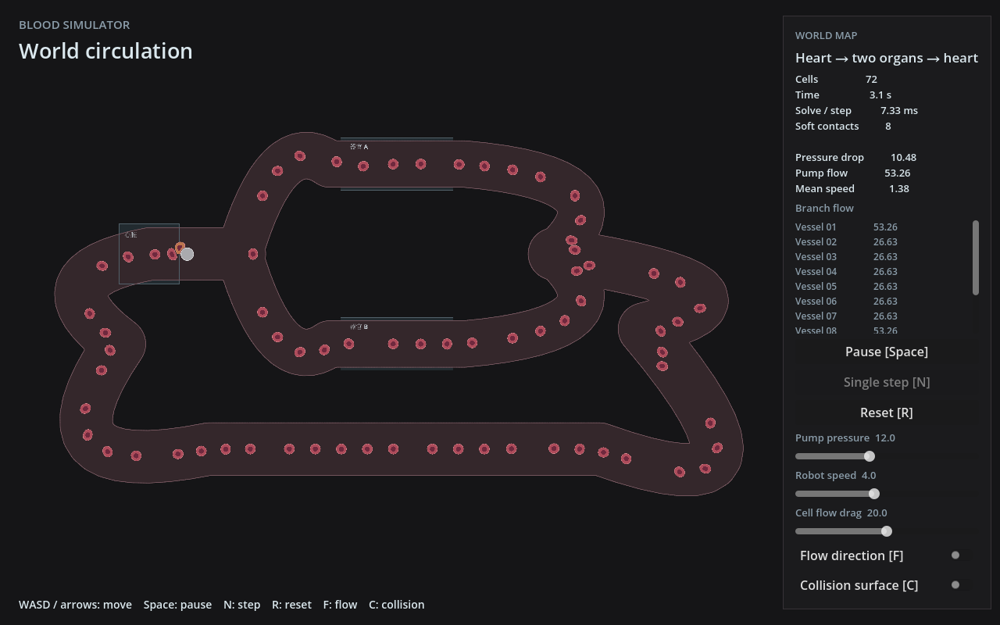

# bloodSimulator

一个以“心”为主题的东方 Game Jam 项目：操控细胞尺度的微型机器人，在血管中穿行、清除病原体与病变组织，并尽量避免损伤正常组织。

项目名暂定。设定背景为永远亭医疗设施与爱丽丝的无人机，人物、剧情和过场之后再细化。

## 当前状态

当前默认启动连续世界小地图：心脏枢纽连接两个器官样板，血流分流后汇合并返回心脏。11 个节点、12 条血管段由 Rust 统一定义，72 个软体红细胞和 4 个白细胞参与接触，每个身体保留 12 粒子；灰色机器人用 WASD 自由移动，镜头跟随，调试面板固定在屏幕上。

默认世界已加入最小近身攻击：按住 J，每 0.35 模拟秒对周围半径 1.9 的区域造成 50 点伤害，固定血管壁阻挡攻击。红细胞初始生命值 100，白细胞 150，受伤后显示血条；死亡后在 0.75 秒内变软、目标面积缩至 60%，保留碰撞并随流漂移，6 秒后清理。暂停、单步和重置共用模拟时钟。完整武器系统、治疗关卡和远处生态尚未实现；原跑道实验场仍可单独启动。

白细胞起初中立，能缓慢巡游；直接受击或在附近感知到攻击后追逐机器人，失去感知后只追最后位置。玩家造成的实际损伤提高 0～100 的免疫警觉度，安静 6 秒后每秒下降 2 点；达到 50 后，白细胞可在自身感知范围内识别机器人，并持续发现 1 秒后尝试呼叫增援。每次最多 1 只，共享 8 秒间隔，白细胞身体上限 8（包括尸体）；墙边拥堵时跳过。入场使用管腔内合法生成与墙边提示，没有实际打穿血管壁。

白细胞贴身接触 0.3 秒后造成 8 点伤害，持续接触时每隔 0.6 秒攻击；玩家可通过移动和交通脱离。自机生命值 100，归零后停止推进，按 R 重置。白细胞变色表示追逐/攻击准备，金色进度圈表示呼叫，墙边浅色脉冲表示增援入场。参数位于 `Config.white_cells`；固定种群探针显式设置 `count: 0`，LBM 专用测量场保持原有红细胞种群。设计及检查见[白细胞实施记录](docs/superpowers/plans/2026-10-30-white-cell-immunity.md)。

生命值与尸体参数集中在 `crates/simulation/src/config.rs`。`--local-cells` 中红细胞尸体不会存回远场活细胞数量池；普通活红细胞仍只按数量汇总，离开详细范围后不保留个体身份和伤势。少量白细胞保持独立身份与完整身体，不计入红细胞远场总量；不新增远场冻结或卸载机制。破裂与碎片留到后续。设计见[细胞生命值与近身攻击](docs/superpowers/specs/2026-10-30-cell-health-design.md)。

局部 Stokes 原型已接入 faer 联合 LU，并提供两块固定重叠区域：加载时预分解，玩家进入上方相邻管段时切换，复用点力历史和原 Rapier 物体。默认世界保持解析血流，`--local-stokes` 显式开启双区验证。十二物理节点保留，解析驱动采用此前确认的六次采样。

**Stokes 性能研究仍暂停，LBM 可选路径已接入选定算法。** 当前选定 D2Q9 MRT＋Guo、LSQ-FD 给定速度边界和帧末平均密度控制，物理含义与限制见 [LBM 流体模型与算法](docs/physics/lbm-fluid.md)。固定分叉的 RTX 3060 10000 帧纯流体实验已完成；后续已接入可玩的分叉验证场，包含真实机器人、72 个红细胞及窗口迁移。完整模拟步 p95 约 12 ms，但本轮 Godot/Xorg 含绘制回放的帧间隔 p95 约 70–71 ms，尚未达到 60 FPS，见[机械耦合与游戏实测](docs/research/2026-10-29-lbm-gameplay/README.md)。默认世界仍用解析流体。

上一阶段 Stokes 模型、实验与未决问题见[流体实验阶段记录](docs/research/2026-10-27-fluid-checkpoint.md)。其 GPU 回放约 46–184 ms／次属于另一种算法；CPU LU 继续作为显式局部 Stokes 默认后端。

保留模块化求解器、分段 profiling 和已验证的回读缓冲复用。云实例已停止。历史实验与复现入口见[研究索引](docs/research/README.md)；旧报告中的后续建议不代表继续执行的安排。

- [当前状态与待办](docs/STATUS.md)：统一维护阶段结论、下一步优先级与待确认事项。
- [LBM 验证场与游戏性能](docs/research/2026-10-29-lbm-gameplay/README.md)：启动方法、实卡负载、渲染差距与原始数据。
- [LBM 物理文档](docs/physics/lbm-fluid.md)：所用方程、边界算法、密度控制、质量与动量补偿及适用范围。
- [流体研究索引](docs/research/README.md)：按测量时点保留的 Stokes、GPU、Rayon、LBM 实验与原始数据。
- [世界小地图设计](docs/superpowers/specs/2026-10-22-world-small-map-design.md)与[实施记录](docs/superpowers/plans/2026-10-22-world-small-map.md)：已确认的地图、流速、镜头与实现限制。
- [整体架构](docs/superpowers/specs/2026-10-21-world-architecture-design.md)与[玩法设计草案](docs/superpowers/specs/2026-10-19-blood-simulator-design.md)。
- [正式原型性能诊断](docs/superpowers/plans/2026-10-22-performance-audit.md)：72 个细胞的节点数对照与流速查询开销。



全景截图只调整了观察镜头；游戏默认跟随机器人。

后续已接入静态血管纹理缓存、细胞视野剔除和显式 `--local-cells` 近场软体/远场数量模式。默认仍为全量软体；本机解析流60秒回放的模拟步均值6.335→3.755ms，不能外推为RTX/LBM或完整游戏FPS改善。当前可复现入口、原始记录和剩余验证见[性能阶段交接](docs/research/2026-10-29-performance-checkpoint.md)。

## 游戏方向

- 2D 抽象血管网络，保留心脏与核心器官的循环关系，空间尺度按玩法压缩。
- 机器人略大于红细胞，以自由移动为主；血流轻微推动机器人，红细胞交通带来逆行、推挤和堵塞。
- 同时包含刺击与射击。软体细胞参与碰撞，让战斗与交通相互干扰。
- 免疫细胞起初对机器人中立；感染、局部损伤和机器人的攻击触发不同反应。
- 每关经历若干次循环，完成治疗目标后从指定地点撤离，目标时长为 10–20 分钟。
- 机器人被毁或累计正常组织损伤达到上限时失败；关间有升级与过场。

## 技术方向

采用 **Rust 模拟内核 + Godot 表现层**，通过 GDExtension 接入。

| 部分 | 职责 |
| --- | --- |
| Rust 模拟库 | 物理状态、Rapier 接触与软体、血管网络、局部流场；后续加入命中与受力 |
| Rust 接入层 | 将 Godot 输入转换为模拟输入，将模拟结果转换为显示数据 |
| Godot | 输入采集、绘制、场景、声音、界面与调试显示 |

同一物体只由 Rust 一侧推进物理，模拟库不依赖 Godot。

世界地图采用 **血管图阻力与泵压 → 各段流量 → 局部速度 → 细胞运动** 的单向驱动。每段圆管阻力为 `R = 8 μ L / (π r⁴)`，节点满足流量收支守恒；心脏所在边提供压升。初始化以 f64 Cholesky 求单位压升下的节点压力和各段流量，固定阻力下随泵压脉动缩放。

普通管段采样圆管中心截面的抛物线速度，路口混合相邻边速度。这是游戏近似，局部二维场不保证严格无散度或精确的细胞分流比例。机器人与细胞通过独立速度采样入口接受驱动，为后续更换局部流体方案保留边界；默认解析模式中物体不反向改变流场；显式局部模式通过原有少量阻力标记与反冲量反馈。

地图由 Rust 内置中心线和管宽构造，marching squares 从通道并集生成墙与地面，物理和绘制共享边界。地图编辑与磁盘格式以后单独确定。

细胞沿用 Rapier 原生二维闭合软体。膜边约束与面积保持分别调节，以保留挤压变形并减少面积损失。机器人每个子步直接使用移动意图加少量流速作为目标速度，不额外保留操控惯性；实际接触仍由 Rust 物理处理。

## 当前原型范围

- 一张分流、汇流、回流连通的小地图，镜头跟随机器人；细胞不靠传送、删除重生完成通行。
- 72 个 12 粒子红细胞，灰色圆形机器人；橙色细胞用于目视追踪绕行。
- 默认世界的 J 键近身范围伤害、受伤血条、尸体变软/变瘪及清理。
- 暂停、单步、重置，压力、机器人速度与细胞拖曳调节，以及流向和碰撞表面显示。
- 心脏与两个器官位置样板，所有物体详细运行；后续按战斗、区域衔接、大地图规模验证的顺序推进。

## 开发与验证

本机已验证 Linux x86_64、Rust/Cargo 1.98.1、Godot 4.7.1；Rust 依赖锁定为 Rapier 0.36.1、godot-rust 0.5.5，保留 Cargo.lock。绑定使用 Godot 4.7 API；Cargo 声明 Rust 1.94 起，未实测最低版本。暂不提供其他平台的扩展二进制。

```bash
# 构建 Rust 扩展
bash scripts/build.sh

# 构建并运行世界小地图（需要图形桌面）
bash scripts/run.sh

# 打开 Godot 编辑器（先构建扩展）
godot --editor --path godot

# 启动双区域 Stokes 原型（先构建扩展）
godot --path godot -- --local-stokes

# 近场真实软体、远场数量；默认不启用，不与local-stokes组合
godot --path godot -- --local-cells

# 单独启动原单回路实验场
godot --path godot res://lab.tscn

# Rust 检查、物理测试、扩展构建和 Godot 导入 / 短时加载
bash scripts/check.sh

# 真实软体世界探针：细胞数、模拟秒数、world 模式
cargo run --locked -p simulation --example circulation_probe -- 72 60 world

# 原单回路探针
cargo run --locked -p simulation --example circulation_probe -- 72 60
```

LBM 桥接功能默认关闭。显式构建并请求局部 LBM：

```bash
bash scripts/build.sh --features lbm-gpu
godot --path godot -- --local-lbm --lbm-validation --lbm-profile=fine
# 也可显式选择 coarse；省略 profile 时使用暂定的 fine
```

游戏运行只接受硬件 GPU；软件适配器仅用于显式 Rust 功能诊断，不用于选择发布精度。`--lbm-validation` 进入已实现的分叉验证场，正常 WASD、暂停、单步、重置可用；指定往返路线的实卡耦合与迁移已测，任意漫游不在验证范围。省略该参数仍选择默认小地图，其出生位置开口缺少所需直线缓冲，会报错退出。开发命令默认构建 debug，报告中的性能使用 release。`--local-lbm` 与 `--local-stokes` 不能同时使用；构建未启用功能或启动失败时不会自动回退。运行中发生模拟错误会暂停并记录诊断，需要检查后重置。

`GODOT_BIN` 可指定 Godot 可执行文件。首次构建需要联网下载 Rust 依赖。世界探针输出各管段间的下游通行记录、移动距离、面积偏差、越界与求解耗时；单回路模式保留逐细胞圈数统计。结果与限制见本轮实施记录。

| 操作 | 按键 / 控件 |
| --- | --- |
| 自由移动 | WASD 或方向键 |
| 近身攻击（默认世界） | 按住 J；圆形范围伤害，攻击间隔 0.35 模拟秒 |
| 暂停 / 继续 | Space 或面板按钮 |
| 暂停时前进一步 | N 或面板按钮 |
| 重置场景 | R 或面板按钮；保留当前暂停状态和滑块参数 |
| 流向显示 | F 或开关 |
| 碰撞表面显示 | C 或开关 |
| 调参 | 面板滑块：泵压差、机器人速度、细胞流动阻力 |

初始参数位于 `crates/simulation/src/config.rs`。模拟单位是局部细胞尺度单位，时间为秒，向下为 +Y；显示比例为每单位 24 像素。Godot 以 60 Hz 调用一次 Rust 固定步，每步包含 2 个物理子步。若修改固定步长，应同步调整 Godot 的物理帧率设置。

世界样板使用 11 节点、12 条血管段，主干半宽 3.5、两支路半宽 3.1；静态几何网格步长为 0.2。等效黏度 0.05、平均泵压差 12、脉动幅度 15%、频率 1.2 Hz。软体膜边约束 12 Hz、面积保持 30 Hz、拖曳系数 20；机器人速度为 4、顺流比例为 0.08。数值均为游戏单位。

默认轮廓已从 20 降为 12 粒子，材料刚度与子步数保持原值。相同 72 个细胞、30 模拟秒的 release 对照中，整步均值从 11.72 降到 6.90 ms，12 粒子的 p95 为 10.13 ms，最大面积偏差 3.23%，未观察到粒子越壁；仍未达到 5 ms 目标。数据不含 Godot 绘制，来自本机 Xeon Gold 6330。两条支路的细胞分配明显不均，流速查询也是主要开销，具体取舍见性能诊断。原 20 粒子版本的 60 秒测量保留在世界小地图实施记录中。

密集交通、操控手感与逆行体验仍需人工游玩判断；自动检查和循环探针不替代体验验收。

工程入口：

```text
crates/simulation/    map 统一几何、circulation 图流量与采样、runtime 协调、软体、view
crates/godot_bridge/  BloodLab 接口，场景选择、输入、静态地图与快照转换
godot/               world 世界与镜头、world_hud 面板、原 lab 实验场
scripts/             构建、运行、检查入口
```

按改动运行必要的已有检查。新增测试围绕具体行为和物理不变量；页面与画面验证以截图为主，操作手感由人工体验。不默认增加浏览器交互测试或大规模 CI。

## 制作约束

三周、单人结合 Codex 制作，优先发挥引擎和物理模拟优势。美术与声音尽量采用程序化方法及许可明确的免费素材；生物、医学图像可用于参考或纹理，使用时记录来源与授权条件。

本项目采用生物学启发的游戏规则与二维近似，不用于医学判断。
