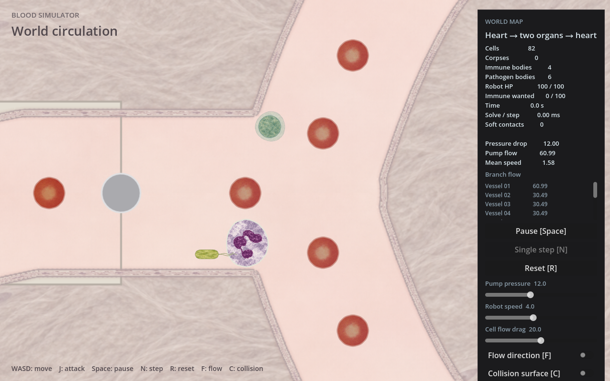

# 细菌美术接入

2026-11-05。两种细菌及后续杆形／荚膜细化已同步到当前主目录 `main` 工作区，可直接运行；尚未提交或推送，原 `feat/bacteria-art` 工作树保留。用户确认保留软体并要求按纹理进行程序生成与贴图化。机器人暂缓。

## 形状第二版

用户反馈初版过于椭圆后，游动细菌由1.6∶1椭圆改为2.6∶1圆端杆形；12节点分别分配给圆端头与直侧边，再按原面积归一化。放置半径由同一参考形状直接计算，荚膜细菌不改。`rod-v2/`保存最终截图和脚本，根目录原截图保留为首版证据。

本次增量运行 `cargo test --locked -p simulation cell::tests`（4项）与 `cargo test --locked -p simulation runtime::immunity_tests`（12项）、`bash scripts/build.sh`、180帧战斗加载、静态截图、fmt与diff检查；均通过。只读局部复查无阻断项，没有因样式迭代重跑全套测试或追加性能实验。

## 荚膜第二版

用户反馈荚膜细菌太像普通绿色球后，本轮把原先很薄的描线改为明确的半透明胶质外套：沿真实平滑膜的外法线生成三层外扩轮廓，厚薄由材料索引和稳定ID控制；现有菌体纹理淡叠到外套上形成斑驳，外围描边减淡。内外层现在可以在正常缩放下区分，荚膜跟随身体形变和尸体淡出，不参与碰撞或伤害。

`capsule-v2/`保存当前正常画面、细节、显示形变／死亡样板及复现脚本。基准厚度约菌体半径34%，最大外伸5.76绘图像素，仍在原8像素显示剔除余量内。没有新增纹理、shader、动画状态或Rust改动。

本次实际执行Godot headless editor导入（退出0）、180帧战斗加载（退出0）、软件OpenGL截图（退出0）及 `git diff --check`；日志无脚本／引擎错误，最终截图已查看。截图细化后只重跑受影响的截图，沿用已有模拟证据，没有新增永久测试或重复Rust检查。局部只读复查通过。极端凹折、连续游玩及FPS仍未验收。

## 实际画面与启动



[默认zoom1](capsule-v2/game-default.png)、[游动细菌细节](rod-v2/motile-detail.png)、[荚膜细菌细节](capsule-v2/encapsulated-detail.png)。这些是Godot软件OpenGL实际绘制，不是生成图。细节图使用12倍／10倍镜头，不能据此判断正常游玩尺度。

当前版本启动：

```bash
bash scripts/run.sh -- --combat-preview
```

在主目录 `/data/sunyunbo/www/bloodSimulator` 运行上述命令。普通世界未新增细菌种群，使用战斗预览查看两种细菌。主目录产品代码及两张纹理已逐字节核对，与已审阅工作树一致。

## 已接入内容

- 两张满幅菌体纹理沿现有材料节点UV裁切并随软体变形，移除原实色深色圆心。
- 游动细菌的初始圆端杆形参考轮廓约2.6:1，面积、节点数、质量与软体材料保持原值；休眠恢复使用同一形状构造。墙边放置使用长轴外接半径，真实轮廓接触规则不变。
- 两条鞭毛由程序行波曲线生成，根部落在材料端对应的平滑膜上，随身体转动／形变；只有显示效果，无碰撞、推进或伤害。
- 鞭毛使用模拟时间和实体ID，相同模拟时间保持相同姿态；死亡后不绘制鞭毛，不新增死亡姿态缓存。
- 荚膜由同一软体轮廓外扩的三层浅色半透明填充和淡纹理生成，厚薄略不均，绘制在菌体下方；与尸体同步变形和淡出。
- 细菌描边减细至0.5世界绘图像素；鞭毛使用连续抗锯齿折线，避免逐段线条接点变深。最远装饰纳入显示剔除余量。
- 未新增依赖、shader、物理类型或bridge字段，也未修改机器人、红／白细胞、流体和战斗参数。

## 验证

- 基线 `cargo test --locked -p simulation cell::tests`：原3项通过；新增真实短杆／面积／休眠恢复用例先因圆形初始身体失败，接入后4项通过。
- `cargo test --locked -p simulation`：60单元＋5集成通过；`bash scripts/build.sh`、`cargo fmt --all --check`、`git diff --check`通过。
- `godot --headless --path godot --editor --import --quit`：退出0，纹理导入、脚本解析通过。
- `godot --headless --path godot --fixed-fps 60 --quit-after 180 -- --combat-preview`：退出0，无脚本错误。
- X显示 `:2`、llvmpipe软件OpenGL运行 `res://tests/world_cell_mesh_test.gd`：退出0，现有网格检查通过。
- [截图脚本](capture.gd)通过生产World绘制入口取得正常缩放／放大图，已查看。相机切换须 `force_update_scroll()` 后再排队绘制，否则冻结场景的首张图可能沿用旧视图剔除。
- [尾巴相位A](motile-detail.png)、[相位B](motile-phase-b.png)、[保持B](motile-phase-held.png)：A/B只在尾部区域产生RGB像素变化，B与保持B完全一致。[视口边缘](motile-edge.png)中身体在屏幕外、尾巴仍可见。
- [形变展示样板](motile-deformed-swatch.png)、[游动细菌死亡样板](motile-dead-swatch.png)、[荚膜细菌死亡样板](encapsulated-dead-swatch.png)明确使用修改后的显示快照，仅检查绘制层，不称为实际战斗死亡／形变证据。
- 未发送键鼠事件、自动点击按钮或执行UI交互流程。`logs/`保存引擎日志；软件驱动不支持切换VSync的警告不影响本轮截图，不能用于FPS结论。

独立只读审阅通过，无阻断问题；详见 [审阅记录](review.md)。局部避墙继续沿用既有名义半径，真实碰撞仍按软体处理，未因理论边角风险追加行为修改。

本轮未进行完整战斗负载FPS、人工手感或极端凹形验收。鞭毛在放大镜头下仍是有限段数曲线，荚膜是装饰外套近似，均可按实际反馈再调，不据此追加性能或机制工作。

## 素材与来源

[细化概念图](style-v1.png)是生成参考，下排形变不来自模拟；实际显示以上方游戏截图为准。

| 文件 | 用途 |
| --- | --- |
| `candidates/motile-cytoplasm-v1.png` | 橄榄黄绿内部材质，已原样复制到生产素材目录 |
| `candidates/encapsulated-cytoplasm-v1.png` | 灰青绿内部材质，已原样复制到生产素材目录 |
| `style-v1.png` | 本轮两种细菌风格参考 |
| `initial-reference.png` | 上轮来源图；其中机器人已被否定，不再采用 |

两张1254×1254 RGB纹理不含背景、外膜、鞭毛或荚膜，由游戏网格裁切。内置 `image_gen.imagegen` 生成，没有API脚本或新增外部照片；属于游戏美术，不能称真实显微图像。来源链为旧游戏截图 → 初始概念 → 细化概念 → 两张内部纹理。完整本轮生成提示词及输入关系见 [prompts.json](prompts.json)，文件校验见 [SHA256SUMS](SHA256SUMS)，生产素材来源见 [SOURCES](../../../godot/assets/cells/SOURCES.md)。没有宣称逐像素平铺验收。

[设计说明](../../superpowers/specs/2026-11-05-bacteria-art-design.md)与[实施记录](../../superpowers/plans/2026-11-05-bacteria-art.md)保留范围和取舍。
