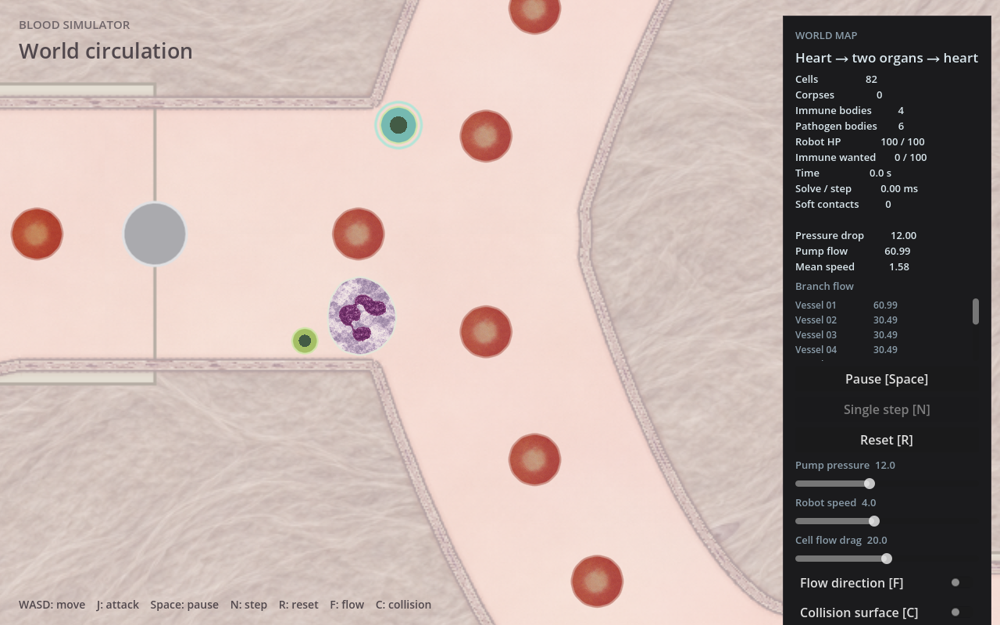
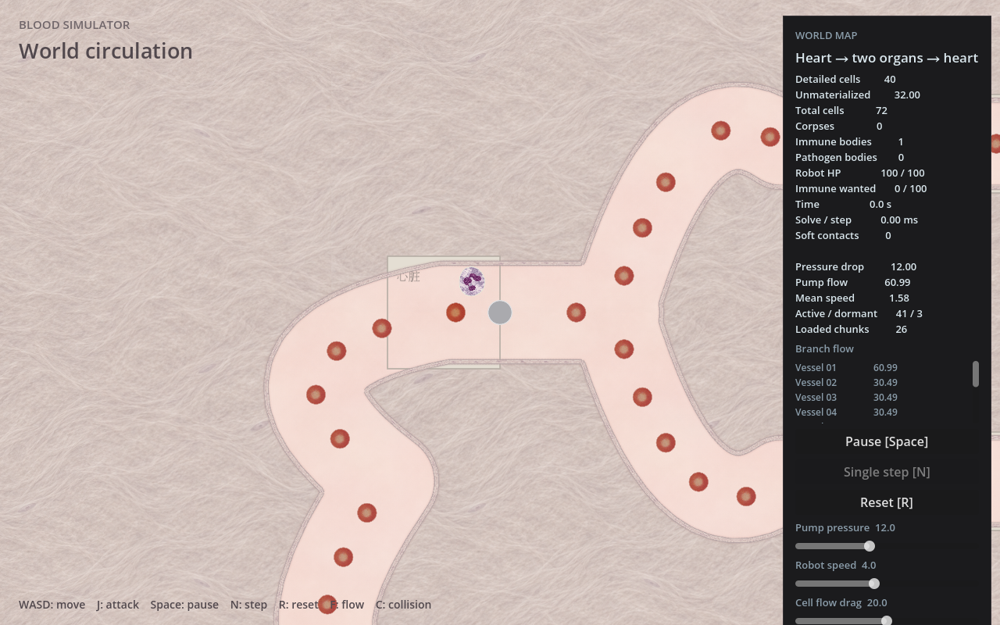

# 显微细胞、血管与组织美术阶段记录

用户已要求整理、合并main并提交推送。本阶段以已确认的显微观察风格为基准，整合细胞表现、内皮管壁、管腔和外部组织。最终合并结果见 [集成记录](integration.md)。

## 最终画面与入口





在主目录运行：

```bash
bash scripts/run.sh
bash scripts/run.sh -- --combat-preview
bash scripts/run.sh -- --stream-world
```

默认世界与战斗预览直接使用新美术，无额外开关。细胞阶段实现为 `2b27b14`，已先行快进进入main；本次背景阶段同时包含红细胞材质第二版。功能分支和工作树保留。

## 当前实现

- 红细胞采用中央淡区更明确、外围明暗略不规则的第二版纹理；保留现有软体形变。
- 中性粒细胞胞质与核分层，胞质保持固定采样尺度；三种核排列及角度按实体ID固定。核不参与物理，正常保持形状，居中空间不足时等比缩小。
- 所有World细胞使用平滑显示轮廓；中性粒/巨噬细胞的物理参考形状有轻微个体差异，原面积、节点数、材料与阻尼保持不变。休眠恢复重建同一参考形状。
- 管壁沿原墙段绘制窄内皮纹理带；近壁8像素范围作柔和颜色过渡，不改变管径与碰撞。
- 管腔保留浅暖红底色 `#f2e2da`，专用 `lumen.png` 按512像素世界尺度、85%混合加入宽缓明暗和极淡细纹，不再叠加组织纤维。
- 外部组织为米白暖灰纤维纹理。底层与缓存使用相同世界UV；没有内容的区块仍不分配缓存，SubViewport仍UPDATE_ONCE。视野底面仅绘制一个quad，不重烘焙缓存。
- HUD布局和深色面板保留，仅调整裸露文字与地标颜色以适配浅背景。

正常血浆通常淡黄色，管腔的暖红是游戏艺术化配色。依据：[NIH 血浆说明](https://www.cc.nih.gov/bloodbank/donation-types/plasma)、[NCBI 血红蛋白与血液颜色](https://www.ncbi.nlm.nih.gov/sites/books/NBK2263/)。红细胞中央淡区与双凹形态参考 [耶鲁组织学图谱](https://www.medcell.org/histology/blood_bone_marrow_lab/erythrocytes.php)。

## 素材与历史过程

- [细胞素材来源及提示词](../../../godot/assets/cells/SOURCES.md)：两张公有领域/CC0真实照片作为参考，AI辅助重建，保留原图和来源；不称原始显微像素直接裁切。
- [背景素材来源及提示词](../../../godot/assets/environment/SOURCES.md)：三张内置imagegen生成材质，不是真实组织或血浆照片。
- [本阶段纹理SHA256](SHA256SUMS)、[细胞原图及前期纹理SHA256](../microscopy/sources/SHA256SUMS)。
- [美术基准与细胞历次记录](../microscopy/README.md)、[静态参考形状](../microscopy/rest-shapes.md)。
- 背景初版：[近景](game.png)、[分块图](stream.png)；暖色修正：[整体](background-rose.png)、[红细胞旧/新对比](rbc-comparison.png)。这些是历史画面，最终效果以上方 `lumen-*` 截图为准。

## 已完成验证

细胞阶段沿用：`cargo test --locked -p simulation`（59单元+5集成）、workspace检查、桥构建、网格行为检查与多场景加载/截图。没有因背景样式再次运行全套Rust测试。

背景阶段实际执行：

- `godot --headless --path godot --editor --import --quit`：修正后退出0，无脚本错误。
- `godot --headless --path godot --fixed-fps 60 --quit-after 180 -- --combat-preview`：红细胞第二版阶段通过。
- `godot --headless --path godot --fixed-fps 60 --quit-after 180 -- --organ-preview`：背景首版通过。
- `godot --headless --path godot --fixed-fps 60 --quit-after 180 -- --stream-world`：最终管腔层次通过。
- 普通及分块场景软件OpenGL截图通过，图像已查看，无自动UI操作。初次管腔过渡代码有GDScript offset类型推断错误，显式标为Vector2后重跑通过；不能只凭Godot退出码判定无脚本错误。
- 首版背景及最终管腔/红细胞增量的独立只读审阅均无重要缺陷；确认世界UV、空块规则、缓存padding与素材引用。

截图复现（需要可用X显示服务，当前使用`:2`）：

```bash
mkdir -p /tmp/sunyunbo/cell-texture
DISPLAY=:2 godot --path godot --display-driver x11 --rendering-method gl_compatibility --script "$PWD/docs/art/microscopy-background/capture-lumen.gd" -- --combat-preview
DISPLAY=:2 godot --path godot --display-driver x11 --rendering-method gl_compatibility --script "$PWD/docs/art/microscopy-background/capture-lumen-stream.gd" -- --stream-world
```

输出写入 `/tmp/sunyunbo/cell-texture/lumen-game.png` 与 `lumen-stream.png`。前者冻结初始状态并调整相机，后者静态拉远镜头检查分块背景；不代表人工游玩验收。

## 剩余范围

巨噬细胞内部、细菌和机器人仍有占位表现；没有新增器官种群、流动背景粒子、核物理或纹理模拟。核为保守居中适配，强凹形中心落在轮廓外时可能隐藏；没有全局核位置搜索。

人工手感、完整战斗负载FPS、全地图移动、极端形变、逐像素平铺无缝均未验收。弯角内皮接续、远景重复感与缩放清晰度可后续按反馈细化。本轮不启动性能研究、云实验或新烘焙。
