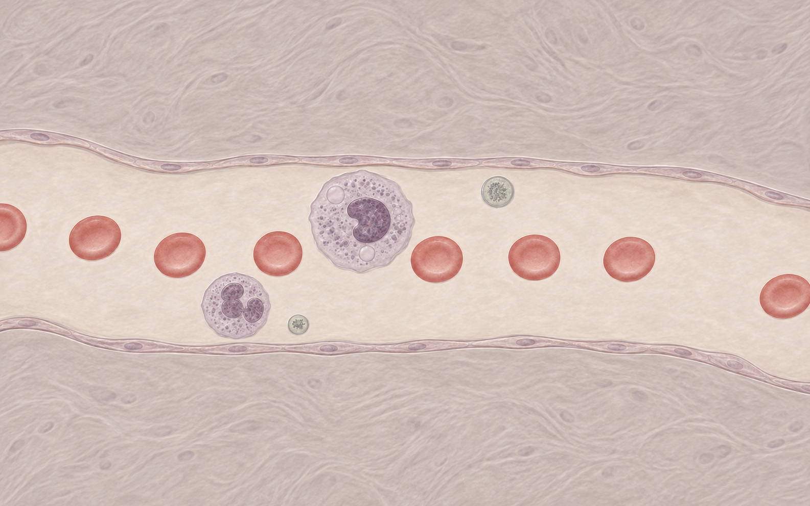

# 显微观察美术基准

本页保留细胞阶段过程。最新整体画面和发布状态以 [美术阶段记录](../microscopy-background/README.md) 为准；下方旧记录中的“未合并/未推送”是当时状态。

2026-11-04，用户确认下图的整体美术方向。本图为生成的风格参考；红细胞与中性粒细胞已完成首轮实际渲染样板，见下方实装进度。生成图中的具体细胞形态、比例和组织结构不作为生物学依据或新增内容需求。

## 已确认的视觉要求

- 整体接近显微镜下观察组织与细胞的感觉。
- 保留淡色活体观察方案 A 的细腻纹理和透明感，提高辨识度；饱和度取 A、B 染色方案之间，减少整体粉色。
- 借鉴染色血涂片的区域区分：柔和砖红的红细胞、灰紫胞质与较深紫色细胞核；背景以米白、暖灰为主。
- 采用简单纹理与分区域渲染建立质感，背景细节不应压过活动细胞。
- 所有细胞的显示轮廓做平滑插值，消除当前明显的多边形折角。

## 方案比较与当前边界

- A：淡色活体观察，质感得到认可，但饱和度过低、单位难以辨认。
- B：粉紫染色，细胞内部区域更明确，但整体粉色过多。
- 选定：以 A 的质感为基础，提高细胞颜色与内部对比，降低背景粉色的折中版。

现已沿用 Godot 网格实装：红细胞纹理、中性粒胞质与核分层、稳定核排列变体以及平滑显示轮廓。随后用户批准白细胞采用轻微不规则的物理参考形状，节点数、面积与材料保持原值。模拟与渲染的职责边界不变。历史失败版本与修正过程见下方记录。

## 后续实施关注点

正常游玩缩放下应能区分各类单位、胞质和核；填色、描边、荚膜应跟随同一平滑轮廓。观察挤压和拉伸时的曲线鼓包、纹理拉伸及显示边界与碰撞边界的差异。后续实现需保留真实碰撞轮廓的调试显示。

## 来源

- 活体观察参考：[Nikon 红细胞相差/DIC 图像](https://www.microscopyu.com/gallery-images/human-erythrocytes-1)。
- 染色参考：[PUCRS 大学组织学图谱，血液](https://editora.pucrs.br/livro/atlas-de-histologia-em-cores-da-pucrs/sangue.html)。
- 本地基准图：通过内置 imagegen 生成，使用现有战斗截图布局及此前 A/B 草图作输入。提示要求保留 A 的构图、显微纹理与透明膜感，将饱和度提高至 A/B 之间，减少粉色背景，增强砖红红细胞与灰紫免疫细胞的区域对比，平滑轮廓，无 HUD。
- 上述 Nikon 和 PUCRS 链接仅作初期风格参考，未将其照片纳入素材。实际制作使用另行核实为公有领域/CC0的两张照片，已保存来源及加工说明，见 [纹理来源](../../../godot/assets/cells/SOURCES.md)。

## 实装进度

红细胞与中性粒细胞第一轮实装见 [实现记录](implementation.md)，来源见 [纹理记录](../../../godot/assets/cells/SOURCES.md)。

最新修正：[核与胞质独立显示](render-layers.md)。用户已否定首轮整体贴图拉伸；新版本核仅作渲染，常规形变不缩放，狭窄时等比适配。

最新外观迭代：[核排列差异与增强胞质纹理](birth-variations.md)。

最新物理轮廓尝试：[白细胞静态参考形状](rest-shapes.md)。
