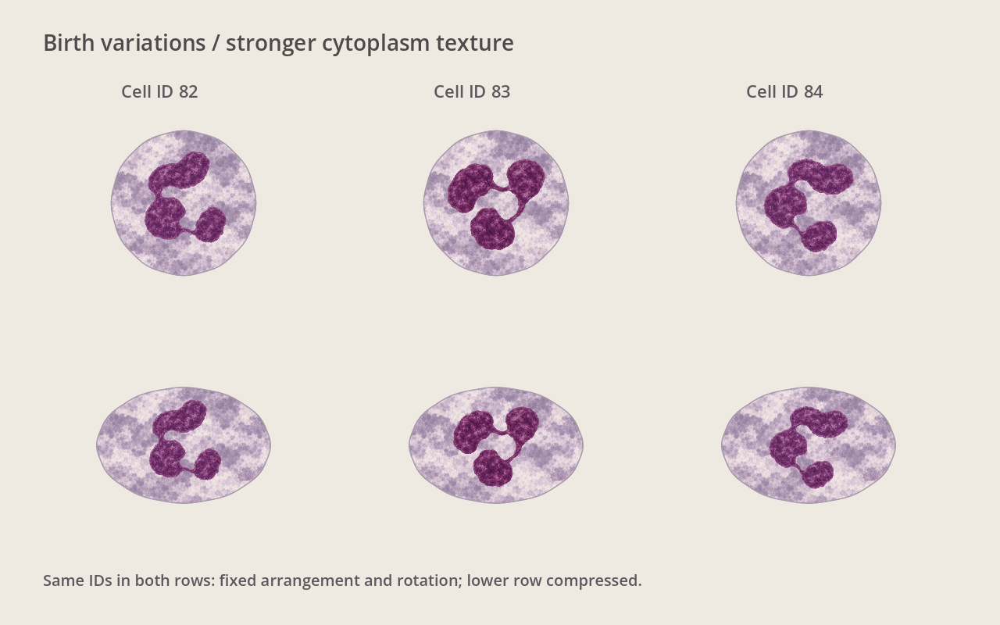
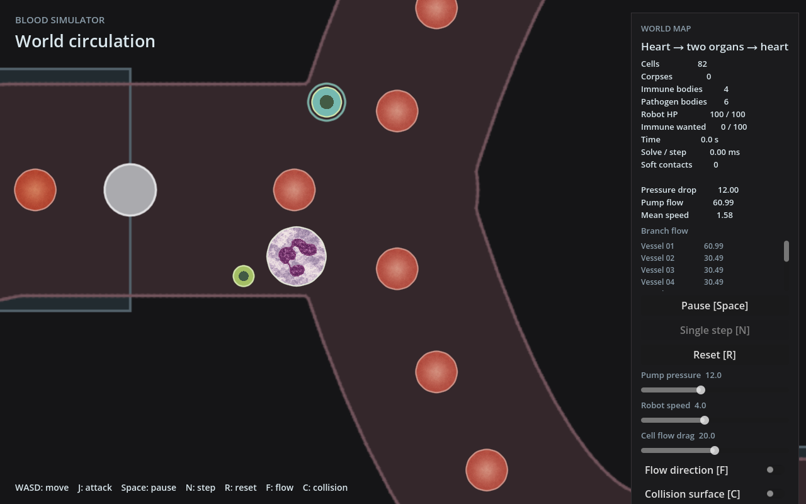

# 核排列差异与增强胞质纹理

用户要求在白细胞生成时固定小幅核叶排列/角度差异，并显著增强胞质斑驳。当前落实到已制作材质的中性粒细胞，巨噬细胞仍沿用原占位内部结构。

## 本轮改动

- 三种连接完整的核排列纹理，通过现有实体ID播种局部随机数发生器，固定选择一种并增加±0.6弧度（约±34度）的旋转差异。首次可见时配置，由ID决定，因此视野剔除、休眠或显示槽重建不会重新随机；不影响模拟的随机序列。
- 使用预制的核排列变体，不为各核叶增加关节、运动或物理对象。
- 按已同意的真实照片对比方向，核显示半径由胞质美术半径的0.65增至0.88；核继续独立渲染，在居中包络空间不足时等比缩小。
- 胞质采用新的多尺度灰紫/米白斑驳纹理，明显增强成片明暗与颗粒聚集；保持固定纹理尺度，避免随膜形变拉长。

## 实际验证

以下均在本功能工作树运行：

- `godot --headless --path godot --editor --import --quit`：退出0。
- `DISPLAY=:2 godot --path godot --display-driver x11 --rendering-method gl_compatibility --script res://tests/world_cell_mesh_test.gd`：退出0、PASS、无脚本错误。保留已有检查，补充相同ID跨重复配置/槽位复用/显示对象重建的外观一致性。
- `godot --headless --path godot --fixed-fps 60 --quit-after 180 -- --combat-preview`：退出0。
- `capture-v3.gd` 与 `swatch-v3.gd` 通过软件OpenGL静态截图，退出0、无脚本错误；无自动交互。
- `git diff --check`：通过。

本轮仅运行受影响检查；没有新增物理、模拟接口、云实验或FPS验收。极端凹形居中适配限制沿用前轮。分支 `feat/cell-microscopy-textures`，仍未提交、合并或推送。
