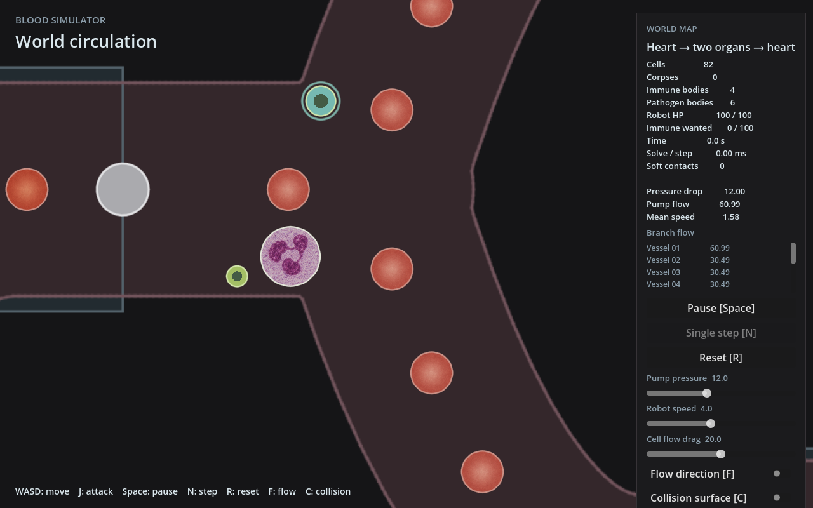
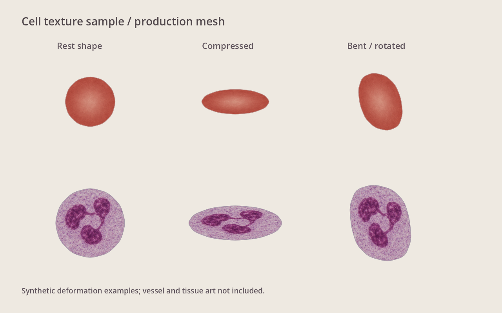

# 血细胞纹理第一轮实装

后续修正见 [核与胞质独立显示](render-layers.md)。下文保留首轮历史记录。

**用户验收：未通过。** 用户指出中性粒细胞将核与胞质烘在同一张纹理中、随轮廓整体拉伸，观感不可接受。后续必须分离核与胞质，限制核的大幅形变，并修改细胞本体的变形行为。下文为被否定的首轮实现和技术检查记录，不能作为视觉效果验收通过的证据。此前选定的配色与显微质感方向仍有效。

2026-11-04，分支 `feat/cell-microscopy-textures`，宿主管理工作树 `/data/sunyunbo/.codex/worktrees/271c/bloodSimulator`。尚未提交、合并或推送。

## 实际改动

- World 的红细胞、中性粒细胞改用两张真实照片参考后 AI 重建的内部纹理；保留死亡色调、淡出、敌对颜色与攻击提示。
- 所有 World 细胞共用局部二次圆角显示轮廓，填充、描边和荚膜一致；物理节点不变，碰撞辅助线继续显示原始节点轮廓。
- 纹理 UV 绑定节点编号，随旋转、平移及形变移动；复用现有 ArrayMesh 更新，无新 shader、依赖、snapshot 或模拟接口。
- 中性粒细胞旧三圆核标记由纹理中的连通分叶核替换。巨噬细胞、细菌暂沿用原配色与内部标记。
- 血管与外部组织未改；lab 保持原始诊断画法。

## 观察截图

第一张为真实 world 场景初始状态，暂停物理后调整相机到中性粒细胞附近。第二张使用生产 CellMesh，输入圆形、仿射压扁及弯曲的合成轮廓；不代表实际力学轨迹或生物学形变验收。配套截图脚本保存在本目录；没有自动键鼠交互。

## 验证

在上述工作树，Godot 4.7.1、软件 OpenGL llvmpipe：

- `godot --headless --path godot --editor --import --quit`：退出0，脚本与纹理导入通过。
- `DISPLAY=:2 godot --path godot --display-driver x11 --rendering-method gl_compatibility --script res://tests/world_cell_mesh_test.gd`：退出0，输出 PASS，无脚本错误。保留原有凹多边形、面积、GPU顶点/索引更新断言，增加UV随旋转/压扁/平移稳定、输入不变、纹理/旧填充切换检查。
- 初次新增模式切换检查用正十二边形的理论面积，内层浮点误差触发断言；改用已有方形夹具，未放宽原断言。该脚本原有框架可能在子函数断言失败后继续输出PASS，本轮同时检查错误日志，不能只看退出码或PASS。
- `godot --headless --path godot --fixed-fps 60 --quit-after 180`：退出0。
- `godot --headless --path godot --fixed-fps 60 --quit-after 180 -- --combat-preview`：退出0。
- `godot --headless --path godot --fixed-fps 60 res://lab.tscn --quit-after 180`：退出0。
- 两个截图脚本均退出0，无脚本错误。软件驱动报告不支持切换V-Sync，不影响本轮截图；未据此评价帧率。
- `git diff --check`：通过。

Rust未改，复用主目录已构建桥库（本工作树target链接到主目录target）；未重复全量Rust测试、构建或云实验。

## 边界

本轮是可运行的视觉样板。尚未验收人工游戏手感、完整动态战斗、极端凹折、自交轮廓、性能或FPS。显示圆角会轻微收进物理多边形；核随整张纹理形变，未模拟独立核运动。纹理三角剖分改变时内部拉伸仍需后续实际游玩观察。

来源见 [素材记录](../../../godot/assets/cells/SOURCES.md)，选定风格见 [基准](README.md)。

## 独立审阅

独立 reviewer 只读审阅本轮未提交代码与计划，未发现阻塞问题。确认UV绑定、GPU更新、模式切换、轮廓一致和状态反馈；未重复既有验证。指出强烈非仿射形变时重新三角剖分可能影响内部纹理，本轮按未验收边界记录，不扩大成新形变算法。

启动：`godot --path /data/sunyunbo/.codex/worktrees/271c/bloodSimulator/godot -- --combat-preview`。
