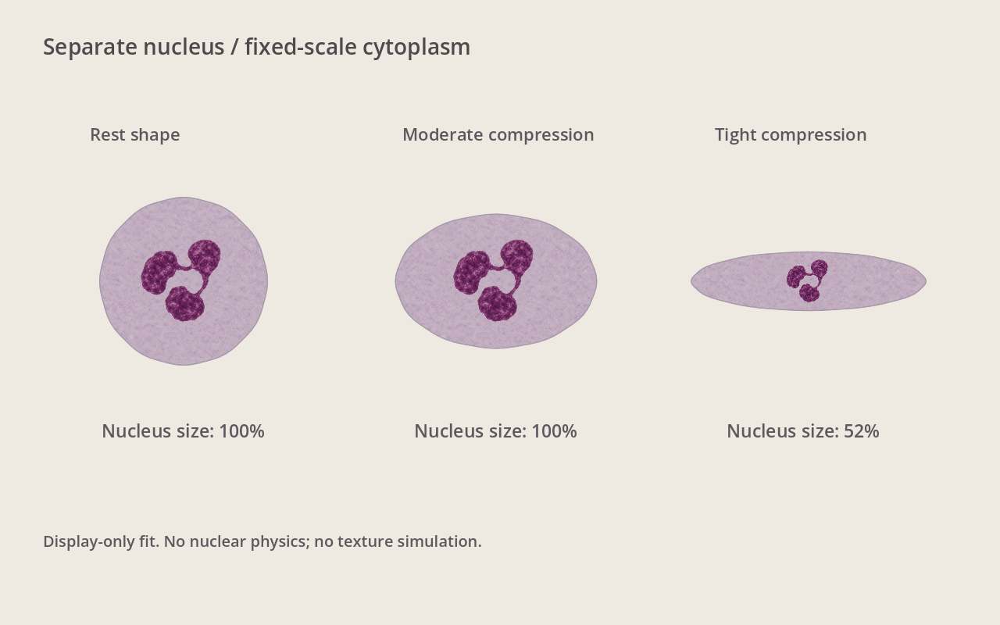
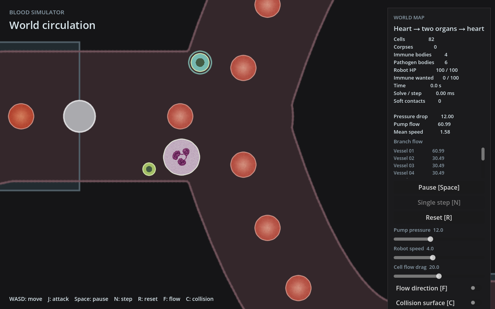

# 中性粒细胞显示层修正

用户否定首轮核与胞质整图拉伸，并明确选择：核只做渲染，能容纳时保持形状，避免增加核物理或纹理模拟。本记录替代首轮实现的中性粒显示方式；视觉效果待用户确认。

## 实现

- `neutrophil-cytoplasm.png`：去核的胞质纹理，以细胞中心与整体方向作局部坐标、固定尺度采样。轮廓变化只改变裁切区域，不把颗粒拉长。
- `neutrophil-nucleus.png`：透明三叶核，独立绘制，随整体平移/转动，固定显示比例。核显示半径为0.65世界单位，跟随现有中性粒默认1.0单位的美术尺度。
- 膜附近空间不足时，按细胞中心到轮廓的最短距离作保守的等比缩小；核不会被压成长条。没有全局位置搜索或独立核运动。
- 核、胞质沿用死亡、敌对与淡出颜色。Rust、snapshot、物理、细胞行为均未改；其余物种与红细胞延续第一轮路径。
- 只有采用固定尺度胞质的中性粒细胞每帧重建UV所在网格属性；其余细胞保留原复用路径。未做性能验收。

## 截图

此图是生产渲染的合成轮廓样板：正常和中度形变的核显示比例100%，严重挤压约52%。属于显示适配，不代表核生物学尺寸变化。

## 实际验证

- `godot --headless --path godot --editor --import --quit`：0。
- `DISPLAY=:2 godot --path godot --display-driver x11 --rendering-method gl_compatibility --script res://tests/world_cell_mesh_test.gd`：0，无脚本错误。保留旧检查，增加正常/中度挤压核尺寸不变、严重挤压等比缩小、胞质UV尺度恒定检查。
- `godot --headless --path godot --fixed-fps 60 --quit-after 180 -- --combat-preview`：0，无脚本错误。
- 本目录 `capture-v2.gd` / `swatch-v2.gd` 通过 `DISPLAY=:2 godot --path godot --display-driver x11 --rendering-method gl_compatibility --script <脚本路径>` 执行（前者追加 `-- --combat-preview`），退出0，无脚本错误，未执行自动交互。
- `git diff --check`：通过。
- 独立 reviewer 定点复查通过：胞质固定尺度、核等比、坐标恢复、状态反馈及物理边界保持正确。

## 限制

居中圆包络适配较保守，没有搜索核可以挪到的其他位置；极端凹形的中心落在膜外时隐藏核。固定朝向的外观纹理不代表真实胞质流动；无核物理、胞质粒子模拟、人工手感或FPS验收。血管与组织仍未替换。

启动入口不变，分支仍为 `feat/cell-microscopy-textures`，未提交/合并/推送。
