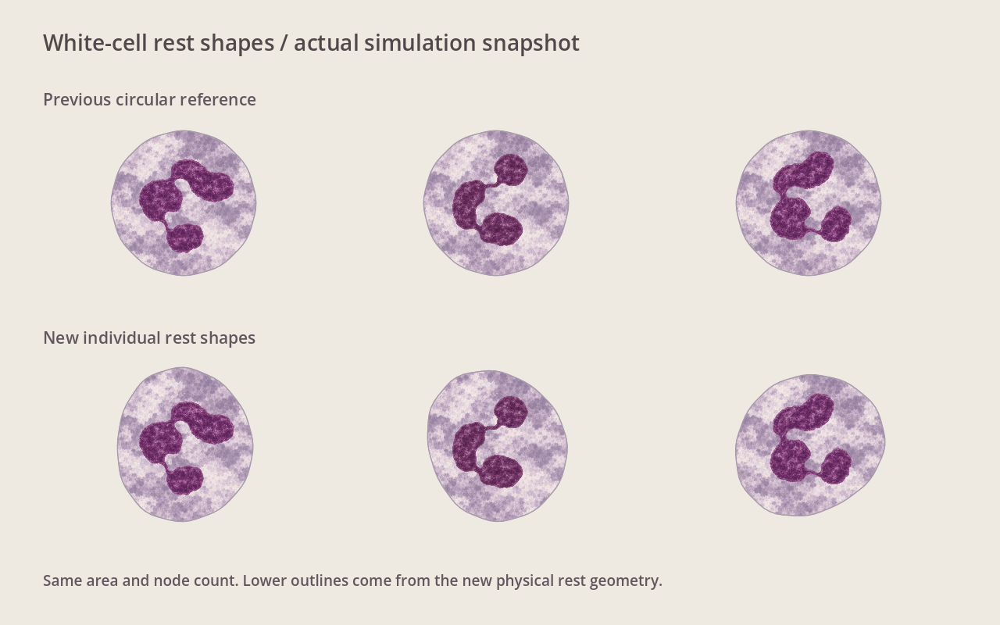
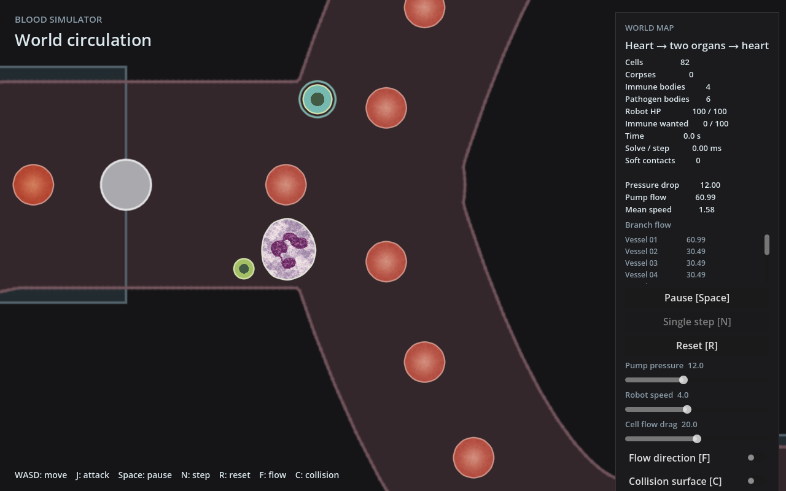

# 白细胞轻微不规则静态形状

用户批准尝试让出生轮廓成为非圆形平衡形状。本轮只改现有Rapier软体的参考几何，不增加主动伪足、核物理或行为系统。

## 实际改动

中性粒细胞和巨噬细胞按ID确定宽缓的二阶/三阶径向起伏（系数0.07和0.03），重居中并归一到原同节点数圆环面积，以 `SoftBodyBuilder::polygon` 建立边、弯曲和面积约束。节点数、质量、材料、阻尼与碰撞厚度保持原值。红细胞和细菌保留disk。

活跃出生、休眠出生和恢复共用同一参考形状构造；恢复时仍还原保存的实际位置与速度。ID决定形状，不新增实体字段、存储数据或Godot接口。

下排读取真实 `BloodLab.use_combat_preview()` 的初始快照，仅将位置移到对比排版中，未在渲染侧制造不规则形状。核与胞质继续使用前轮独立显示。

## 验证证据

- `cargo fmt --all --check`：通过。
- `cargo test --locked -p simulation immune_cells_keep_individual_rest_shapes_after_deformation_and_wake -- --nocapture`：通过。
- `cargo test --locked -p simulation`：59单元+5集成通过。
- `cargo check --locked --workspace`：通过。
- `cargo build --locked -p godot_bridge --target-dir /tmp/sunyunbo/blood-cell-texture-target -j 4`：通过。
- `DISPLAY=:2 godot --path godot --display-driver x11 --rendering-method gl_compatibility --script /tmp/sunyunbo/cell-texture/swatch-v4.gd` 及相同选项下 `capture-v4.gd -- --combat-preview`：退出0、无脚本错误。脚本副本保存在本目录。
- `godot --headless --path godot --fixed-fps 60 --quit-after 180 -- --combat-preview`：退出0。
- `godot --headless --path godot --fixed-fps 60 --quit-after 180 -- --stream-world`：退出0。
- `git diff --check`：通过。

新增单项真实物理测试覆盖两种白细胞：个体非圆差异、相同ID活跃/休眠出生一致、初始面积与原圆环一致、无外力静置稳定；施加面积保持的压扁形变，休眠/恢复后运行Rapier松弛，以节点间距离确认恢复原参考形状，允许刚体旋转和平移。

独立定点审阅无重要缺陷。默认尺寸下靠墙生成余量仍足够；巨噬细胞凸起可能消耗邻近细胞的生成余量，允许轻微初始接触，由已有碰撞处理。本轮不增加新生成恢复机制。

## 构建与范围

本工作树的target链接现指向 `/tmp/sunyunbo/blood-cell-texture-target`，使用独立桥库，避免覆盖主目录运行库。此前共享目标目录的记录仅适用于早期纯GDScript阶段。

尚未验收人工手感、全地图自由移动、完整战斗负载FPS或任意节点数/尺寸参数。未运行云实验，未提交、合并或推送。入口仍为 `godot --path /data/sunyunbo/.codex/worktrees/271c/bloodSimulator/godot -- --combat-preview`。
