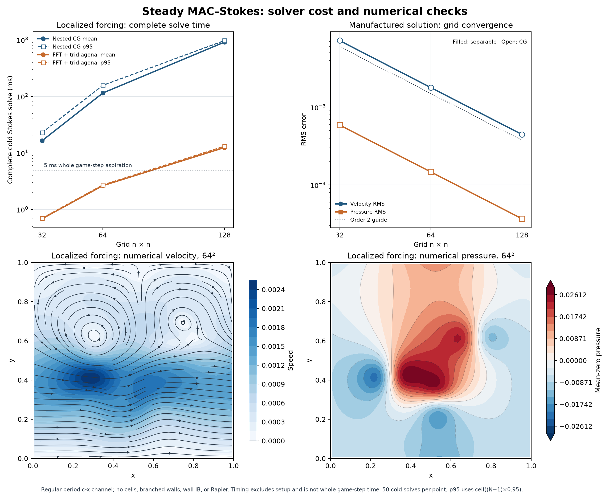

# MAC + Stokes 专项调研与首轮数值实验

日期：2026-10-22。用户已选择先研究并实验 MAC + Stokes，LBM + 浸入边界留作下一条对照路线。本轮由三个 `gpt-6-sol / medium` 子 agent 分担方法研究、求解器实现、Rapier 接口核查及交叉检查；主 agent 组织实验、串行计时并整理结论。

后续结果见 [2026-10-23 简化细胞耦合与不规则边界实验](2026-10-23-coupling-experiment.md)。下文为首轮规则通道基准，性能不能直接代表带障碍物或细胞的场景。

## 结论

**MAC + Stokes 值得继续，但线性求解方法决定成本；当前实验不能直接作为正式血管求解器接入。** 同一个 64² 局部受力问题，基础嵌套 CG 的完整求解均值为 114.74 ms，换成规则通道专用的可分离速度逆后为 2.63 ms，数值解保持一致。这支持继续研究快速求解，尚未证明加入分岔墙、细胞界面与 Rapier 后能达到整步 5 ms。

本轮交付是独立研究程序、原始样本和图表。没有更换产品流场、修改 Cargo 依赖、改变细胞材料或新增正式系统接口。原型仅含准稳态流体，不含流体时间惯性、细胞或浸入边界。



## 1. 本轮具体求解什么

固定单位方域 `[0,1]²`，x 周期，上下壁无滑移，黏度 `μ=1`。这是一组无量纲数值算例，未标定为生理血液参数。32²、64²、128² 均保持同一物理域和同一外力尺度。

- MAC：压力位于格心，两个速度分量位于对应格面；周期面只保留一个自由度。
- 固壁：法向速度位于壁上并固定为零；切向速度用反对称 ghost，使壁上插值速度为零。
- 方程：`A u + G p = f`、`D u = 0`，`A=-Δ`，离散 `D=-Gᵀ`，压力去均值消除常数零模。
- 压力求解：消去速度得到 `S p = -D A⁻¹f`，其中 `S=-D A⁻¹G`，外层 CG 求零均值压力；最后求速度并重新检查原方程残差。

这是真正的稳态速度—压力求解，没有将单次投影当作稳态，也没有将解析速度直接填入网格当作数值结果。规则交错网格的块系统及预条件路线参考 [Cai 等](https://arxiv.org/abs/1308.4605)。

两种后端只改变 `A⁻¹` 的计算方式：

| 后端 | 方法 | 本轮用途与限制 |
| --- | --- | --- |
| `cg` | 速度子问题也用无预条件 CG，形成内外嵌套迭代 | 简单正确性基线；内解按容差停止，外层算子并非严格固定线性，必须验真残差；不推荐直接用作实时实现 |
| `separable` | x 方向 radix-2 FFT，逐 Fourier 模解 y 三对角系统；因子预计算 | 同一离散速度算子的准确逆，压力仍需外层迭代；依赖矩形周期通道与常系数，不能直接处理真实分岔 |

内层 CG 容差为 `2e-12 max(||b||₂,1)`，外层为 `2e-9 max(||rhs||₂,1)`。原型用 f64；没有放宽精度、改为 f32 或用线程/GPU 换取速度。它也尚未消除所有临时分配和重复子求解，不能作为 MAC 的性能极限。

## 2. 三个场景与正确性证据

1. **泊肃叶流：** `f=(1,0)`，理论 `u_x=y(1-y)/2`、`u_y=0`、`p=0`，单位深度通量为 `1/12`。检验壁面和速度剖面，但单独使用它会漏检非零压力及二维流动。
2. **二维制造解：** `ψ=sin(2πx+φ) sin²(πy)`，`u=(∂yψ,-∂xψ)`，`p=cos(2πx+φ)cos(πy)`。外力由连续解析公式 `-Δu+∇p` 独立生成，再在格面采样；不是用待测离散算子生成右端。
3. **局部受力：** 三个固定物理宽度 `σ=0.05` 的 Gaussian 体力分量，检验更丰富空间频率下的迭代成本。它没有解析真值，只报告原方程残差与实际数值场；不冒充细胞反馈模型。

制造解的误差如下。速度误差是所有活动格面自由度上的 RMS，压力误差是去均值后的格心 RMS；源码字段保留为 `u_l2/p_l2`。

| 网格 | 速度 RMS 误差 | 压力 RMS 误差 |
| --- | ---: | ---: |
| 32² | 7.1874e-3 | 5.8960e-4 |
| 64² | 1.7872e-3 | 1.4709e-4 |
| 128² | 4.4576e-4 | 3.6754e-5 |

两后端结果一致；每次加密速度误差缩小约 4.02、4.01 倍，压力约 4.01、4.00 倍。泊肃叶通量依次为 0.0834961、0.0833740、0.0833435，趋向理论 0.0833333。

各汇总行最终冷解的真实散度 RMS 最大约 `1.12e-11`；真实动量残差 RMS 最大为 CG `2.77e-10`、可分离后端 `2.33e-11`。这些是本组无量纲方程下的绝对残差，不是原游戏单位下的误差。64² 局部受力场的两后端逐点对照，速度差不超过 `1.1e-15`、压力差不超过 `2.1e-14`。误差收敛只验证规则平壁，不能外推至斜壁、分岔或膜界面。

## 3. 性能结果及实际热点

环境：Xeon Gold 6330，Rust 1.98.1，`rustc -O`，单线程固定 CPU 2；机器未独占。每种后端先跑 3 次热身，每场景/网格再做 50 次零初值完整求解。制造解另测 49 次上一解作初值的求解，并逐次改变 x 相位 0.31 rad。两个后端串行执行。

计时包含全部内外迭代、最终速度逆与解向量分配；不含后端预计算、网格/外力生成、残差分析、输出或绘图。初始化另列于原始汇总。p95 使用排序后的 `ceil((N-1)×0.95)` 下标；这是探索性微基准，不是目标玩家设备的验收。

**局部受力场，每次完整流场求解，单位 ms：**

| 网格 | 嵌套 CG 均值 / p95 | 可分离后端均值 / p95 |
| --- | ---: | ---: |
| 32² | 16.397 / 22.796 | 0.683 / 0.698 |
| 64² | 114.736 / 156.719 | 2.632 / 2.711 |
| 128² | 912.867 / 971.385 | 12.432 / 13.113 |

64² 局部受力场仅需 5 次压力外迭代，但基础后端累计执行 1548 次速度内层 CG 迭代。可分离后端把这部分换成 7 次直接速度逆，完整求解均值约快 43.6 倍。当前原型的主要成本是反复求速度子问题，不是速度数组取样。

只看简单剖面会低估成本：可分离后端在 64² 泊肃叶、制造解、局部受力下均值分别为 **0.744、1.486、2.632 ms**。压力约束和右端空间结构都会改变工作量。

本次 warm start 没有获益。64² 制造解的可分离后端由冷解 1.486 ms 变为 warm 1.837 ms；外迭代同为 2 次，但初始化压力残差多调用一次速度逆。直接速度逆本来也不使用速度初值。这只说明当前算法和变相位序列的结果，不代表其他求解器或真实缓慢运动场景下 warm start 无效。

原始 900 次冷解与 294 次 warm 求解的均值、p95 已由绘图脚本独立复算并与汇总核对：[summary.csv](experiments/2026-10-22-mac-stokes/results/summary.csv)、[CG 样本](experiments/2026-10-22-mac-stokes/results/cg-samples.csv)、[快速后端样本](experiments/2026-10-22-mac-stokes/results/separable-samples.csv)、[核对结果](experiments/2026-10-22-mac-stokes/results/analysis.json)。

## 4. 对整步 5 ms 目标意味着什么

5 ms 是整个求解预算，不是每次流场更新预算。原游戏每固定步有两个 Rapier 子步；若每子步都进行一次与本例同成本的 64² 流场求解，仅流体均值工作量就约为 `2×2.632=5.264 ms`，尚未计细胞耦合与 Rapier。这个乘法是条件预算说明，不是已运行的整合场景性能。

因此，当前实现不能直接按“64² 看起来小于 5 ms”验收。32² 单次约 0.68 ms 提供了较小活跃域的实验起点，但是否能分辨细胞、窄缝和整个观察范围仍未知。也不能把不同模块各自的 p95 相加作为整步 p95。

下一轮应继续区分三种成本：固定血管边界的处理、局部线性求解、移动细胞的界面约束。固定几何可以复用算子与多重网格层级；移动的 IB 插值/散布与界面响应仍需更新。文献中块 GMRES 配 Helmholtz/Poisson 多重网格是更一般的候选，而本次 FFT 逆主要提供参照。[Cai 等](https://arxiv.org/abs/1308.4605)

## 5. 分岔边界与细胞耦合：尚需解决的部分

**固定血管墙：** 阶梯 mask 易于起步，但斜壁位置、截面和剪切会有误差；cut-cell 更贴合几何，却要同时处理流体体积、开口面积及黏性通量；IB 墙可以保留规则网格，但增加墙面约束或惩罚求解。本轮没有选定正式墙面方案。不能向现有 FFT 通道随意加一个 mask 就认为算法仍成立。

**Rapier 接口：** 已核对实际 0.36.1 源码，12 点细胞的 `.mass(1.0)` 是总质量，单点约 `1/12`。现有 `particle_position/velocity/mass` 与 `apply_particle_impulse` 足以做有限阻力实验。`add_particle_force` 会持续生效直到清零，混用时需注意其他系统外力；逐节点子步冲量更适合最小实验。旧 `cell::advect` 应由新交换取代，不能叠加。

沿 12 条机械边派生更多流体标记，位置与速度都线性插值，力以相同权重回传原节点；它们无需独立质量或积分。网格插值与力散布互为伴随，可使界面交换力与功率一致。有限阻力仍允许滑移，增加标记也不自动保证不渗透。

严格无滑移需要压力、速度、界面乘子以及固体响应的联合处理。Rapier 当前公开 API 没有直接提供含接触、弹性和面积约束的界面力—速度响应算子；不能把强耦合描述成一次加力就完成。已有交错网格约束 IB 研究证明路线可行，但其复杂度及刚体假设不能直接套到本项目软体。[Kallemov 等](https://arxiv.org/abs/1505.07865)

另纠正一个容易混淆的术语：纯准稳态 Stokes 没有流体时间惯性，不含经典的流体附加质量；此时应研究阻力与固体质量的显式交替刚度。切换到非定常流体后，才另查低密度比下的附加质量稳定性。

详细代码路径、最小交换公式和圆体实验提案见 [Rapier 耦合核查](experiments/2026-10-22-mac-stokes/rapier-coupling.md)，墙与解法取舍见 [方法备忘](experiments/2026-10-22-mac-stokes/methods.md)。

## 6. 下一轮实验与 LBM 对照口径

本轮完成流体核心 A 阶段，没有运行圆体、薄膜 IB、软体反馈或分岔。推荐接下来按依赖关系验证：

1. **固定不规则边界：** 一个倾斜通道或简单分岔，比较壁面位置、流量和误差；同时验证可复用的通用快速解法，避免只优化当前可分离通道。
2. **规定运动的圆体：** 先看滑移、绝对法向穿透通量、反力与求解成本。体积惩罚可以作为辅助实验，但它是实心区域阻力，不能代替薄膜 IB 验收。
3. **一个原有 Rapier 细胞：** 明确尺度、质量和子步交换后，再量形变、面积漂移、漏流、稳定性及整步耗时。之后才扩大细胞数。

LBM + IB 下一轮使用相同几何、有效分辨率、驱动、界面误差目标和流固模型；如保留瞬态，还要匹配 `Re`、`L²/(νT)`、弹性响应及游戏/物理时间映射。若只比稳态，两者都应从给定初值达到同一误差阈值，并记录初始化与更新成本；如果比较动态过程，必须计所有内部步。

LBM 的一次 collide/stream 不能对比 MAC 的完整 Stokes 解，MAC 的一次 stencil 同样不能冒充完整求解。HemoCell 官方资料说明了格子时间和机械更新频率分离，这可降低某些耦合工作，却仍需统计全部格子步。[HemoCell 单位与时间尺度](https://hemocell.eu/user_guide/concepts/units_and_scaling.html)

## 7. 复现与验证记录

在仓库根目录运行：

```bash
python3 docs/research/experiments/2026-10-22-mac-stokes/run.py --runs 50 --cpu 2
python3 docs/research/experiments/2026-10-22-mac-stokes/plot.py
rustfmt --check docs/research/experiments/2026-10-22-mac-stokes/main.rs docs/research/experiments/2026-10-22-mac-stokes/separable.rs
git diff --check
```

`run.py` 用 `rustc -O` 在临时目录编译，无外部 Rust 依赖；保存源码 SHA-256、机器信息和原始样本。绘图使用当前环境已有的 NumPy / Matplotlib。源码与运行说明见 [实验目录](experiments/2026-10-22-mac-stokes/README.md)。

上述数值运行与原始样本核对已完成。正式游戏代码未改，因此没有重跑 Godot 或游戏交互验证；流固耦合、真实分岔、目标玩家机器和整步 5 ms 仍未验证。
