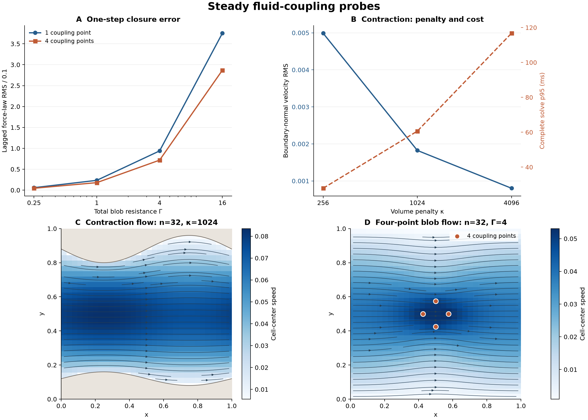

# 简化细胞耦合与不规则边界实验

日期：2026-10-23。接续 [MAC + Stokes 首轮实验](2026-10-22-mac-stokes-experiment.md)。用户明确选择“先有局部带流与受阻效果，允许近似”。本轮沿用独立 Rust 数值实验，未接入游戏、未改变 Rapier 或依赖。

后续已完成 [LBM 与少量阻力点对照](2026-10-23-lbm-experiment.md)。下文保留 MAC 阶段的实验结果与结论范围。

## 结论

**可以把首版细胞耦合简化成少量有限阻力点。** 每个细胞只在 1–4 个位置与流体交换相反的力，Rapier 继续管理机械节点、弹性和接触。单点主要作用于整体平移，多点才有机会表达更粗略的转动及不均匀受力。它允许流体穿过细胞，不能当作可靠挡流或不可渗透膜。

本轮数据支持“小阻力的一次流场更新”作为游戏近似候选，也明确了边界：把阻力增大，会使只更新一次的方法明显偏离自洽解。另一方面，当前不规则墙的体积惩罚求解仍然很慢；简化细胞耦合没有自动解决整步 5 ms 预算。



图中右下流场来自四点阻力的自洽参照，左上则是一次更新的闭合误差；两者的计算方式不同。

## 1. 实际完成的实验

三个 sol medium 子 agent 分别补充少量阻力点实现、核查数值公式与计时口径、整理原始数据和图表；主 agent 接续已有不规则壁程序，统一串行计时。实验为单位方域、x 周期、y 固壁、黏度 1 的准稳态 Stokes 流动，没有流体时间惯性。

- **少量阻力点：** 1 点位于域中心；4 点位于中心周围半径 0.075 的四个方向。均规定速度 `(0.1,0)`，背景外力为零。
- **圆膜参照：** 半径 0.15 的圆周上取 12、24、48 个无质量流体标记，规定相同平移速度；流体存在于膜内外。
- **体积惩罚：** 一条光滑周期收缩通道，以及静止和规定平移的实心圆盘快照。用二值格面 mask 近似曲边，没有 cut-cell 几何修正。

这些规定运动快照没有推进自由细胞、没有测试接触、软体形变、72 个细胞或时间稳定性。实验 Γ、κ 是上述无量纲方程的参数，不能直接代替游戏中的 `cell_drag=20`。

## 2. 少量阻力点如何交换力

对 m 个点，使用总阻力 Γ，每点阻力 `r=Γ/m`：

```
F_i = r (V_i - J_i u)       # 作用于流体的总点力
u   = K S F                # 含压力与不可压约束的完整 Stokes 响应
```

J 是四点 Peskin 核插值，S 用同样的权重把反作用散回格面，并除以控制体积 `h²`。物体受到 `−ΣF_i`。因此空间传递的合力和功率有清楚的对应关系，但这不等于自由细胞显式时间推进已经稳定。

为分开精度与成本，比较两种计算：

1. **自洽参照：** 解 `[I/r + JKS]F=V`，再求实际流场。当前用逐列完整流体求解组装小矩阵，花费 `2m+1` 次 Stokes 解。这个实现用于正确性参照；物体移动后不能把旧矩阵免费复用，也不能认为所有隐式方法都必须这样组装。
2. **一次更新：** 用初始零流速计算 `F_i=rV_i`，散布后只求一次流场。它是滞后近似，最后的 F 与 u 一般不同时满足阻力公式。本实验测的是一个规定运动快照，不是运行多个时间步后自然收敛的证明。

圆膜的参数则为每单位弧长阻力 κ，点阻力 `r=κ(2πR/m)`，与 blob 的总阻力 Γ 不可直接按数值比较。粗粒子耦合和标记插值的文献背景、替代方案见 [简化方案备忘](experiments/2026-10-23-coupling/coupling-options.md)；本报告的取舍以实际实验为依据。

## 3. 一次更新在哪些条件下接近参照解

以下均为 32² 网格、4 个阻力点，目标速度 `|V|=0.1`。闭合误差定义为 `RMS(F/r+Ju−V)/0.1`，RMS 按 2m 个速度分量计算，**不是力的相对误差**。反力偏差另以自洽参照的总 x 反力为基准。

| 总阻力 Γ | 一次更新闭合误差 | 一次更新反力偏差 | 点上最大速度 / 目标速度：参照 → 一次更新 |
| --- | ---: | ---: | ---: |
| 0.25 | 4.48% | 6.33% | 0.0621 → 0.0660 |
| 1 | 17.93% | 25.33% | 0.2105 → 0.2642 |
| 4 | 71.73% | 101.17% | 0.5230 → 1.0566 |
| 16 | 286.91% | 403.04% | 0.8283 → 4.2265 |

小阻力时，两者接近，但带动流体也较弱。Γ=4 时，一次更新给出的流速已经略高于规定的物体速度，反力约为参照的两倍；Γ=16 时过量推动更明显。不能因为流体跟得快、表面速度差小，就判定耦合正确。

1 点结果趋势相同：Γ=0.25 的闭合误差为 5.86%，点流速比从参照 0.0766 变为一次更新 0.0829。少量点方案值得先验证体验；能否接受它的带流强度与穿透程度仍需游戏中的观察。

## 4. 成本：区分新几何建立与一次流场更新

Xeon Gold 6330，`rustc -O`，f64、单线程固定 CPU 2，非独占机器。每案例先热身一次、再执行 20 次。这里只列均值，完整样本及探索性 p95 已归档。

| 场景 | 自洽参照总耗时 | 一次更新耗时 |
| --- | ---: | ---: |
| 32²，1 点，Γ=0.25 | 2.60 ms | 0.83 ms |
| 32²，4 点，Γ=0.25 | 7.84 ms | 0.82 ms |
| 32²，4 点，Γ=4 | 7.92 ms | 0.82 ms |
| 64²，4 点，Γ=4 | 24.75 ms | 2.64 ms |
| 32²，24 点圆膜，κ=32 | 33.77 ms | 0.62 ms（误差很大） |

两列口径不同：左列包含网格/核初始化、流体响应矩阵组装、分解、最终流体解；右列复用已建立的网格与插值数据，只计一次施力与流体解。**不能将二者相除宣称生产加速比，也不能把右列当作整游戏步。** 自洽总计时包含前置核权重和矩阵反对称性检查，排除求解后的指标分析与 CSV 导出。

若以后采用一次更新，应先汇总所有细胞的点力，再做一次全局流体求解；不应给每个细胞单独求完整流场。不过多个细胞的相互作用会改变滞后误差，这里的一物体结果不能直接外推到 72 个细胞。

## 5. 密膜和不规则墙给出的参照

在本次平滑圆膜、32²、κ=32 下，12/24/48 个流体标记的绝对法向相对通量积分约为 `0.007818 / 0.007804 / 0.007805`，几乎不变；自洽参照的建立加求解均值却从 22.28 ms 增至 67.53 ms。这里有限阻力滑移的影响很大。此结果不能证明 12 点能处理变形后的尖角、近壁窄缝或一般不渗透边界。

体积惩罚求解的是 `(-Δ+κχ)u+Gp=f+κχV`。原规则通道 FFT 逆只作为速度 PCG 的预条件器，实际速度算子已随障碍物改变。

| 32² 体积惩罚 | κ=256 | κ=1024 | κ=4096 |
| --- | ---: | ---: | ---: |
| 收缩通道完整求解均值 | 27.76 ms | 54.00 ms | 115.21 ms |
| 通道壁法向相对速度 RMS | 0.004989 | 0.001823 | 0.000801 |
| 规定平移圆盘求解均值 | 10.45 ms | 19.07 ms | 37.08 ms |
| 圆盘法向相对速度 RMS | 0.01384 | 0.004299 | 0.001389 |

更强惩罚降低穿透，同时增加当前迭代成本。固定 κ=1024 加密到 64² 时，通道求解为 231.29 ms，规定平移圆盘为 94.78 ms；通道法向 RMS 降至 0.001594，圆盘则略增至 0.004377。二值曲边取样和有限惩罚都会影响结果，只有两层网格，不能宣称已验证收敛阶。

这说明**本次嵌套 PCG/Schur 的体积惩罚实现不适合作为实时版本直接接入**。它不是 MAC 或体积惩罚方法的性能极限，但也不能沿用上一轮规则通道约 2.6 ms 的数据来估计带墙场景。

静止场景的背景体力作用于包含惩罚区的全域，体积反力包含该区域外力，不是纯表面拖曳。整框通量包含惩罚区渗流；按二值 mask 裁出的通量也有几何取样误差。穿透评价使用真几何上相对边界速度的绝对法向积分，避免净通量正负抵消。

## 6. 建议与尚未证明的部分

按用户选择，推荐继续以 **1–4 个阻力点、小阻力、汇总反力后一次流场更新** 做首版候选。保留现有 12 个机械节点，流体点不增加质量、弹簧或积分状态；力按与位置/速度构造相容的权重传回机械节点。现有单向 `cell::advect` 不能与新拖曳重复叠加。

此路线优先得到局部带流和阻力，接受穿透与有限剪切精度。完整膜约束和可靠封堵暂不作为实现前提。体积惩罚目前只保留为研究参照；若直接将可变形细胞填成低渗透实体，会改变内部流体模型及速度构造，需要单独选择。

当前尚未证明自由软体的时间稳定性、材料响应、接触下的受力、实际局部网格大小或整步 5 ms。对性能路线，仍需更适合不规则边界的 MAC 求解或后续 LBM 对照数据；本轮没有选择新的产品求解器，也没有测 LBM。

## 7. 可复现结果

源码与脚本位于 [实验目录](experiments/2026-10-23-coupling/README.md)，包括每次测量、机器与源码 SHA-256、真实数值场和指标核对结果。在仓库根目录运行：

```bash
python3 docs/research/experiments/2026-10-23-coupling/run_volume.py --runs 20 --cpu 2
python3 docs/research/experiments/2026-10-23-coupling/run_markers.py --runs 20 --cpu 2
python3 docs/research/experiments/2026-10-23-coupling/plot.py
```

两组 runner 均已成功结束。它们分别在临时目录用 `rustc -O` 编译，未安装 Rust 依赖。测量共 240 次体积惩罚解、240 次自洽点力解及 240 次一次更新对照；额外热身不计入样本。指标直接调用实验求解器，不是 mock。

逐次样本已独立复算并与汇总核对。原始样本中，体积惩罚最大动量/散度 RMS 为 `3.16e-10 / 1.42e-10`；点力自洽阻力公式的最大速度单位残差为 `2.40e-13`，流体动量/散度最大 RMS 为 `1.41e-13 / 2.41e-10`，力交换不平衡不超过 `3.55e-15`。这些只说明离散方程和空间力交换按预期求解，不是动态稳定性证据。

产品代码未修改，因此没有重跑游戏检查或 UI 验证。全部实验均是规定几何/速度的快照，不能用残差小或作用反作用相等替代游戏验收。
