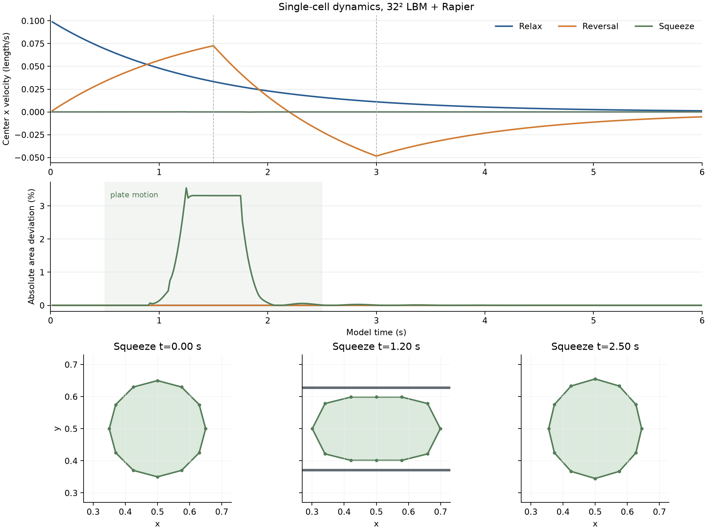

# 移动阻力点与单个 Rapier 细胞的动态实验

日期：2026-10-23。用户接受百分之几量级的误差，优先排除明显奇异。本轮接续 [LBM 静态实验](2026-10-23-lbm-experiment.md)，在独立研究程序中加入移动标记和一个真实 Rapier 软体；未替换主游戏实现。

后续结果见 [子步采样核复用与 4 / 16 细胞规模实验](2026-10-23-lbm-scale.md)。

## 结论

**32²、τ=2、四点弱阻力与现有软体力学在这组短时动态场景中能够共存。** 跨格和周期缝没有观察到特异的阻力尖峰；单细胞自由滑行、外力反转、挤压恢复各运行 6 秒，没有非有限状态、面积翻转或密度失稳。挤压时最大面积偏差约 **3.54%**，释放后恢复。

整步计时比上一轮固定点流体测试更接近实际，但只有一个细胞：f64 均值约 **3.37–3.88 ms**，p95 约 **4.94–5.06 ms**。因此仍不能宣布整步 5 ms 已留出足够余量。f32 对照的机械轨迹差很小，本轮却没有测到可靠的性能收益，暂不据此切换默认精度。



[查看由实际轮廓快照生成的挤压动画](experiments/2026-10-23-lbm-dynamics/results/squeeze.gif)。压板只作为 Rapier 接触代理，没有加入流体固壁。

## 1. 模型与交换时序

流体沿用单位域、ν=ρ=1、32²、τ=2 的 D2Q9/Guo 内核，x 周期、y 固壁，内部时间步 `Δt_LB=1/2048`。固定传播索引继续预计算；移动点的 Peskin 核只重建其 4×4 支持区。x 坐标保持展开，只有流体索引按周期取模。当前样例的点远离 y 墙，核若超出墙外会停止并报告，没有静默裁剪、钳制或恢复机制。

软体使用已有 Rapier 0.36.1：12 个机械节点、总标称质量 1、膜频率 12 Hz、面积频率 30 Hz、线性阻尼 0.5。为放入单位域，半径由主项目的 0.7 缩为 0.15，粒子/接触半径由 0.07 缩为 0.015。材料频率保持原值，未做生理或全世界尺度标定。

四个流体点分别由节点 0/3/6/9 与全体节点质心各取一半位置与速度构成，总阻力 Γ=0.25 均分给四点。返回冲量也用相同权重：一半给选中节点，一半平均分给所有节点。它们没有独立质量、弹簧或积分。全域仍含流体，这是一种可渗透点阻力模型，不代表真实排液或封闭膜。

每个 1/60 帧有两个 Rapier 子步。子步开始时冻结节点位置与速度，然后：

1. 按累计目标时间推进约 17 或 18 个 LB 步，每步重新计算反馈。
2. 从实际格子力场扣除背景后积分流体冲量，并与返回的相反点冲量核对。
3. 汇总这段时间的点冲量，按上述权重回传节点；调用一次 Rapier `world.step()`。

旧 `cell::advect` 没有叠加。时间因子只在流体步冲量中乘一次，避免每个子步向上取整造成时钟持续跑快。6 秒结束时共推进 12288 个 LB 步，模型时间正好 6 秒；中间最大时差为 **0.000455729 秒**，小于一个 LB 步。

同权重传递保证冻结状态下的合力、力矩与瞬时功率对应；固体冻结、时钟取整、Rapier 弹性/阻尼和接触仍会产生时间离散误差。没有把这些空间恒等式当作完整动态稳定性证明。

## 2. 移动点：跨格和跨周期缝

四点相对中心半径 0.075，分别进行平滑往返、恒速过周期缝，以及 Γ=4 的较强阻力对照。平滑中心为 `x=0.5+0.2 sin(πt)`，峰值规定速度约 0.628；恒速中心为 `x=0.55+0.1t`。

| 规定运动 | 持续时间 | 密度范围 | 最大流体速度 |
| --- | ---: | ---: | ---: |
| 平滑往返，Γ=0.25 | 4 s | 0.9998397–1.0001590 | 0.04013 |
| 恒速过缝，Γ=0.25 | 5 s | 0.9999744–1.0000259 | 0.00664 |
| 平滑往返，Γ=4 | 4 s | 0.9978996–1.0020711 | 0.34000 |

排除前 0.1 秒的静水启动后，Γ=0.25 往返的跨格/非跨格最大单步力变化约为 `2.179e-4 / 2.273e-4`，过缝案例为 `1.151e-6 / 2.046e-6`。标记与中心通过周期缝时的变化分别约为 `1.18e-9`、`1.38e-11`，未出现比普通更新更大的跳变。较强对照下也未见跨格特异尖峰，但其流速和 Re 更高，不能视作默认低速工况。

规定运动中的最大核权重误差约 `4.44e-16`，网格与点冲量误差小于 `1e-18`。新模块固定四点运行 3190 步后，与上轮相同步数的归档场逐格对比，速度和密度在 CSV 导出精度下完全一致。这检查了移动核改写与既有算法的一致性。

## 3. 自由软体与接触

三种场景均运行 6 秒、360 帧；稳定性检查覆盖全部帧。

| 场景 | 实际输入 | 主要结果 |
| --- | --- | --- |
| 自由滑行 | 初始整体 x 速度 0.1，随后无外部驱动 | 速度平滑衰减至约 0.00123；同时包含流体拖曳和 Rapier 既有阻尼的作用 |
| 外力反转 | 0–1.5 s 施加 +0.08，1.5–3 s 施加 −0.08，之后撤力 | 速度连续经过零点并反向；最大中心加速度发生在外力切换后，不是无输入尖峰 |
| 挤压与恢复 | 两块运动接触板收缩、保持、释放 | 最大面积相对偏差 3.54198%，最大节点帧位移约 0.00438；未翻转，释放后恢复 |

挤压末尾面积相对初始差约 `1.6e-7`；释放后阶段的最大面积偏差约 **0.0273%**。面积指标属于当前软体材料、接触与耦合的组合表现，不是相对真实血细胞的物理误差。

复用挤压场景前 0.5 秒的无输入静置区间，中心最大漂移约 `6.7e-8`，记录的中心速度、节点帧位移和流体速度均为零。其后接触期间的节点运动不能直接归类为数值抖动。

三场景均保持节点和流体状态有限、密度为正、面积符号不变；节点回传采用 f32，最大流体/固体交换冲量不平衡约 `6e-11`。压板没有加入 LBM 障碍物，因此本例不验证挤压薄层流动或真实血管壁附近的排液。

## 4. 整步性能与 f32 对照

Xeon Gold 6330，单线程 CPU 2，非独占机器，Cargo release；每场景一次完整轨迹。计时剔除前 30 帧，保留 330 帧，用 nearest-rank p95。整步包含流体、冲量回传、两个 Rapier 子步和帧诊断，不含 CSV/快照写入与绘制。

| 场景 | f64 整步均值 / p95 | f32 流体整步均值 / p95 |
| --- | ---: | ---: |
| 自由滑行 | 3.480 / 4.949 ms | 3.749 / 5.261 ms |
| 外力反转 | 3.878 / 5.062 ms | 3.399 / 5.235 ms |
| 挤压恢复 | 3.371 / 4.936 ms | 3.470 / 5.248 ms |

f64 的流体阶段均值约 3.27–3.79 ms，单细胞 Rapier 阶段约 0.05–0.07 ms。当前瓶颈仍主要在流体推进及相关交换计算。各阶段 p95 不能相加；表中 p95 直接来自整步样本。

f32 只改变内部格子分布、力存储和碰撞计算；物理时钟、点位置与返回接口维持 f64，Rapier 与所有输入、步数、检查门槛保持相同，没有放宽阈值来通过实验。

相对 f64，f32 的最大中心位置差约 `2.50e-6`，存档节点位置差不超过约 `2.57e-6`，面积偏差曲线最大差约 `1.1e-6`。跨所有存档流场的速度相对 L2 差为滑行 **0.652%**、反转 **0.527%**、挤压 **7.35%**；对应最大绝对速度差约 `1.3–1.6e-5`。挤压案例的参考流速很小，必须连同绝对差解释，不能声称所有相对误差均低于几个百分点。

f32 的快照平均密度漂移最高约 `1.21e-5`，状态仍有限、正密度且交换检查通过。但其本轮均值变化混合，三个 p95 都没有改善。两轮顺序执行且主机非独占，这不足以证明 f32 固有更慢；**没有可靠收益依据时，先保留 f64 为研究参照**。

## 5. 仍需解决的部分

本轮支持继续动态原型，但不支持宣布“任何情况下都无奇异”或“5 ms 已满足”。尚未测多个细胞互相接触、紧贴真实流体墙、72 细胞负载、机器人快速推挤、大地图覆盖与长时间运行。当前四个内部点也不能让细胞可靠封堵管腔。

下一步优先减少每个物理子步内重复的核构造与回传计算，再测 4/16 个细胞的性能增长；参数 Γ=0.25、质量 1、阻尼 0.5 的跟流体验也需要实际观察，不能把当前弱拖曳直接当成原 `cell_drag=20` 的等价替换。正式后端、局部区域及接口仍未接入主游戏。

## 6. 复现

源码、逐帧数据、轮廓/流场快照、图和动画见 [实验目录](experiments/2026-10-23-lbm-dynamics/README.md)。仓库根目录：

```bash
python3 docs/research/experiments/2026-10-23-lbm-dynamics/run.py --cpu 2 --seconds 6
python3 docs/research/experiments/2026-10-23-lbm-dynamics/run_f32.py --cpu 2 --seconds 6
python3 docs/research/experiments/2026-10-23-lbm-dynamics/plot.py
```

两组运行及独立分析成功。Rapier 探针只依赖已缓存的 0.36.1，以独立 Cargo workspace 和锁文件离线编译；f32 runner 在临时包中只替换流体模块路径。元数据记录所测源文件 SHA-256。

编译有两条 `FluidError` 枚举载荷的 dead-code 警告；它们保留在 Debug 错误输出中，不影响编译或本轮结果。未启动 Godot、浏览器或 UI 自动交互，动画由真实数值快照生成。
