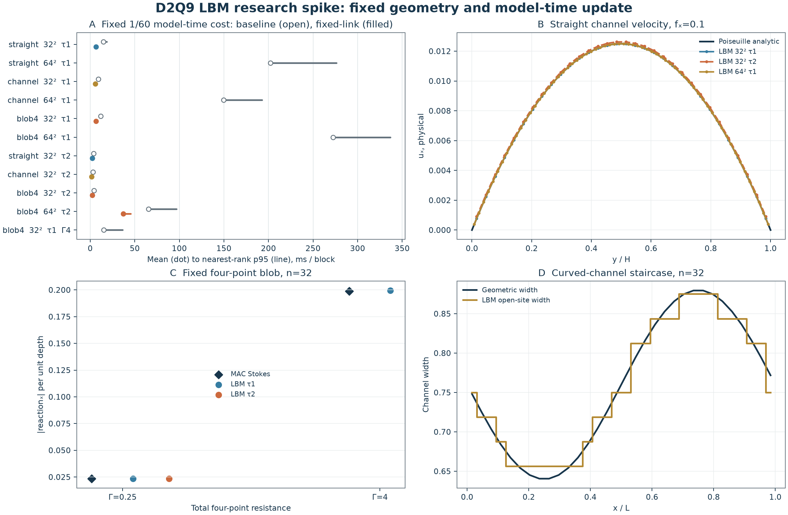

# LBM 与少量阻力点对照实验

日期：2026-10-23。接续 [MAC 与简化耦合实验](2026-10-23-coupling-experiment.md)。本轮实现独立 D2Q9 LBM 原型，检验直管、曲线通道和四点有限阻力反馈，并做一次保持数值结果不变的 CPU 优化。主游戏、Rapier、Cargo 依赖均未改变。

后续动态结果见 [移动阻力点与单个 Rapier 细胞](2026-10-23-lbm-dynamics.md)。下文的 2.23 ms 是固定点流体更新成本，不能代替后续整步测量。

## 结论

**32² 小域、τ=2、四点弱阻力是值得继续验证的组合。** 预计算固定传播索引后，推进约 `1/60` 模型秒的完整流体更新均值为 **2.230 ms，p95 2.242 ms**，包含 35 次格子步和每步点力更新。代价是直管速度相对 L2 误差约 **1.47%**，以及粗网格的曲墙几何误差。

这是固定几何、固定标记的流体成本，没有 Rapier、自由细胞、移动核重建、72 细胞或绘制。模型时间尚未与游戏世界标定，所以不能将这个数直接当作游戏帧成本，更不能宣称整步 5 ms 已实现。64² 的同类优化更新仍需 **37.154 ms**。



## 1. 本轮算法

每个格点存 9 个分布值，对应静止和二维八个方向。分布的和给出密度，加权方向和给出动量；局部 BGK 松弛后将分布传播到邻格。外力采用 Guo 格式，宏观速度含半步力修正，避免力输入与速度定义不一致。[Guo、Zheng、Shi，2002](https://journals.aps.org/pre/abstract/10.1103/PhysRevE.65.046308)

使用 f64、Rust 标准库、单线程 CPU。外框 x 周期、上下固壁；曲管用格心二值固体标记和 halfway link bounce-back。它描述阶梯形反弹墙，与此前 Brinkman 有限渗透墙不同，不能按同网格直接比较误差或计算公平加速倍数。

单位方域，参考密度、运动黏度和动力黏度均为 1。直管与曲管体力密度为 `(0.1,0)`；blob 无背景体力。LBM 保留有限惯性与弱可压行为，与准稳态 Stokes 的方程不同。实测流速所定义的 `Re=Umax L/ν` 为约 0.006–0.013（弱耦合和管流），不是零；小 Mach 数也不意味着 Re 必然小。

## 2. 时间换算与停止条件

```
h = 1/N
ν_lu = (τ − 0.5)/3
Δt = ν_lu h² / ν_phys
u_phys = u_lu h/Δt
```

因此保持物理 ν=1 时：

| 网格与 τ | 每格步模型时间 | 覆盖 1/60 模型秒的步数 |
| --- | ---: | ---: |
| 32²，τ=1 | 1/6144 | 103 |
| 32²，τ=2 | 1/2048 | 35 |
| 64²，τ=1 | 1/24576 | 410 |
| 64²，τ=2 | 1/8192 | 137 |

每块取向上取整步数，所以实际时间略超过 1/60；例如 32²、τ=2 为 `35/2048≈0.01709`。本轮未实现跨帧小数时间余量调度。每个 1/60 模型秒的全部格步已经计入，不因 Rapier 未来使用两个子步再重复乘二。格子/物理单位及机械更新频率的区分也见 [HemoCell 官方说明](https://hemocell.eu/user_guide/concepts/units_and_scaling.html)。

首次从静水开始，按约 0.01 模型秒的窗口测速度变化率，并用固定速度尺度归一化。强制模型时间至少为 1，连续三个窗口低于 `1e-5` 才停止；未收敛会返回失败。这个保守条件防止很小的格子速度被绝对阈值误判为稳态，也意味着首次收敛耗时不是最快可达到的初始化时间。

每案例只测一次首次收敛，没有首次收敛 p95；随后连续测 30 个固定时长块，每块都完整更新流体和点力。测量使用 Xeon Gold 6330、`rustc -O`、CPU 2，机器非独占。块 p95 使用 nearest-rank `ceil(0.95N)-1` 下标。

## 3. 精度与 MAC 对照

直管的独立解析真值为 `u_x=0.1 y(1−y)/2`、`Q=0.1/12`：

| 设置 | 速度相对 L2 误差 | 流量相对误差 |
| --- | ---: | ---: |
| 32²，τ=1 | 0.04457% | +0.09765% |
| 64²，τ=1 | 0.01114% | +0.02441% |
| 32²，τ=2 | 1.47093% | +1.66015% |

增大 τ 减少了所需格步，但本例的离散误差变大。不能无限调大 τ 并沿用原精度结论；这些平壁结果也不能证明曲壁有同样误差阶。

四点位置与此前 MAC 相同，目标速度 `(0.1,0)`，总阻力 Γ 分摊给四点。与同一 Γ 的 MAC 自洽参照对照：

| 32² blob 设置 | 格心速度场相对 L2 差 | 去均值压力场相对 L2 差 | 总 x 反力幅值差 |
| --- | ---: | ---: | ---: |
| Γ=0.25，τ=1 | 0.1491% | 5.501% | 0.0361% |
| Γ=0.25，τ=2 | 1.934% | 9.342% | 0.216% |
| Γ=4，τ=1 | 0.2531% | 5.406% | 0.305% |

这是交叉核对，不是解析精度证明。LBM 的力在格心插值/散布，MAC 在速度面上处理且导出时平均到格心；LBM 还有有限 Re 和弱可压误差。压力差明显大于速度与合力差，不能把“反力接近”写成各场完全一致。两种实现的原生散度定义也不同，没有把它们按同名列直接比较。

曲管实际阶梯截面宽度与真曲线的平均绝对差，在 32² 和 64² 下分别约为 0.00961、0.00430。沿 x 的全流体截面流量一致性良好，但这不消除墙位置误差。曲管与旧 Brinkman 模型的通量差也包含边界渗透及有效墙位差，不能全部归因于求解精度。

## 4. 细胞反馈如何处理

目前没有自由细胞，四个点在固定位置规定速度，以测流体对其受力的响应。每点总力为

```
F_i = (Γ/4) (V_i − J_i u)   # 作用于流体
F_body = −Σ F_i             # 对物体的反作用
```

用四点 Peskin 核取流速，并用同一权重散布力。先将点力除以 `h²` 变为物理力密度，再乘 `Δt²/(ρ_ref h)` 转为格子力；固定物理力密度不额外乘局部格子密度。

每个 LB 格子步都重新计算反馈，使用上一状态含半步力修正的流速估算当前点力，再碰撞和传播。它是逐小步滞后耦合；最终实测阻力公式残差很小，只支持这些固定标记的稳态算例，不能据此保证自由细胞的动态稳定。

这与旧 MAC 的“一次从零流速计算阻力、只解一次流场”不同：LBM 此处经历了数千次更新，流体反馈持续影响下一次阻力。也没有像 MAC 的密集参照那样逐列建立完整流体响应矩阵。

原始样本中质量相对漂移不超过约 `2.2e-12`，点力合力守恒和终态力律通过检查。四点仍允许流体穿透，不表示细胞轮廓或不可渗透膜。下一步若接 Rapier，应保留其机械积分，传回同一批力在对应时间段的冲量；当前程序没有实现该积分与时序。

## 5. CPU 优化与持续更新成本

基础内核每个格步重复计算周期下标和墙面传播目标。优化版仅在初始化时预计算所有流体格点及九个传播目的位置，检查每个目的分布只有一个写入者，从而使用直接赋值并省去整场清零；同时预计算常数系数。未改方程、f64、τ、停止条件或点力更新频率。

7 组正式对照中，优化版所有非计时摘要字段与导出场 CSV 均与对应基线完全一致。以下是**优化版**每个约 1/60 模型秒块的均值 / p95：

| 场景 | 32²，τ=1 | 32²，τ=2 |
| --- | ---: | ---: |
| 直管 | 6.555 / 6.964 ms | 2.200 / 2.211 ms |
| 曲线通道 | 5.836 / 6.414 ms | 1.675 / 1.682 ms |
| 四点弱阻力 Γ=0.25 | 6.553 / 6.568 ms | **2.230 / 2.242 ms** |

64²、τ=2 的四点弱阻力为 **37.154 / 45.207 ms**。在相同物理 ν、τ 下，加密一倍既增加约四倍格点，又增加约四倍内部步数，因此持续推进的工作量会大幅增长。

首次收敛不能藏进上述持续更新数字：优化版 32²、τ=2 的曲管、四点弱阻力分别经历 2100、2140 步，本次单次耗时约 101.5、137.7 ms；64²、τ=2 四点为 8528 步、约 2262 ms。若以后移动边界或大幅改变驱动，不能默认已经处于稳态。本轮连续块期间几何和目标速度始终固定。

## 6. 对项目的建议

按用户允许局部带流/受阻近似的目标，**我更倾向先做 32² 局部 LBM、τ=2 与少量阻力点的单细胞动态原型**。理由是本轮已有较低的流体更新成本，固定墙可预计算，且反馈可随格子步持续更新；这是基于本项目实验的工程建议，不是 LBM 普遍优于 MAC 的结论。

还需明确局部网格覆盖范围及游戏/模型时间比例，并测移动标记、自由软体形变、接触下的交换与整步性能。现有 Rapier 成本已占用不少预算；不能相加各自 p95 作为整步 p95，也不能用 2.23 ms 宣布 5 ms 达标。32² 对窄缝与细胞尺寸是否足够尚未验证，不能直接扩展为整张地图的精细流体。

MAC 路线仍有更一般的块预条件与多重网格等改进空间；当前实验没有实现它们。也未测试 LBM 的 MRT、GPU、曲边插值或大规模多细胞。正式后端和模块接口仍待选择，当前游戏继续沿用原实现。

## 7. 复现与证据

源码、原始样本、环境与源码 SHA-256、图表均在 [实验目录](experiments/2026-10-23-lbm/README.md)。仓库根目录命令：

```bash
python3 docs/research/experiments/2026-10-23-lbm/run.py --cpu 2 --blocks 30
python3 docs/research/experiments/2026-10-23-lbm/run_optimized.py --cpu 2 --blocks 30
python3 docs/research/experiments/2026-10-23-lbm/plot.py
rustfmt --check docs/research/experiments/2026-10-23-lbm/main.rs docs/research/experiments/2026-10-23-lbm/optimized.rs
git diff --check
```

两组测量成功，基线 11 组、优化版 7 组，每组 30 个连续块，共 540 个块样本；独立复算均值与 nearest-rank p95、步数与实际时长。优化版另核对与基线的数值字段及场文件一致性。主游戏未改，没有运行 Godot 或游戏交互检查。
