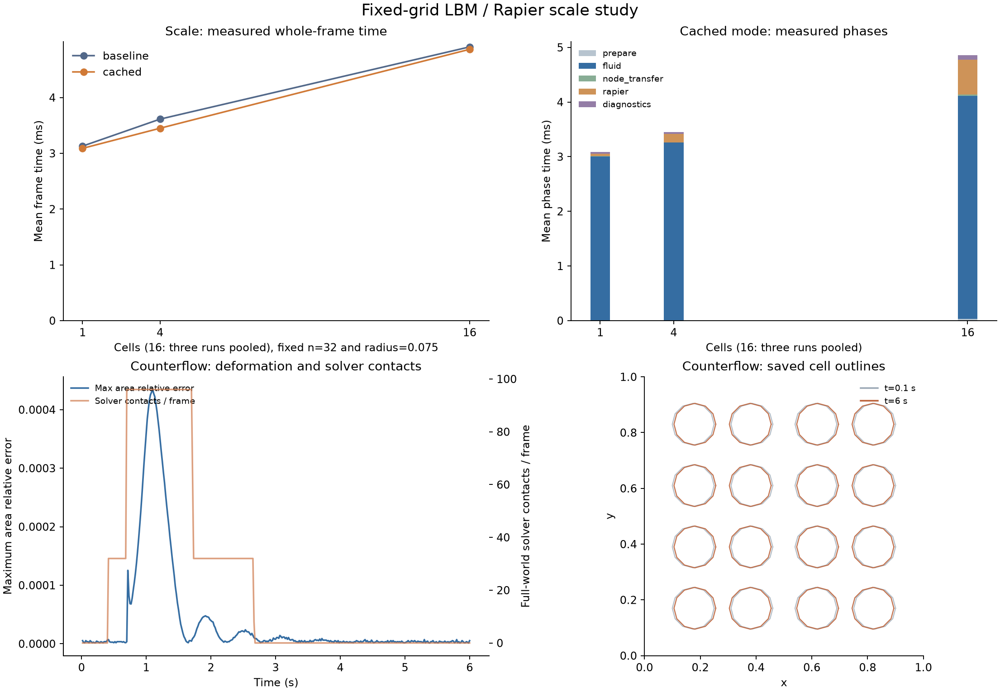

# 子步采样核复用与 4 / 16 细胞规模实验

日期：2026-10-23。接续 [单细胞动态实验](2026-10-23-lbm-dynamics.md)。本轮按用户确认的方向减少重复计算，并测试多个细胞；全部工作仍在独立研究程序中，未修改主游戏或根 Cargo 依赖。

## 结论

**采样核复用没有改变本轮轨迹，但整体提速有限。** 五组相同场景的 baseline/cached 对照，所有非计时输出与轮廓一致。4 细胞整步均值约 3.45 ms、p95 4.57 ms；16 细胞三轮合并后均值约 **4.865 ms、p95 5.911 ms**，尚未达到有余量的 5 ms 目标。

16 细胞中的主要成本仍是流体推进及点力计算，均值约 **4.081 ms**。继续优化应拆解这部分，而不能只凭减少核构造次数就预计整体明显加速。16 细胞相向运动确实产生了求解器接触，6 秒内未观察到明显失稳。



## 1. 优化范围

上轮已经在每个 Rapier 子步开始时冻结标记位置与速度，再推进约 17 或 18 个 LB 步。本轮将不变的 Peskin 支持点、权重与权重和移到子步开始计算一次；标记到机械节点的回传索引也预先构造。

- baseline：每个 LB 步重建核。
- cached：每个 Rapier 子步重建核，其内部 LB 步复用。
- 每个 LB 步仍重新插值当前流速、计算阻力、散布反作用、进行碰撞传播。
- 每个物理子步仍重建标记几何；没有跨子步保留旧位置，也没有减少流体步数或反馈频率。

两种模式使用同一 f64 算法、τ=2、32² 网格、Γ=0.25/细胞、原来的有限性及冲量检查。节点回传保持原 f32 累加次序。所有细胞的标记一次汇入同一个流体场，未按细胞重复求整个流场。

独立小核对照引用旧归档模块，连续运行 17＋18 步；第二子步移动标记并跨周期缝。每步全格速度/密度、点冲量与网格冲量逐 bit 一致。随后五组完整 6 秒轨迹的全部非计时 CSV 列及轮廓，也在同一 harness 的两个模式间完全一致。

## 2. 规模与输入

保持 12 个机械节点、质量 1、膜 12 Hz、面积 30 Hz、阻尼 0.5。所有 scale 场景共用单位域、32² 网格及**固定细胞半径 0.075**，粒子半径约 0.0075。每细胞仍有四个无质量内部阻力点。

| 场景 | 细胞数 | 输入 |
| --- | ---: | --- |
| scale | 1 / 4 / 16 | 无初始重叠，同向初速 +0.05，随后无持续驱动 |
| counterflow | 16 | 4×4 排列，相邻成对列初速为 +0.05 / −0.05，随后无持续驱动 |
| reversal、squeeze | 1 | 单细胞交叉参照，半径 0.15，沿用上轮反向外力和挤压板输入 |

16 个半径 0.15 的细胞无法在单位域内无重叠排开，所以 scale 单独固定为 0.075；该半径在 1/4/16 的比较中始终相同。不能把这组单细胞物理结果直接等同于旧半径 0.15 的单细胞结果，也不能将它当作完整主地图的负载。

流体 x 周期，机械节点保留展开坐标；Rapier 尚未实现跨 x 周期缝接触。本轮布局和运行范围未依赖这种接触。标记保持完整 y 向核支持，没有裁剪墙外权重。

## 3. 性能结果

环境为 Xeon Gold 6330、单线程固定 CPU 2、Cargo release、非独占主机。每条轨迹 6 秒、360 帧；计时剔除前 30 帧，稳定性检查覆盖所有帧。p95 使用 nearest-rank。

| 细胞数 | baseline 整步均值 / p95 | cached 整步均值 / p95 | 样本口径 |
| --- | ---: | ---: | --- |
| 1 | 3.129 / 3.621 ms | 3.089 / 3.154 ms | 每模式一次轨迹，330 个计时帧 |
| 4 | 3.613 / 4.773 ms | 3.449 / 4.568 ms | 每模式一次轨迹，330 个计时帧 |
| 16 | 4.908 / 6.564 ms | 4.865 / 5.911 ms | 每模式三次轨迹合并，990 个计时帧 |

16 细胞初轮出现了没有改动的 Rapier 阶段也明显变慢的现象，因此只对这一规模补了两对反序测量。逐轮整步均值如下，保留全部观测，没有挑选最快一轮：

| 测量顺序 | baseline | cached |
| --- | ---: | ---: |
| 初轮 baseline → cached | 4.640 ms | 4.684 ms |
| 反序 cached → baseline | 5.244 ms | 5.581 ms |
| 再次 baseline → cached | 4.841 ms | 4.330 ms |

三轮的变化方向不一致。合并均值只相差约 **0.9%**，不能声称稳定的大幅提速；记录的 p95 改善也不能当作目标设备保证。所有重复轨迹的非计时数值与初轮完全一致。

16 细胞 cached 的合并阶段均值为：

| 阶段 | 均值 |
| --- | ---: |
| 核准备 | 0.033 ms |
| 流体推进、每步取速/点力/散布及交换结果采集 | 4.081 ms |
| 节点冲量回传及子步准备 | 0.022 ms |
| Rapier | 0.635 ms |
| 帧诊断 | 0.088 ms |
| 整步实测 | 4.865 ms |

baseline 的核准备时间包含在 `fluid_ms`，因此公平比较使用 `prepare_ms+fluid_ms`：16 细胞合并均值为 **4.250 → 4.114 ms**，约减少 3.2%。目前还没有把流体阶段进一步拆成取样、散布、碰撞与传播，不能把整个 4.081 ms 都归给其中某一项。

`whole_ms` 含研究用的节点两两距离诊断等开销，不含 CSV 与轮廓输出、渲染或游戏逻辑。该诊断按细胞数近似平方增长，表中已单独计时。各阶段 p95 不可直接相加，整步 p95 来自整步样本。

## 4. 稳定性与接触

所有模式都完成 6 秒，累计 12288 个 LB 步；中间最大时差 **0.000455729 秒**，小于 `1/2048`。未发现节点非有限、面积翻转或流体非正密度。16 细胞同向场景的最大交换冲量不平衡约 `1.30e-9`，包含返回 Rapier 时的 f32 累加舍入。

| cached 场景 | 密度范围 | 最大面积相对偏差 |
| --- | ---: | ---: |
| scale，1 细胞 | 0.9999830–1.0000170 | 0.000309% |
| scale，4 细胞 | 0.9999769–1.0000232 | 0.000530% |
| scale，16 细胞 | 0.9999785–1.0000215 | 0.000795% |
| counterflow，16 细胞 | 0.9999746–1.0000317 | 0.04345% |

同向漂移的三种 scale 场景没有记录到求解器接触，故不将其当作细胞碰撞验证。相向场景中，第 25 帧开始出现接触计数，共 136 帧非零，单子步最多 48 个求解器接触点；保存轮廓间的最短距离约 0.015，与两倍接触半径接近，支持输入确实触发了接触。

接触计数来自 `world.physics_pipeline.counters.solver.ncontacts`，属于全场求解器口径，可能含自接触或其他接触，不能标作纯 cell-cell 数量。节点间距离只是节点间距；独立轮廓距离从每 6 帧保存的多边形计算，不是每帧连续检测。

本次相向场景整步均值约 **4.245 ms**、p95 **5.925 ms**。它的面积变化很小，但只有较低初速和短时弱阻力输入，不足以证明高密度堵塞或快速挤压始终稳定。

## 5. 与旧参考及下一步

同一新 harness 的 baseline/cached 是本轮严格的行为一致性证据。跨旧 harness 的 reversal 物理输出也一致；旧 squeeze 有很小差异，不能称逐位一致：旧接触半径使用 `0.015f32` 字面量，新代码由 `0.15f32×0.1f32` 得到，两者相差一个浮点末位、约 `9.31e-10`。因此这不是逐位相同的输入；跨 harness 差异只作描述记录，没有用放宽容差充当通过证明。当前 A/B 输入完全相同，断言保持严格。

下一步优先拆分流体阶段，定位重复宏观量计算、取样/散布和碰撞传播的实际占比，再选择局部优化。核缓存已经减少了重复工作，但不能单靠它支撑 16 细胞稳定低于 5 ms，更不能据此外推 72 细胞。正式后端、地图覆盖范围和游戏接口仍未接入。

## 6. 复现与产物

[实验目录](experiments/2026-10-23-lbm-scale/README.md) 保存源码、原始帧数据、轮廓、环境与源码 SHA-256、重复测量顺序和独立分析。在仓库根目录运行：

```bash
python3 docs/research/experiments/2026-10-23-lbm-scale/run.py --cpu 2 --seconds 6
python3 docs/research/experiments/2026-10-23-lbm-scale/repeat16.py
python3 docs/research/experiments/2026-10-23-lbm-scale/plot.py
```

三项均成功。初轮 11 条轨迹加 4 条针对性重复，共 5400 帧；分析核对 A/B、时钟、稳定性与接触口径。Rapier 0.36.1 离线锁定构建通过；编译保留实验共享模块未使用接口的 dead-code 警告。未运行 Godot 或 UI 自动交互。
