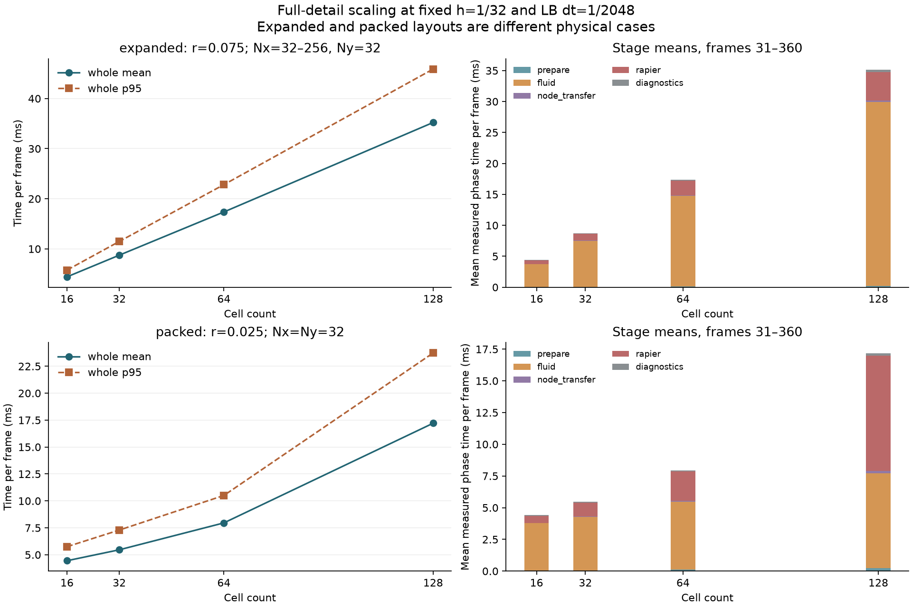

# 16–128 细胞规模实验与分级模拟建议

日期：2026-10-23。接续 [核复用与 4 / 16 细胞实验](2026-10-23-lbm-scale.md)。本轮使用独立 Rust 探针扩大细胞数，并核查正式游戏的活跃范围；未更换游戏流体后端，也未实施区域切换或新增依赖。

## 结论

**分级模拟值得做，需要同时限制详细细胞数量和流体网格覆盖范围。** 保持细胞大小、密度与格距，连同流场一起扩展时，32 / 64 / 128 细胞整步均值为 **8.75 / 17.37 / 35.22 ms**。固定 32² 小网格、统一使用更小细胞时，分别为 **5.46 / 7.96 / 17.21 ms**；这组只是低分辨率点阻力容量实验，不是等精度替代。

本轮八组都完成 6 模型秒，未触发节点非有限、面积翻转、非正密度或冲量失配检查。各组 p95 均超过 5 ms。不能把单个平均值当成正式地图的细胞上限；运行环境非独占，探针没有绘制、游戏逻辑与区域切换，也没有标定游戏单位。

建议沿已批准的世界架构先采用两层：近处保留详细软体、接触及必要的局部流场，远处只推进区域指标与全局循环网络。若镜头内本身需要上百个可推挤细胞，再研究可见对象简化和求解器优化；仅关闭远处模拟无法解决这部分近景成本。



## 实验口径

所有细胞均为 12 节点软体，质量 1、膜 12 Hz、面积 30 Hz、阻尼 0.5；每细胞四个内部阻力点，总阻力系数 Γ=0.25。每个 Rapier 子步准备一次支持核，每个 LB 步重新采样流速、计算点力和散布反馈。所有细胞共享一个流体场。

两组均采用 f64 D2Q9、τ=2、ν=1，格距 `h=1/32`、`dt_LB=1/2048` 不变。每帧推进 `1/60` 模型秒，包含两个 Rapier 子步和 34 / 35 个 LB 步；六秒累计恰好 12288 个 LB 步。细胞均有初始 x 速度 +0.05，此后没有持续外力输入。

| 布局 | 16 / 32 / 64 / 128 细胞的域和网格 | 细胞半径 | 回答的问题 |
| --- | --- | ---: | --- |
| expanded：等密度扩展 | 宽度 1 / 2 / 4 / 8，高度 1；网格 32×32 / 64×32 / 128×32 / 256×32 | 固定 0.075 | 相同大小和分辨率下，更多世界区域都详细运行的成本 |
| packed：固定域增加数量 | 始终为单位域、32×32；分别排成 4×4 / 8×4 / 8×8 / 16×8 | 固定 0.025 | 不扩大流场时，更多软体和耦合点的成本 |

expanded 在每个单位宽度内重复相同的 4×4 布局。packed 的半径在四个数量之间保持一致，初始无重叠；但它与 expanded 的半径、密度、阻力点分布不同，不能当作同一物理场景比较精度。packed 的细胞直径只有 **1.6 个格距**，没有解析细胞边界和窄缝流动，不能宣称流体误差只有百分之几或已验证真实堵塞。

流体 x 周期、y 固定墙；机械节点的 x 坐标保持展开，Rapier 没有跨周期缝接触。流体质量按整个矩形面积积分，初始参考质量等于域宽。扩展 16 细胞组的所有非计时 CSV 字段及轮廓，与上一轮相同输入的 cached 组完全一致。

## 性能结果

Xeon Gold 6330、单线程固定 CPU 2、离线锁定 Cargo release。每例一次 360 帧轨迹，性能剔除前 30 帧；p95 使用 nearest-rank。主机非独占，本轮看规模趋势，不对几十分之一毫秒的差异作优化结论。

| 细胞数 | 等密度扩展：均值 / p95 | 固定 32² 小域：均值 / p95 |
| ---: | ---: | ---: |
| 16 | 4.422 / 5.769 ms | 4.448 / 5.751 ms |
| 32 | 8.747 / 11.483 ms | 5.463 / 7.295 ms |
| 64 | 17.370 / 22.821 ms | 7.960 / 10.506 ms |
| 128 | 35.222 / 45.878 ms | 17.210 / 23.734 ms |

本轮 expanded-16 的轨迹与上一轮一致，但计时均值不同；这与前轮已观察到的运行间波动相符，不代表算法变快。

### 成本在哪里

以下均为帧 31–360 的阶段均值，单位 ms：

| 布局 / 数量 | 核准备 | 流体及点力 | 节点回传 | Rapier | 诊断 | 整步 |
| --- | ---: | ---: | ---: | ---: | ---: | ---: |
| expanded 16 | 0.030 | 3.712 | 0.020 | 0.576 | 0.079 | 4.422 |
| expanded 32 | 0.059 | 7.431 | 0.042 | 1.129 | 0.077 | 8.747 |
| expanded 64 | 0.114 | 14.675 | 0.077 | 2.316 | 0.168 | 17.370 |
| expanded 128 | 0.222 | 29.727 | 0.179 | 4.652 | 0.382 | 35.222 |
| packed 16 | 0.031 | 3.743 | 0.020 | 0.569 | 0.080 | 4.448 |
| packed 32 | 0.058 | 4.219 | 0.039 | 1.093 | 0.046 | 5.463 |
| packed 64 | 0.119 | 5.363 | 0.076 | 2.313 | 0.071 | 7.960 |
| packed 128 | 0.223 | 7.502 | 0.172 | 9.102 | 0.163 | 17.210 |

expanded 中流体及点力阶段约占整步 **84%–85%**，随域面积和细胞数一起增长。只简化远处软体、仍保留全图详细 LBM 网格，不足以消除主要开销。固定网格后流体阶段增长较缓，但每个 LB 步的点力仍随细胞数增加；128 个密集小软体的 Rapier 阶段也变得很贵。

`fluid_ms` 仍包含采样、点力、散布、碰撞传播和交换结果采集，本轮未进一步拆分，不能归因于其中某个操作。`whole_ms` 包含诊断，排除初始化、CSV / 轮廓输出、渲染和游戏逻辑。扣除诊断后，128 细胞两组整步均值仍分别约 34.84 和 17.05 ms，结论不由诊断开销主导。

节点两两距离诊断为 O(N²)：16 细胞每帧运行，更大数量仅首帧、每 30 帧及末帧运行，其余记录 `inf`。因此诊断均值不宜当作统一频率的规模曲线；有限性、面积、流体密度、时钟和冲量检查没有降频。

### 128 个小细胞的接触计数

仅 packed-128 在全部 360 帧出现求解器接触计数，单子步最多 **1200 个接触点**；这不是 1200 对细胞，也不证明已经挤压。其他七组该计数为零。

Rapier 0.36.1 默认预测距离是 `0.02 × length_unit`，本探针没有改变默认 `length_unit=1`。软体表面 contact skin 使用粒子半径，packed 两体 skin 合计约 0.005。源码中顶点—边和边—边判定允许正间距的预测接触，因此几何间距小于约 0.025 时便可能生成约束；更远的点也可能因运动预测进入候选。packed-128 的最小采样节点距约 **0.00998**，大于两侧粒子半径和 0.005，与预测接触计数不矛盾。

依据为锁定版本源码 `integration_parameters.rs` 的默认参数、`soft_body_set_proxies.rs` 的 contact skin、`soft_contacts_vertex_pass.rs` / `soft_contacts_edge_pass.rs` 的预测判定，以及 `staged_island_solver/init.rs` 的计数。`ncontacts` 是全物理世界提交求解器的接触点数，可能包含自接触。采样距离既不是连续最短边界距离，也没有周期最小镜像处理。

这提示后续可以检查预测距离与细胞尺度是否相称；本轮没有调小它或做 A/B，不能量化它对 9.102 ms 的贡献，也不能据此删除有效接触保护。

## 稳定性及适用范围

检查覆盖全部 **2880 帧**。八组累计 LB 步数各为 12288，最终时差为零，中间最大绝对时差约 0.000455729 模型秒，小于一个 LB 步。最大流体—细胞交换冲量不平衡为 `6.9842e-8`，未放宽既有 `1e-6` 检查。

所有数据合计：流体密度范围 **0.999964395–1.000035789**；最大软体面积相对变化约 **0.00954%**；没有节点非有限或面积翻转。流体总质量在 CSV 的九位小数精度下与初始面积一致，这不代表浮点计算数学上严格零误差。

面积变化小和密度稳定只说明这些输入下没有观察到失稳，不是对真实流体的误差估计。这一轮主要是同向漂移，尚未覆盖百细胞相向碰撞、狭窄血管、持续拥堵、局部开口边界或镜头切换；既有 16 细胞相向实验的结果不能自动外推。

## 分级模拟的落点

### 当前游戏还没有按可见范围省掉模拟

[世界架构](../superpowers/specs/2026-10-21-world-architecture-design.md)已确认远处区域指标、附近详细现场、相邻活跃区域共享一个 Rapier 世界，以及重要对象保留身份。当前第一阶段仍让全部 72 个软体参与两个子步的驱动、物理和快照。

代码依据为 [runtime.rs](../../crates/simulation/src/runtime.rs) 的全量 `self.cells` 推进和快照、[cell.rs](../../crates/simulation/src/cell.rs) 的 `can_sleep(false)`、[world.gd](../../godot/world.gd) 的 tick / snapshot / 绘制。只裁剪快照会省桥接和显示，不能停止详细物理。

默认 1280×800 视口、24 像素/世界单位和默认相机缩放，对应约 53.33×33.33 世界单位。按复制的地图与布点规则[独立复算](experiments/2026-10-23-lbm-many/estimate_view.py)，出生视野内约有 **21 个细胞中心**，而全图 72 个都在运行。此数是估计，未启动 Godot 测量；浮点临界点、窗口尺寸和相机平滑会影响实际画面。它说明可调查的活跃范围差异，不给出 LOD 提速倍数。

### 首选两层，必要时增加可见简化层

| 层级 | 计算内容 | 取舍 |
| --- | --- | --- |
| 近处及屏幕外缓冲 | 详细软体、接触、与玩法相关的流体反馈；若最终选定 LBM，仅覆盖必要局部 | 保留推挤和形变，仍需严格控制活跃数量与格数 |
| 远处 | 已批准的区域指标与全局 0D 循环网络；普通细胞不保留逐体软体和网格 | 保留交通及玩法状态，普通群体回访时不保证原队形 |
| 可选中层，暂不实现 | 镜头边缘或不互动对象使用刚体代理，完全无需碰撞时可用运动学表现 | 可容纳更多可见交通，但失去部分形变或推挤，需要新增切换规则 |

显示 LOD 和模拟 LOD 可以独立安排。Epic 的 [Mass Gameplay 官方文档](https://dev.epicgames.com/documentation/en-us/unreal-engine/overview-of-mass-gameplay-in-unreal-engine)也区分表示与模拟层级，并允许模拟变频；这只支持工程方向，不构成本项目性能证据，也不建议引入 Unreal 的框架。

现阶段推荐两层的理由是：方向已在世界架构中确认，减少远处对象与格子直接对应本轮的主要成本，且切换种类较少。可见范围如果确实要求上百个软体一起挤压，远处抽象能节省的部分有限，需要继续优化近景；本轮不承诺某个总细胞数或活跃数必然低于 5 ms。

### 流体分级还要单独解决边界

远处的全局阻力网络可以保留流量分配，近处网格研究局部扰动。但目前探针是周期通道，尚未证明网络与局部开放窗口的连接可行。后续需要用同一输入比较完整通道与局部窗口，测量流量、细胞受力、速度扰动和窗口切换峰值，再判断是否满足用户接受的几个百分点误差。

局部开口不能当成封闭墙，同一端口的压力和流量也不能任意独立指定；还需定义二维流量与网络单位的对应。低雷诺数下压力扰动会向远处传递，局部反馈如果要改变全局分流或堵塞阻力，需要另行设计网络反馈，不默认已经实现。

对象激活范围应包含不可见缓冲，正在交互的重要对象维持详细模拟，交接时保持位置、速度和数量含义一致。局部 LBM 窗口新建或平移还涉及初始化与流场过渡，不能把创建窗口当作零成本操作。

本轮也不建议直接减少每帧 LB 步数：在相同 dt 下少推进，只会让流体物理时钟落后。远处改用独立区域模型是明确的近似；不同格距或不同步长的 LBM 网格耦合则是另一项算法工作。先限制覆盖范围，不优先引入多层自适应网格。

进入实施前，关键内容预算是“典型镜头可见多少细胞，其中多少必须真实推挤”。已有远处抽象方向无需重选；可见代理层、区域具体划分和局部流体端口属于尚待确定的方案，本轮没有直接落地。

## 复现与验证

[实验目录](experiments/2026-10-23-lbm-many/README.md)保存 Rust 源码、锁文件、逐帧 CSV、轮廓、环境和源码 SHA-256、汇总数据及绘图脚本。

```bash
python3 docs/research/experiments/2026-10-23-lbm-many/run.py --cpu 2 --seconds 6
python3 docs/research/experiments/2026-10-23-lbm-many/analyze.py
python3 docs/research/experiments/2026-10-23-lbm-many/estimate_view.py
cargo fmt --manifest-path docs/research/experiments/2026-10-23-lbm-many/rapier/Cargo.toml -- --check
git diff --check
```

本轮运行及分析完成，expanded-16 与旧数据的非计时输出严格一致。分析核对所有帧、时钟、数值有限性、轮廓覆盖与诊断口径，汇总图已查看。构建保留共享实验接口的四项 dead-code 警告。没有修改或重新验证正式游戏，也没有运行 Godot / UI 交互；上述结果均属于独立研究程序。
