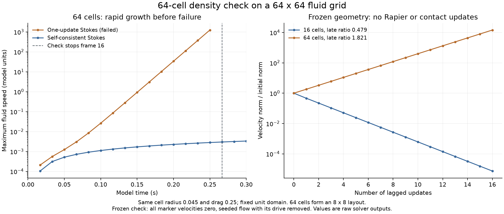

# 64 细胞密集场景：一次更新反馈失稳

后续进展：[点力欠松弛实验](2026-10-26-stokes-relaxation.md)已完成所测64细胞六秒轨迹；本文保留无欠松弛失败和自洽对照，当前任务见[状态与待办](../STATUS.md)。

日期：2026-10-26。用户要求把[热路径实验](2026-10-26-stokes-hotpaths.md)扩大到 64 个细胞。流体网格保持 64²、单位方域，细胞半径仍为 0.045，总阻力 Γ=0.25、质量、材料和时间步保持原值。本轮发现的主要限制是耦合稳定性，不能仅报告失败前的耗时。

## 结论

**当前一次更新 Stokes 不能直接用于这个高密度 64 细胞布局。** 优化/基线、串行/四线程四种组合都在第 16 帧（约 0.27 模型秒）触发原有冲量失配检查并停止。四组完整保存的前 15 帧物理字段、细胞轨迹、轮廓和流场输出一致，所以该失败不是并行化或缓冲复用单独引入的。

同一场景改用已有的完全自洽 Stokes 作为诊断对照，优化版四线程完成 6 模型秒、360 帧；整步均值 **40.922 ms**、p95 **48.914 ms**，仍远超 5 ms 目标。这是一次对照轨迹，非性能保证。



## 输入与边界

- 64 个细胞排成 8×8，两个坐标方向的中心均从 0.11 均匀分布到 0.89，间距约 0.11143；半径 0.045，初始没有轮廓重叠。相对 16 细胞实验，本轮在相同域、相同格距和细胞大小下增加密度，不是等密度扩大域的测试。
- 细胞直径仍为 5.76 格，每细胞 12 个机械节点、4 个内部流体标记，共 768 节点、256 标记。材料、阻尼及阻力完全沿用原 harness。
- 第 3 列、第 3/4 行（零起算，cell 27/35）的两个细胞受 x 向外力 0.18，持续 0.5 秒；其余不直接施力。新布局需要相应调整驱动对象索引。
- 仍为周期直管，不含不规则流体墙或开放窗口。60 Hz、两个机械子步、profiling 关闭。默认 Rapier 接触设置没有调参；首帧已有全局求解器接触计数，不能把这一密集场景当作无接触传力验证。
- 原有 solver crate 和历史数据均未改动。新 harness 只增加 64 细胞布局和驱动索引，引用上一轮基线/优化求解器。

## 失败如何出现

一次更新的四组均保存到第 15 帧，并在第 16 帧报：

```text
exchange mismatch 0.0000027010929870365083
```

没有放宽原有 `1e-6` 检查阈值。在触发检查前，流场和阻力律残差已经明显放大：

| 帧 / 模型时间 | 最大流速 | 最终阻力律 RMS |
| --- | ---: | ---: |
| 1 / 0.0167 s | 0.000207 | 0.0000803 |
| 5 / 0.0833 s | 0.00853 | 0.00625 |
| 10 / 0.1667 s | 3.063 | 2.512 |
| 15 / 0.25 s | 1235.148 | 1013.542 |

这些值是模型单位；从小驱动下持续放大的趋势可以判断发生数值反馈失稳。不能通过放宽最终停止阈值将它视为可用解。失败案例没有进入性能汇总，原定的第二轮计时也未执行；失败前不足热身长度的样本不用于宣称实时性能。

## 隔离反馈与碰撞

为判断是不是 Rapier 接触导致，另做了一个很小的冻结几何诊断：取各实验第 1 帧记录的真实轮廓，生成相同的四点位置，固定所有标记速度为零。先用无细胞泊肃叶解给流场一个初始扰动，再撤去背景驱动，连续执行 16 次 lagged 更新；不运行 Rapier、不更新位置或接触。相同输入的自洽解经程序断言为全零速度。

| 冻结布局 | 最后几次的速度场范数比 `||u_next|| / ||u_prev||` | 结果 |
| --- | ---: | --- |
| 原16细胞布局 | 约 0.47874 | 扰动交替换向并衰减 |
| 新64细胞布局 | 约 1.82053 | 扰动交替换向并放大 |

这里的比值是指定初始扰动和布局下的实际迭代测量，不是对任意细胞配置给出的稳定性界限。两种布局的细胞大小、单体阻力和网格一致，密度与位置不同。

固定位置、速度和外驱动时，当前更新为 `F_next=R(V−Ju_prev)`、`u_next=K(f₀+SF_next)`，因此相对自洽解的误差满足 `e_next=−KSRJ e_prev`。该冻结诊断直接观察到 64 细胞布局中存在被放大的扰动，支持失败来自一次更新耦合近似，而非并行竞态或碰撞所必需。只增加 CPU 线程或加速 FFT，不会改变这个反馈映射。

## 自洽诊断对照

同一 64 细胞场景、优化版四线程、完全自洽 Stokes，完成全部 360 帧。去掉前 30 帧后：

| 阶段 | 均值 | p95 |
| --- | ---: | ---: |
| 流体及回传准备 | 36.985 ms | 43.152 ms |
| Rapier 及节点冲量施加 | 3.812 ms | 5.826 ms |
| 整步 | **40.922 ms** | **48.914 ms** |

整步最大有效帧为 190.537 ms。主机非独占，使用同一插槽不同物理核心 CPU2–5、release、文件锁串行测量。计时不含初始化、CSV/快照写入、绘制和游戏逻辑；阶段 p95 不可相加。

全程最大流速约 0.005162、最大面积相对偏差约 0.1484%、最大界面冲量失配 `1.3e-11`、最大阻力律 RMS `7e-12`，未触发非有限、面积翻转或交换检查。全局求解器接触数最多 284（不等于细胞对数）。该短时对照说明同一输入可以由自洽求解完成，但既不代表长期拥堵验证，也没有足够实时余量。

## 后续含义

16 细胞下成立的一次更新近似，不能直接外推到固定小域中的 64 个细胞。下一步需要先选择稳定且较便宜的耦合更新方式，再研究其并行性能；本轮未擅自降低阻力、缩小细胞、放宽检查或加入新的稳定化算法。

这不是“任何64细胞场景都不可行”的结论。扩大流场保持密度、改变布局或改变耦合模型会得到不同问题，但需要独立验证，不能与本轮同密集场景混为一谈。

## 产物与复现

- [实验入口与命令](experiments/2026-10-26-stokes-64-cells/README.md)
- [四个失败案例的完整原始记录与摘要](experiments/2026-10-26-stokes-64-cells/results/summary.json)
- [自洽对照摘要](experiments/2026-10-26-stokes-64-cells/reference-results/summary.json)
- [冻结反馈诊断](experiments/2026-10-26-stokes-64-cells/frozen-results/summary.json)

`run.py` 按设计保留失败并返回非零，`run.py --reference` 和 `run_frozen.py` 成功。`analyze.py` 核对来源哈希、记录连续性、有限值、失败组输出一致性、范数比与交替方向；失败案例始终标为失败。没有新增正式产品测试、运行 UI 或改变正式工作区依赖。
