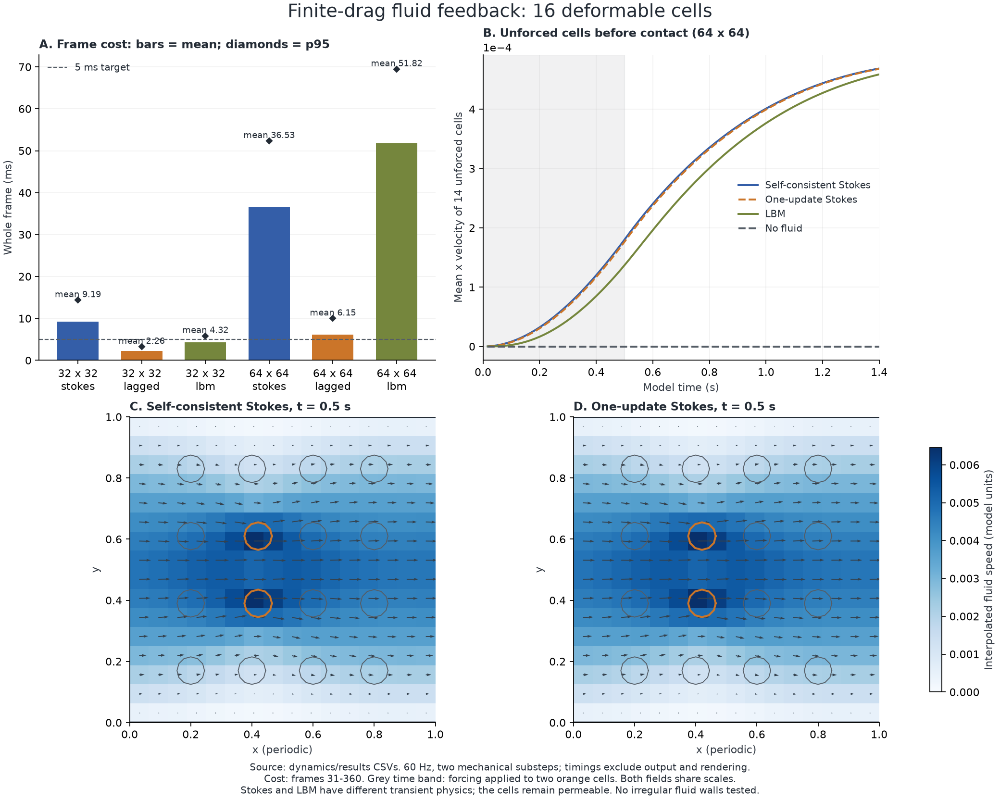

# 有限阻力 Stokes：保留局部流体反馈的成本

日期：2026-10-26。用户批准三个 `gpt-6-sol` 子 agent 做独立调研与实验。目标是近景几十个细胞具有真实局部流体反馈，同时接受可渗透近似；本轮没有替换正式游戏后端、增加正式依赖或实现区域切换。

## 结论

**沿用前一子步流场、每个子步只做一次完整 Stokes 更新，是值得继续研究的便宜候选。** 在本轮 16 细胞、32² 网格、六秒的低速推动场景中，整步均值 **2.262 ms**、p95 **3.255 ms**，与同网格自洽 Stokes 的最大细胞中心位置差约 **5.98e-6 模型单位**。在没有接触的阶段，未直接施力的细胞产生了运动，无流体对照保持静止，支持确有流体传力。

**它还没有解决较细网格和几十至数百个近景细胞的预算问题。** 相同 16 细胞场景提高到 64² 后，一次更新方案整步均值 **6.146 ms**、p95 **9.987 ms**。完全自洽 Stokes 更贵；本轮也没有测 32 细胞的一次更新方案。不能将 16 细胞的小域结果外推到正式地图或百细胞拥堵。

图 A 的柱为整步均值，菱形为 p95；图 B 仅画前 1.4 秒，所有所示场景尚无求解器接触计数；图 C/D 使用同一速度色标和箭头尺度，橙色细胞受到外力。画出的流场是实际输出的插值速度，细胞轮廓是实际 Rapier 快照，未人为放大细胞位移。图像只用于检查数值结果，不替代游戏体验验收。

## 比较了什么

流体域为单位方形，x 周期、上下平直固壁；黏度为 1。细胞沿用 Rapier 0.36.1 的 12 节点软体，半径 0.045、质量 1、膜频率 12 Hz、面积频率 30 Hz、阻尼 0.5。每细胞四个内部流体点，总阻力 Γ=0.25，标记位于选中节点与质心的中点。

所有动态案例以 60 Hz 推进，每帧包含两个 Rapier 子步。指定的两个细胞各受到 x 方向 0.18 的外力，持续 0.5 秒，然后撤力；无背景流。每例运行 6 模型秒、360 帧。16 细胞采用较疏布局，32 细胞增加横向密度；两者半径相同。

| 模式 | 每个机械子步的流体计算 | 含义 |
| --- | --- | --- |
| 自洽 Stokes | 固定当前标记位置和速度，迭代解 `(R⁻¹+JKS)F=V−Ju₀`，最后重解流场 | 当前时间层的阻力与流速满足同一力律；Rapier 仍是交替显式耦合 |
| 一次更新 Stokes | 在当前标记位置采样前一子步流场，算 `F=R(V−Ju_old)`，再求一次完整 Stokes | 有意保留时间滞后；新场不严格满足同一步阻力律 |
| LBM | 沿用已有 D2Q9、τ=2；按流体时钟推进全部内部步，每格步重新计算点力 | 保留流体时间惯性与弱可压性，不能把与 Stokes 的动态差异全称为数值误差 |
| 无流体对照 | 同样的 Rapier、外力、接触与阻尼，不施加流体反馈 | 用于识别未接触阶段的传力来源 |

MAC Stokes 沿用规则通道的 FFT/Thomas 速度逆与压力 Schur 求解。本轮没有加入多重网格、不规则墙算子、GPU 或新线性代数依赖。点力插值和散布采用同一权重，回传 Rapier 的反冲量只乘一次实际子步时间。准稳态流体没有储存的惯性动量，交换检查衡量的是界面施力与回传冲量的一致性。

## 动态整步成本

下表来自同一 harness，单线程 release、固定 CPU 2、共用文件锁串行测量；主机非独占。每例一次完整轨迹，计时排除前 30 帧，p95 使用 nearest-rank。整步包含流体、节点回传、两个 Rapier 子步及诊断，排除初始化、CSV/场输出、绘制和游戏逻辑。

| 细胞 / 网格 | 方法 | 均值 | p95 | 最大值 |
| --- | --- | ---: | ---: | ---: |
| 16 / 32² | 自洽 Stokes | 9.190 ms | 14.359 ms | 14.723 ms |
| 16 / 32² | 一次更新 Stokes | **2.262 ms** | **3.255 ms** | **3.313 ms** |
| 16 / 32² | LBM | 4.320 ms | 5.843 ms | 5.991 ms |
| 16 / 64² | 自洽 Stokes | 36.530 ms | 52.344 ms | 61.606 ms |
| 16 / 64² | 一次更新 Stokes | **6.146 ms** | **9.987 ms** | **10.556 ms** |
| 16 / 64² | LBM | 51.821 ms | 69.467 ms | 70.046 ms |
| 32 / 32² | 自洽 Stokes | 11.220 ms | 16.613 ms | 18.705 ms |
| 16 | 无流体对照 | 0.579 ms | 0.789 ms | 0.999 ms |
| 32 | 无流体对照 | 1.456 ms | 1.962 ms | 2.531 ms |

一次更新仍每个机械子步解流场，本轮没有通过低频刷新摊薄平均成本。32² 与 64² 的细胞直径分别为 2.88 和 5.76 格，均不解析密封膜和薄缝；加密改善的是这个有限阻力模型的空间表达。两层网格不能证明真实红细胞误差，也没有对正式游戏单位作标定。

## 反馈是否真实存在

16 细胞在第 15 帧（0.25 秒）均没有求解器接触，驱动组与非驱动组之间的采样边界间隙约为 0.0955。32² 下未驱动细胞最大 x 速度绝对值分别为：

- 自洽 Stokes：`7.69e-5`；
- 一次更新 Stokes：`7.35e-5`；
- LBM：`4.96e-5`；
- 无流体对照：`0`。

这支持本场景中由流体传递作用，而不是接触把邻居推走。其幅度仍弱：是否达到游戏里可感知的程度，需要对应显示尺度和实际操控再判断。

16 细胞的无流体对照从第 87 帧出现求解器接触，三种流体模式从第 105 帧出现；后续邻居速度同时受接触影响，不能把全程位移都解释成流体传力。32 细胞从首帧就有接触计数（初始几何仍留有间距），包含预测接触的可能性，故不将其当作独立流体传力证据。

## 近似误差与稳定性

同网格自洽与一次更新 Stokes 的逐帧细胞中心比较：

| 网格 / 16 细胞 | 最大中心距离差 | 最大中心速度向量差 |
| --- | ---: | ---: |
| 32² | `5.98e-6` | `2.29e-5` |
| 64² | `6.45e-6` | `8.26e-6` |

一次更新的最大最终阻力律 RMS 为约 `8.0e-5`（速度单位），自洽动态参照最大约 `9e-12`。两者不使用同样的闭合验收标准；前者明确是时间滞后近似。位置接近不意味着全部流体场都同样接近，也不能外推到强阻力、快速推挤和高密度堵塞。

九条轨迹共 3240 帧完成，未触发非有限状态、面积翻转或交换冲量检查。16 细胞流体场景最大面积相对偏差约 0.01%，界面冲量失配不超过 `1.76e-10`。所有场景中最大面积偏差约 0.162%，出现在 32 细胞无流体对照。LBM 的累计时间余量小于一个格步，六秒终点对应的累计格步数一致。

静态探针给出一个重要反例：若直接从无细胞背景场计算一次多细胞点力，32²/16 的最终阻力律 RMS 约为 `0.0265`，相对于规定运动速度 0.1 的量级约为 26%；它的流量也明显偏离自洽值。因此不能把“一次更新”普遍称为几个百分点的近似。本轮动态之所以接近，适用条件是连续的小时间步、弱阻力和逐渐变化的运动；还未验证快速场景切换。

## 仍未解决的边界

- 求解器只支持规则周期通道，标记的插值核若碰到固壁就显式拒绝。尚无真实宽窄血管、分岔、开放窗口或细胞近壁实验。
- 四点模型可渗透，不能保证轮廓占满管道后能截流；正式全局血管网络也没有接收局部反馈。
- 一次更新只测 16 细胞；32/64/128 细胞容量、强推动、长期拥堵和目标设备性能不能由本轮推断。
- 阻力场与流体网格仍需要限制覆盖范围；本轮没有实施 LOD，也没有通过减少物理时间推进来换速度。

研究建议是继续保留一次更新 Stokes 作为候选，但暂不替换正式后端。若继续，最有价值的决策点是：先优化 64² 的完整 Stokes 求解，还是优先选择固定不规则血管墙的处理方式。后者会改变求解器成本，不能只依据规则通道的速度作产品选择。

## 产物与验证

- [实验入口与范围](experiments/2026-10-26-stokes-feedback/README.md)
- [静态求解器、复现命令与原始数据](experiments/2026-10-26-stokes-feedback/solver/README.md)
- [动态实验、复现命令与限制](experiments/2026-10-26-stokes-feedback/dynamics/README.md)
- [一手资料研究](experiments/2026-10-26-stokes-feedback/review/notes.md)与[独立数值核查](experiments/2026-10-26-stokes-feedback/review/audit.md)
- [整步统计](experiments/2026-10-26-stokes-feedback/dynamics/results/summary.json)与[逐细胞轨迹差](experiments/2026-10-26-stokes-feedback/dynamics/results/comparisons.json)

实验构建与运行使用已有离线 Rust/Rapier 依赖。静态参照与旧单细胞 dense-mobility 解的合力交叉核对一致；动态运行与 `analyze.py` 成功。主 agent 重新执行动态分析和 `plot.py`，查看实际输出图，核对源码哈希、文档链接和产物边界。静态 crate 的 `cargo fmt --check`、动态自有源码的 `rustfmt --check --config skip_children=true`、两个独立 crate 的 `cargo check --offline --locked` 均通过；动态构建保留只读引用旧 LBM 模块的四项 dead-code 警告。独立审计的 `review/audit_data.py` 复算所有最终数据，命令与结果见审计记录。未运行正式游戏或 UI 交互，未增加永久产品测试或 CI。
