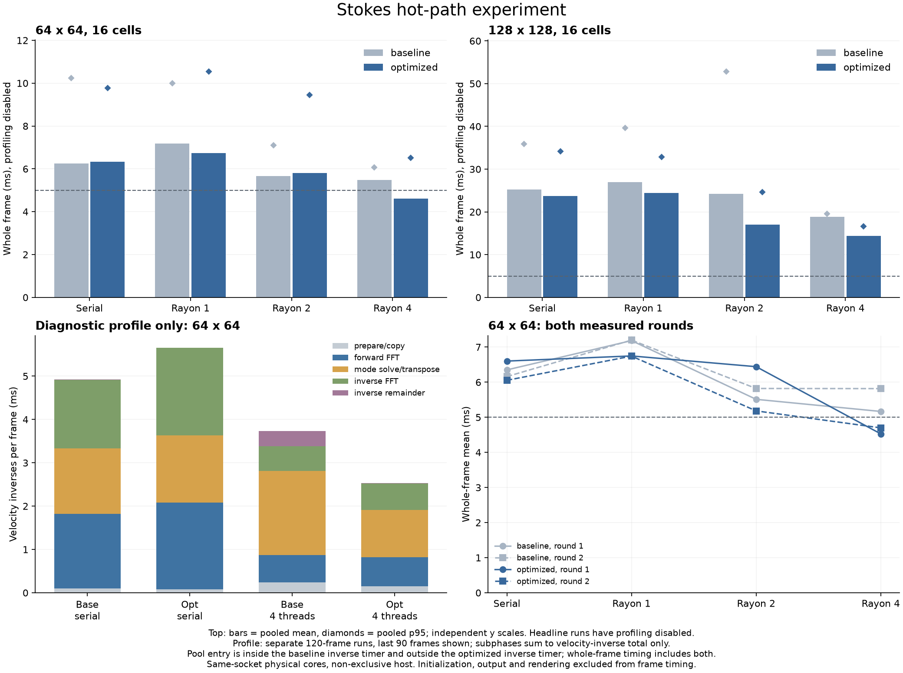

# Stokes 热路径实验：缓冲复用与粗粒度并行

后续进展：已继续完成[64细胞诊断](2026-10-26-stokes-64-cells.md)与[欠松弛实验](2026-10-26-stokes-relaxation.md)。本文保留当时的性能对照，当前任务见[状态与待办](../STATUS.md)。

日期：2026-10-26。接续 [Rayon 并行实验](2026-10-26-stokes-rayon.md)。用户批准先做分段计时、缓冲复用和粗粒度并行。本轮仍使用现有 MAC Stokes、有限阻力和 Rayon，不新增 RustFFT，不更换方程或正式游戏后端。

## 结论

**64²、16 细胞、四线程的整步均值降到 4.613 ms，但 p95 为 6.516 ms，仍未稳定达到 5 ms。** 同轮基线均值为 5.492 ms、p95 为 6.063 ms；优化版均值加速约 1.19 倍，但 p95 略有退步。不能把均值低于 5 ms 当作整步目标已经完成。

128² 四线程的均值由 18.813 降到 14.399 ms，p95 由 19.603 降到 16.649 ms，均值加速约 1.31 倍。64² 的串行、双线程均值没有改善，说明这组改动并非所有负载和线程数都获益。

所有非计时动态结果与基线一致，包括逐帧诊断、细胞中心/速度/面积、轮廓和流场快照；64² 基线串行还与上一轮归档一致。优化没有通过降低精度、减少模拟时间或关闭原有诊断换速度。

图上方使用关闭 profiling 的正式轨迹；下方左图是独立开启 profiling 的定位运行，不能混入主性能对比。该图的 inverse 总量包含四个子阶段，且两版本的线程池入口归属不同，详见后文。

## 实际改动

从上一轮保存两份独立 crate：`baseline/` 只增加默认关闭的可选细分计时；`solver/` 在同样埋点基础上做以下优化：

1. **进入线程池的位置外移。** 从每次速度逆求解进入 Rayon pool，改为一次完整 Stokes 更新进入一次。两个机械子步仍各更新流场一次；本场景每帧通常有 12–14 次速度逆，线程池入口由每帧 12–14 次变成 2 次。
2. **复用 FFT 与模式数组。** 实部、虚部和转置后的模式工作区在求解器构造时分配。每次调用完整覆盖输入并清零虚部，输出仍完整写回。没有引入 unsafe、逐格互斥或新的缓存框架。
3. **合并模式任务。** 同一模式的 gather 与 Thomas 前代/回代在同一任务中完成，然后按行 scatter；u/v 仍分两批。FFT 行、模式和 scatter 的 Rayon 迭代采用 `.with_min_len(4)`，限制过细分割，不保证实际任务数恰好等于线程数。
4. **减少临时分配和整场复制。** `apply_s` 的梯度/速度数组在单次完整 Stokes 求解内复用；已有上一子步流场直接借用采样，不再复制整个 prior 速度场。

dot、归约、CG 向量更新、梯度/散度以及点力散布仍串行。CG 的迭代方法、容差、节点回传、Rapier 更新和原有数值诊断不变。此次没有做每项优化单独开关的消融实验，因此只能将总体收益归于这组改动，不能为每项宣称独立加速倍数。

## 实验口径

与上一轮相同：16 个半径 0.045、12 节点软体，四个内部阻力点，总 Γ=0.25；两个指定细胞受 x 方向 0.18 的外力持续 0.5 秒后撤力。单位方域、x 周期、上下平直固壁，没有背景流。60 Hz，每帧两个机械子步，使用上一子步流场求点力的一次更新 Stokes。

- 原版/优化版 × 串行/Rayon1/2/4 × 64²/128²，正序和反序各一轮，同时交换原版与优化版的运行先后。
- 64² 每例 360 帧、128² 每例 120 帧，合计 **32 条主性能轨迹、7680 帧**。
- 每例排除前 30 帧，64² 每个版本/线程档合并 660 帧，128² 合并 180 帧，p95 按 nearest-rank 重新计算，不平均每轮 p95。
- 整步包含点构造、流体、冲量回传、Rapier 与诊断，排除初始化、文件/图像输出、绘制和游戏逻辑。细分 profiling 在主性能运行中关闭。
- 额外对 64² 的原版/优化版、串行/四线程各跑一条 120 帧 profiling 轨迹，共 **480 帧**；只取帧 31–120 做热点定位。
- 使用同一插槽不同物理核心：串行/Rayon1 为 CPU2，Rayon2 为 CPU2,3，Rayon4 为 CPU2–5。release、离线锁定依赖，文件锁确保本轮各案例串行测量；机器仍非独占。

主性能与 profiling 两类合计 8160 帧。短轨迹冒烟另在 `/tmp` 保存，不混入正式统计。初始化记录在每例 `init.csv`，不计入稳态整步。

## 主性能结果

表内为整步均值 / p95，均来自本轮原版和优化版的匹配对照，不能直接与不同时间运行的旧表比较加速倍数。

| 网格 | 模式 | 原版 | 优化版 | 均值加速 |
| --- | --- | ---: | ---: | ---: |
| 64² | 串行 | 6.256 / 10.239 ms | 6.328 / 9.779 ms | 0.99× |
| 64² | Rayon1 | 7.192 / 10.005 ms | 6.746 / 10.537 ms | 1.07× |
| 64² | Rayon2 | 5.667 / 7.100 ms | 5.813 / 9.440 ms | 0.97× |
| 64² | Rayon4 | **5.492 / 6.063 ms** | **4.613 / 6.516 ms** | **1.19×** |
| 128² | 串行 | 25.269 / 35.854 ms | 23.670 / 34.216 ms | 1.07× |
| 128² | Rayon1 | 26.946 / 39.629 ms | 24.415 / 32.826 ms | 1.10× |
| 128² | Rayon2 | 24.222 / 52.802 ms | 17.007 / 24.616 ms | 1.42× |
| 128² | Rayon4 | **18.813 / 19.603 ms** | **14.399 / 16.649 ms** | **1.31×** |

64² 四线程两轮原版均值 5.166 / 5.817 ms，优化版 4.528 / 4.699 ms；两轮均观察到均值下降。128² 四线程原版 19.258 / 18.368 ms，优化版 15.842 / 12.956 ms。两轮不足以给出长期稳定性或目标设备保证。

耗时尖峰仍明显。64² 四线程的最大有效帧从 90.854 降到 65.096 ms；128² 从 173.958 降到 142.363 ms。没有剔除这些尖峰，也未为了更好数字重复挑选运行。它们的具体来源仍未确定，不能把全部变化归因于代码或主机外部负载。

总 CPU 消耗也有所下降：64² 四线程两轮进程 CPU 时间从约 10.08 降到 8.11 秒，128² 从 10.35 降到 8.84 秒。这些值包含初始化和输出，仅用于了解总体处理器代价，不能当作纯流体计算量。

## 分段计时说明了什么

以下是额外 64² 四线程 profiling 轨迹的帧 31–120 均值，单位 ms/帧：

| 埋点 | 原版 | 优化版 |
| --- | ---: | ---: |
| 速度逆总量 | 3.729 | 2.527 |
| 其中：准备/复制 | 0.243 | 0.146 |
| 其中：正向 FFT | 0.623 | 0.670 |
| 其中：模式 gather / Thomas / scatter | 1.949 | 1.094 |
| 其中：逆 FFT | 0.567 | 0.612 |
| 压力相关梯度/散度埋点，位于速度逆之外 | 0.298 | 0.287 |

**速度逆总量不能与其子项相加。** 另一个重要口径变化是：原版每次 `pool.install` 在速度逆计时内，优化版的外层 `pool.install` 在这一计时外、仍在 fluid/whole 内。因此速度逆总量的下降不能全部解释为消灭的工作；尤其四子项以外的余数从约 0.348 降到 0.006 ms，包含了计时归属变化。真正净收益以关闭 profiling 的整步表为准。

这个窗口每帧固定 14 次速度逆；完整六秒窗口还包含每帧 12 次的部分。profiling 时间段、额外时钟开销和主机负载也与主性能运行不同，不能把这里的比例直接套用到全部帧。

仍可得到有用的优先级判断：优化版的正/逆 FFT 合计约 1.282 ms，模式求解及转置约 1.094 ms，压力梯度/散度埋点约 0.287 ms。**下一轮更值得检查 FFT 和模式处理，而不是把所有短向量循环一律改成并行。** 这只是本窗口的热点证据，未测到的 CG 向量运算也不能视作零成本。

## 数值与适用范围

静态独立探针覆盖 32/64/128²、0/1/2/4 线程、profiling 开关，以及已有 prior 场的 lagged 更新，共 28 组。原版和优化版的速度、压力、点力、采样速度、最终残差逐 bit 相同，迭代计数一致。

动态分析检查 36 条轨迹的所有非计时 frame 字段及完整逐细胞、轮廓、场快照记录一致。profile 开关未改变物理结果；速度逆埋点计数与压力迭代及流体调用次数相符，四个子阶段不超过速度逆包围时间。

这些结果只支持当前弱阻力短轨迹。正式游戏、局部开放窗口、不规则血管、近壁标记和百细胞规模仍未验证。32²/64²/128² 的求解器数值一致性不等于真实血细胞的精度验证，也没有新增密封膜模型。

## 后续建议

本轮可以保留为更合适的四线程候选，但仍不接入正式游戏。先根据分段计时继续比较 FFT/模式处理方案，才有依据决定是否引入支持 SIMD 和批量变换的 FFT 库。RustFFT、新压力求解算法或更一般的血管边界方案都未在本轮实施，仍是需要单独选择的路线。

## 复现与验证

- [实验入口和运行命令](experiments/2026-10-26-stokes-hotpaths/README.md)
- [原版埋点口径](experiments/2026-10-26-stokes-hotpaths/baseline/README.md)与[优化实现](experiments/2026-10-26-stokes-hotpaths/solver/README.md)
- [逐轮统计和独立 profiling](experiments/2026-10-26-stokes-hotpaths/results/summary.json)
- [源码与二进制哈希、CPU拓扑、顺序和命令](experiments/2026-10-26-stokes-hotpaths/results/manifest.json)
- [独立审计](experiments/2026-10-26-stokes-hotpaths/review/audit.md)

实际执行了 `run.py --smoke`、完整 `run.py`、`analyze.py` 和 `plot.py`；两份二进制离线锁定 release 构建、主性能与 profile 轨迹、非计时结果一致性检查均通过。主 agent 查看实际输出图，独立审计重算最终数据。Rust 格式检查与编译结果见各目录；只读引用旧 LBM 模块仍有四项 dead-code 警告。没有运行 UI 或正式游戏，没有新增永久产品测试或 CI。
