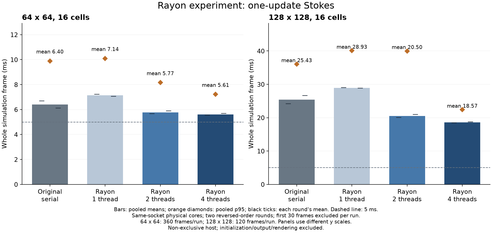

# Rayon 并行更新：收益、开销与耗时尖峰

日期：2026-10-26。用户已确认在独立实验中新增 Rayon，比较原始串行、1/2/4 线程的常驻线程池。本轮沿用[有限阻力一次更新 Stokes](2026-10-26-stokes-feedback.md)，没有更改物理模型、容差、更新时间步或正式游戏。

## 结论

**并行有收益，但本实现尚不能让 64²、16 细胞整步稳定低于 5 ms。** 正反序两轮合并，四线程使整步均值从 **6.403 降至 5.612 ms**，p95 从 **9.894 降至 7.217 ms**。均值加速为 **1.14 倍**，耗时下降约 **12.4%**。128² 短测的四线程均值从 **25.435 降至 18.566 ms**，约 **1.37 倍**加速，仍明显超过预算。

数值方面，所有并行模式与原始串行结果一致：静态非平凡求解的速度、压力、点力、采样速度全数组逐 bit 相同；16 条动态轨迹的非计时 frame 字段与全部细胞、轮廓、场 CSV 字节一致。新串行的 64² 轨迹也与上一轮归档一致，因此本轮没有靠降低精度或改变行为换时间。

四线程并非免费提速。64² 两轮合计进程 CPU 时间约从 **4.65 秒升至 8.87 秒**；128² 从 **6.10 秒升至 10.36 秒**。这些 CPU 时间还包含初始化和文件输出，不是纯流体核计时，但说明总处理器消耗增加。并行组还出现了更大的尾部尖峰，不能把平均提速当成帧时稳定性保证。

柱为两轮全部有效帧合并的均值，橙色菱形为合并 p95，短横线为各轮均值。两面板纵轴尺度不同；图没有隐藏失败案例或挑选最快一轮。

## 并行了什么

实验只新增 Rayon 1.12.0（锁文件包含 rayon-core 1.13.0 及传递依赖），使用本地缓存离线构建。原始求解器、动态 harness 复制到新的独立目录，旧源码和原始结果不改写。

`Stokes::with_threads(n, threads)` 中 `threads=0` 保留旧串行内存布局与循环；1/2/4 在构造时建立私有线程池，并在整个求解器生命周期内复用。没有每帧创建线程，没有修改全局线程池，也没有并行 Rapier。

并行范围为：

- 各行独立 FFT 与逆 FFT；
- 独立 Fourier 模式的 Thomas 三对角求解；
- 为安全划分写入区域而进行的模式数组转置与回写。

压力 Schur CG、标记点力、向量归约、外层时序及 Rapier 仍串行。原行主序中的模式列不连续，Rayon 路径额外分配模式工作数组并进行转置；实现不使用 unsafe 或逐格锁。**Rayon1 相对原始串行包含这些布局、分配、进入线程池与任务调度的总开销**，不能把 Rayon1 当作原始算法无代价换了一个线程设置。

## 运行口径

- Xeon Gold 6330，非独占主机，Rust release、离线锁定依赖。
- 16 个半径 0.045 的 12 节点软体，四个内部阻力点、总 Γ=0.25，材料、布局、驱动力与上一轮完全相同。
- 流体为单位周期直管，60 Hz、每帧两个机械子步，均使用一次更新 Stokes；每子步仍完整解流场，没有降频。
- 64² 每例 360 帧（6 模型秒），128² 每例 120 帧（2 模型秒）。每个网格分别以 0→1→2→4 和 4→2→1→0 顺序测两轮，共 **16 条轨迹、3840 帧**。
- 原始串行和 Rayon1 绑定 CPU2；Rayon2 允许 CPU2,3；Rayon4 允许 CPU2,3,4,5。sysfs 确认这些 CPU 属于同一插槽的不同物理核心，未使用 SMT 兄弟核。worker 继承进程 affinity，没有逐 worker 单独绑核。
- 全部正式测量共用文件锁串行启动；不与其他实验 agent 同时跑性能。无法排除主机其他任务、OS 调度或频率变化影响。
- 每例去掉前 30 帧，64² 每模式合并 660 帧，128² 合并 180 帧，按 nearest-rank 算 p95。整步包含流体、节点回传、Rapier 与诊断，不含初始化、输出、绘制和游戏逻辑。
- 初始化单列在 `init.csv`，本轮求解器构造均小于约 1.01 ms；不能把这一项加入稳态 p95，也不能认为区域创建时它不存在。

## 两轮合并结果

| 网格 | 模式 | 均值 | p95 | 相对原始串行均值加速 |
| --- | --- | ---: | ---: | ---: |
| 64² | 原始串行 | 6.403 ms | 9.894 ms | 1.00× |
| 64² | Rayon 1 | 7.136 ms | 10.095 ms | 0.90× |
| 64² | Rayon 2 | 5.775 ms | 8.155 ms | 1.11× |
| 64² | Rayon 4 | **5.612 ms** | **7.217 ms** | **1.14×** |
| 128² | 原始串行 | 25.435 ms | 36.049 ms | 1.00× |
| 128² | Rayon 1 | 28.927 ms | 40.079 ms | 0.88× |
| 128² | Rayon 2 | 20.499 ms | 39.993 ms | 1.24× |
| 128² | Rayon 4 | **18.566 ms** | **22.391 ms** | **1.37×** |

Rayon1 比原始串行慢约 11–14%。若只用 Rayon1 作分母，四线程看起来分别有 1.27× 和 1.56× 加速，但这忽略了并行改造本身的开销；产品决策应优先看相对原始串行的净收益。

64² 四线程两轮均值分别为 5.540、5.685 ms，原始串行为 6.685、6.122 ms。128² 四线程为 18.422、18.710 ms，原始串行为 24.215、26.654 ms。正反序均观察到均值下降，但两轮不构成目标设备的长期统计保证。

## 尖峰与环境排查

保留全部计时样本后，四线程 64² 的最大有效帧为 **37.336 ms**，原始串行为 **14.844 ms**；128² 四线程最大有效帧为 **130.533 ms**，原始串行为 **36.192 ms**。若包含前 30 帧，128² 四线程最大值为 **141.220 ms**。128² 双线程的合并 p95 甚至高于原始串行，说明均值、p95 和最大值需要分别看。

这些尖峰主要落在 `fluid_ms`，相同物理帧的非计时输出与串行仍然一致，完整流体更新次数没有增加。构造代码确认线程池常驻，不能归因为每帧重建线程。测量后的只读检查显示当前 v1 cgroup 根及 `user.slice` 的 CPU quota 为 `-1`、累计 throttled 计数为 0，未发现配额限流证据。记录见 `results/environment-followup.json`。

**目前没有充分证据确定尖峰来自哪一项调度或实现开销。** 本轮没有删去尖峰，没有挑快轮次重新汇总，也没有未经测量就宣称它们都来自外部负载。线程派发、数据转置与剩余串行部分确实存在，但各自的占比未进一步剖析。

## 下一步判断

当前可保留 Rayon 为研究候选，尚不建议仅凭这轮结果接入正式游戏。64² 从两线程增加到四线程的均值收益较小，总 CPU 消耗继续上升；128² 更能受益，但绝对成本仍高。

如果继续优化，应先定位任务派发/同步、转置与临时数组的成本，再决定是否调整批次和内存布局，不优先继续加线程。上述建议尚未实施。固定不规则血管墙、近壁插值核、开放窗口和更大细胞数仍未验证，本轮规则通道结果不能替代这些决策。

## 复现与验证

- [实验入口、范围与运行命令](experiments/2026-10-26-stokes-rayon/README.md)
- [并行求解器实现与数值核对](experiments/2026-10-26-stokes-rayon/solver/README.md)
- [每轮统计与合并结果](experiments/2026-10-26-stokes-rayon/results/summary.json)
- [源哈希、CPU拓扑、命令与运行顺序](experiments/2026-10-26-stokes-rayon/results/manifest.json)
- [独立审计](experiments/2026-10-26-stokes-rayon/review/audit.md)

执行了 `run.py --smoke`、完整 `run.py`、`analyze.py` 和 `plot.py`，四种模式的短轨迹检查、16 条正式轨迹与原始数据一致性检查均通过。`solver` 的 `cargo fmt --check`、动态自有源码的 `rustfmt --check --config skip_children=true`、独立 crate 的离线锁定编译通过；旧 LBM 模块保留四项未使用接口警告。审计 agent 独立复算全部原始记录。未运行正式游戏或 UI 交互，未修改正式工作区依赖，未提交或推送。
