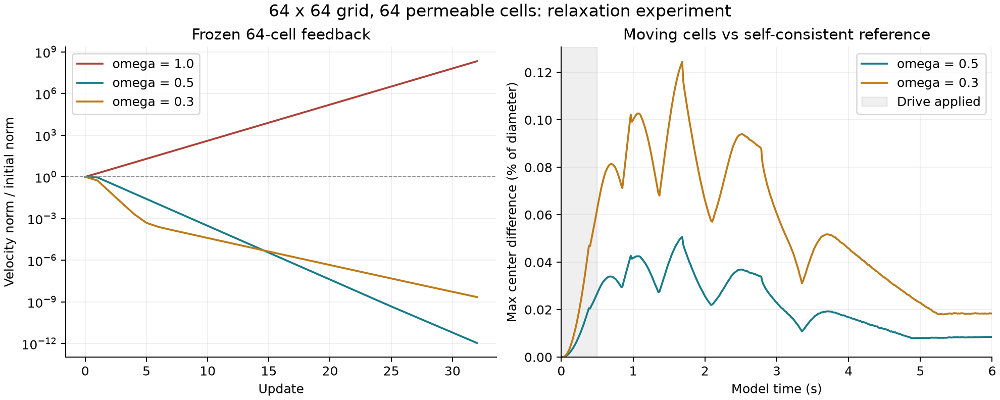

# 点力欠松弛：64 细胞稳定性与成本

2026-10-26。三个 sol 子 agent 分别实现求解器、运行动态实验、独立复算审计；主 agent 汇总并再次运行分析和审计脚本。本轮沿用已确认的有限阻力 Stokes、Rapier 与 Rayon 路线，仅修改独立实验，没有接入正式游戏。

**欠松弛本身的计算量可控：64 细胞下，点力计算和混合循环每帧平均约 4 微秒，正常每个机械子步仍只解一次完整流场。ω=0.5 和 0.3 均完成所测六秒动态轨迹，原 ω=1 在第 16 帧复现失稳。不过整帧模拟仍约 10 毫秒，未达到此前 5 毫秒预算。**

## 做了什么

在同一 64² 网格、相同细胞半径 0.045 下，比较 16 与 64 细胞。每细胞 12 个机械节点、4 个内部阻力点，总阻力 Γ=0.25，材料与接触参数保持不变；60 Hz，每帧两个机械子步。两个细胞接受前 0.5 秒的外力，之后撤去，观察至 6 秒。

每个子步更新：

```text
F_trial = R (V_current − J_current u_old)
F_new   = (1 − ω) F_old + ω F_trial
u_new   = K (f_background + S_current F_new)
```

同一份 `F_new` 散布到流体，再以 `−F_new Δt` 返还 Rapier。旧点力直接取上一子步的 `Solution.marker_forces`。没有降低 Γ，也没有放宽交换冲量阈值；初次初始化多一次背景求解，之后每帧固定两次完整 Stokes 求解。这里只模拟可穿透的有限阻力细胞，仍不具备严格膜封堵。

## 实测成本

Xeon Gold 6330，同插槽四个物理核 CPU 2–5，Rayon 四线程；主机非独占。64 细胞每个 ω 两轮、第二轮反序；16 细胞一轮。每轮 360 帧，耗时统计剔除前 30 帧，p95 使用 nearest rank。整帧包含流体、Rapier 和诊断，不含文件输出或游戏渲染。

| 场景 | 整帧均值 ms | 整帧 p95 ms | 全 360 帧最大 ms |
| --- | ---: | ---: | ---: |
| 16 细胞，ω=0.5 | 5.485 | 6.640 | 76.926 |
| 64 细胞，ω=0.5，第 1 轮 | 9.875 | 12.846 | 14.868 |
| 64 细胞，ω=0.5，第 2 轮 | 10.539 | 16.953 | 118.957 |
| 64 细胞，ω=0.3，第 1 轮 | 10.624 | 14.080 | 81.754 |
| 64 细胞，ω=0.3，第 2 轮 | 10.555 | 14.634 | 52.256 |

64 细胞的点力向量分配、试探力计算和混合循环平均为 **0.00386–0.00450 ms/帧**。这个埋点不含旧场插值，且包含原有点力计算，因此不能称为相对旧方案的净新增耗时。它足以说明这段循环没有成为主要成本。

主要成本仍在流体与机械：64 细胞流体阶段平均约 **5.56–6.27 ms**，Rapier 约 **4.13–4.40 ms**。两轮轨迹相同但耗时有长尾，不能据此判断哪个 ω 更快。旧自洽参照平均约 21.4 次完整 Stokes 求解/帧、整帧 40.92 ms；当前正常每帧两次，确实减少了求解次数，但旧计时不是同期对照，不据此宣称精确加速倍数。

## 稳定性和近似误差



左图冻结几何、标记速度置零、撤去种子流场的驱动力后连续更新，不运行 Rapier。初始历史点力刻意设零，因此首轮是种子过渡。64 细胞的两种不同空间扰动都表现为：ω=1 放大，ω=0.5 和 0.3 衰减；ω=0.5 的观察收缩更快。该结果支持此前反馈迭代的诊断，不构成所有模态、任意几何的稳定性证明。

右图比较同场景完整自洽参照，逐帧取所有细胞的最大中心距离。两种 ω 的两轮轨迹完全一致，因此各画一条。

| 64 细胞指标，全 360 帧最大值 | ω=0.5 | ω=0.3 |
| --- | ---: | ---: |
| 与自洽参照的中心距离，模型单位 | 4.561e-5 | 1.120e-4 |
| 上述距离占细胞直径 | 0.0507% | 0.1245% |
| 与自洽参照的细胞速度差 | 5.10e-4 | 6.21e-4 |
| 面积相对偏差 | 0.1486% | 0.1485% |
| 最终场力律残差 RMS | 7.135e-4 | 9.662e-4 |
| 最终场力律残差最大分量 | 0.00833 | 0.01169 |

力律残差定义为 `F/drag + Ju_new − V`，单位为模型速度。**轨迹接近自洽参照，不等于瞬时点力也已自洽。** 每步只更新一次会产生响应滞后；本轮低速、短时轨迹的距离差不能用作一般物理精度保证。

流体与节点交换冲量误差不超过 `2e-11`。完整动态轨迹的帧平均交换功率没有正值，但它平均了两个子步，不能证明每个子步都耗散。冻结诊断中也保留了可为正的瞬时交换功率。原 ω=1 负例在第 16 帧以原阈值停止，之前 15 帧的公共非计时字段与旧负例完全一致。

## 阶段结论

建议后续沿用 **ω=0.5** 作为这一实验场景的默认候选：它保住了每子步一次求解的成本，在所测密集场景稳定，且比 ω=0.3 更接近自洽参照。暂时没有证据需要为混合本身再做并行化。

若目标仍是整帧 5 ms，后续收益应从完整流场求解和密集接触阶段寻找，单独优化欠松弛循环解决不了预算缺口。本轮尚未验证数百细胞、更长时间、窄管堵塞、分叉或目标游戏设备，也未改变正式游戏实现。

## 产物与验证

- [实验说明及复现命令](experiments/2026-10-26-stokes-relaxation/README.md)、[求解器与冻结探针](experiments/2026-10-26-stokes-relaxation/solver/README.md)。
- [原始动态结果](experiments/2026-10-26-stokes-relaxation/results/)、[逐案例统计](experiments/2026-10-26-stokes-relaxation/results/summary.json)、[独立审计](experiments/2026-10-26-stokes-relaxation/review/audit.md)。
- `python3 .../analyze.py` 与 `python3 .../review/recompute.py` 通过：五条完整轨迹、失败负例、历史对照、源文件 hash 和冻结结果均复算一致。
- 求解器 `cargo fmt --check`、动态源码 `rustfmt --check` 与 `cargo check --offline --locked` 通过。`solver/results/numerical_check.csv` 保存原求解器数值检查结果。
- 图由 `python3 .../plot.py` 从归档 CSV 生成；没有重新计时，也没有 UI 流程测试。
