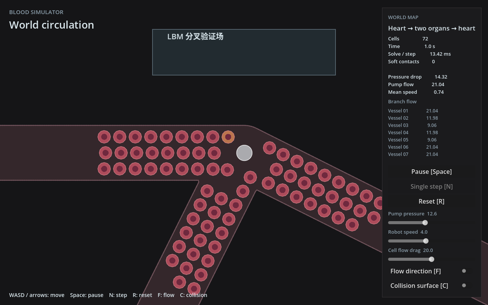

# LBM 可玩分叉场与机械耦合实卡测量

2026-10-29，分支 `feat/lbm-gameplay-validation`，基线 `14bf6d3`。

**验证场已接入真实机器人、72 个红细胞和现有有限阻力机械耦合。固定与移动场景均完成实卡运行，但当前 Godot 默认绘制路径未达到 60 FPS 帧预算。** Rust 独立完整模拟步 p95 约 12 ms；相同物理负载进入 Godot 默认 OpenGL 渲染循环后，实测帧间隔 p95 约 70–71 ms。两者不能混称为同一种性能成绩。

本轮不改 LBM 数值算法、材料参数、时间步或几何限制，没有用减小流速/细胞数换取稳定。仍采用 [LSQ-FD＋帧末均值控制](../../physics/lbm-fluid.md)；全局流量维持单向驱动，有限阻力耦合不提供严格封堵。

## 场景与实际运行

- 局部复用 `fork_a`：入口水平，两支路方向约 26.565°、116.565°，半宽 3。远端增加互不重合的闭合回路，泵在所测窗口外，由原 `GraphNetwork` 解流量。
- 验证场初始泵压为 `12.605889`，平均主干 Q≈`18.529295`；实际两支路 Q≈`10.55135/7.9779463`，约 56.94:43.06。保留 15%、1.2 Hz 脉动；没有继续使用旧纯流体实验的手给 70:30。
- 72 个真实十二节点软体红细胞，半径 0.7，材料、拖曳与机器人速度使用现有默认值。局部种子互相间距至少 1.7，避开管壁与机器人；不删除、重生或搬移细胞维持负载。
- Fine 192²、48×48 世界窗口，ν=0.05，60 Hz 游戏步、每步 2 个机械子步，每帧 14 个格子步。输入经正常 `MoveInput` 路径施加，没有瞬移玩家或直接修改粒子轨迹。
- 固定案例用位置反馈保持在 (24,24) 附近；移动案例每 12 秒切换一次 x=10/x=28 目标，y=24。两种窗口 origin `(0,0)`、`(-1,0)` 均先通过实际 raster/LSQ 创建检查。
- 每例 120 帧预热＋3600 帧测量，即 2＋60 模拟秒。Rust probe 和 Godot 分别运行固定/移动两例，全部 exit0、COMPLETE，无运行守卫失败。另有先行短 smoke 和下述有界性能对照。

硬件为 RTX 3060 12 GB、Xeon E5-2630 v4，20 个逻辑 CPU，容器 CPU quota 为 19.2 核；Rapier 沿用项目四线程池。Ubuntu 24.04、NVIDIA 580.173.02、Godot 4.7.1、同一 release 动态库与 probe。Godot 使用原 `gl_compatibility`、1280×800、Xorg 离屏显示，日志和 `glxinfo` 均确认 NVIDIA RTX 3060，没有软件渲染回退。这是该容器/Xorg 环境下的结果，尚未在用户桌面显示环境复测。

## 实际运动与机械负载

| 观测 | 固定 | 移动 |
| --- | ---: | ---: |
| 玩家实际 x 范围 | 24.000–24.047 | 10.015–28.023 |
| 实际窗口迁移次数 | 0 | 5 |
| 测量帧平均活跃耦合细胞 | 49.41 | 41.82 |
| 活跃细胞范围 | 19–72 | 8–72 |
| soft contact 见证平均／峰值 | 79.33／110 | 62.69／88 |
| 活跃细胞≥24 且有接触的帧 | 2933/3600 | 3071/3600 |
| 全程面积比范围 | 0.993897–1.000478 | 0.908407–1.000478 |
| 膜节点最大管壁 signed distance | −0.01934 | −0.06865 |
| 末帧细胞平均／最大中心位移 | 27.96／52.93 | 31.02／48.96 |
| 测量帧密度范围 | 0.963014–1.037477 | 0.946577–1.050901 |
| 开口流量最大绝对残差 | 5.72e−6 | 7.63e−6 |

`soft_contacts` 是接触见证数量，既不是独立接触对数，也不全部限于窗口内；活跃细胞数来自实际耦合 marker。细胞会逐渐流出局部区：末帧玩家附近 8 单位内分别剩 9/0 个细胞，不能把全程平均当成恒定拥挤负载。因此保存了活跃细胞分组、接触帧、迁移帧与逐 600 帧统计。

膜节点中心未跨出连续管道几何；这不等于带半径接触表面完全零穿透。守卫预先设为位置有限、面积比 0.5–1.5、节点 signed distance≤0.3、机器人中心≤−0.55，并检查 LBM 有效性和流量残差≤1e−3。本轮没有放宽门限，实际观测范围见表；这些运行检查不构成物理精度或严格守恒证明。

Rust 与 Godot 两个完整案例的玩家位置、活跃/附近细胞数、接触见证、密度极值/总和、面积范围、节点壁距和迁移次数，在 f32 精度下逐帧一致。三个性能控制的相应前缀也一致。比较仅覆盖列出的记录量，没有声称所有内部 populations 或全部粒子坐标逐位相同。见 [记录量对比](recorded-state-comparison.json)。

## 完整模拟与实际游戏帧成本

所有数值为毫秒，预热排除，p95 使用 nearest-rank。每组只做本轮记录的单次运行，未以重复跑中的最好成绩代替结果。

| 模式 | 平均 | p95 | 最大 |
| --- | ---: | ---: | ---: |
| Rust 完整模拟步，固定 | 10.410 | 12.484 | 15.115 |
| Rust 完整模拟步，移动 | 10.077 | 12.146 | 24.859 |
| Godot 内 Rust 模拟步，固定 | 30.764 | 32.773 | 35.801 |
| Godot 内 Rust 模拟步，移动 | 30.565 | 31.654 | 55.825 |
| Godot 实际 process 帧间隔，固定 | 68.091 | 71.401 | 75.665 |
| Godot 实际 process 帧间隔，移动 | 68.341 | 70.390 | 93.957 |

Godot 使用 `--fixed-fps 60 --disable-vsync`，每个模拟步仍代表 1/60 秒；固定步长不表示现实时间能达到 60 FPS。这里的平均间隔约对应 14.6–14.7 帧/秒的离屏循环吞吐，未通过 16.667 ms 目标。

计时边界：

- Rust `step_wall_ms` 包围真实 `try_tick`，包含图流量更新、prepare、机械交换、LBM、Rapier 和其他步内工作。snapshot 与质量重诊断在计时区外；snapshot 平均另需约 0.73 ms。原始 CSV 写入也在步计时之外。
- Godot `step_wall_ms` 是相同 Rust 模拟步；`tick_wall_ms` 加上桥接调用成本。`snapshot_refresh_ms` 约 1.00–1.06 ms，含快照封装、验证场 quality、HUD 更新和重绘请求。
- `render_interval_ms` 实为相邻 `_process` 开始之间的墙钟间隔，涵盖引擎、物理、脚本、前一轮绘制/提交及 CSV 仪器化等成本。它不是纯 GPU 绘制时间，也不是物理显示器的呈现延迟。筛选要求间隔两端都落在测量期，因而每例有 3599 个测量间隔；首次零值、预热和截图均排除。
- 分项时间有嵌套和异步等待，p95 不可相加。不能把“帧间隔减 Rust step”直接叫作 OpenGL kernel 时间。

Rust 探针中，活跃细胞≥24 且有接触的帧 p95 为固定 `12.547`、移动 `12.060` ms，表明上述成绩包含实际机械负载。固定测量帧无一步超过 16.667 ms；移动有 4 帧超过。

移动探针的 5 个迁移帧平均 `21.703` ms、最大 `24.859` ms；其中 prepare 平均 `12.313` ms，普通帧 prepare 通常约 0.2–0.3 ms。迁移复制的已记录 overlap error 为零，但创建新权重/几何/GPU资源仍产生尖峰。本轮只定位到 prepare 阶段，没有细分或优化其内部成本。

## 渲染差距的有界控制

完整 Godot 运行出现明显差距后，追加同一冻结代码、同一输入与物理的移动前缀对照。每个控制为 120 预热＋600 测量帧；下表的正常绘制也只取相同前缀，比较 599 个帧间隔。

| 模式 | 帧间隔平均／p95 | Rust step 平均 | LBM 阶段平均 | readback 等待平均 |
| --- | ---: | ---: | ---: | ---: |
| 正常 OpenGL 绘制 | 65.687／69.535 | 29.045 | 20.526 | 17.079 |
| headless | 29.088／31.042 | 16.835 | 8.016 | 4.424 |
| 保留 X11/GL，关闭 render loop | 38.440／41.777 | 17.578 | 8.497 | 4.747 |
| 正常绘制，进程级强制关闭 vblank 同步 | 66.572／71.037 | 29.474 | 20.800 | 17.331 |

正常绘制每帧记录 412 个 draw calls，两个无绘制控制为 0。最后一个控制仅设置 `__GL_SYNC_TO_VBLANK=0`，没有改全局驱动、GPU 频率或物理。Godot 的本机 `--help` 明确指出 `--disable-vsync` 不覆盖驱动级强制同步；该 NVIDIA 环境变量的含义见 [官方说明](https://download.nvidia.com/XFree86/Linux-x86_64/570.86.16/README/openglenvvariables.html)。本轮这一控制没有带来改善，不能用简单关闭 vblank 来解释或解决差距。

已知的是：开启实际绘制后，整帧和 LBM 等待同时显著增大；无绘制时也存在 Godot 相对独立 probe 的额外成本。静态检查没有发现重复 tick 或额外 field 读回。读回等待含 GPU 队列完成、驱动/调度和同步，不等于 2.5 MB 数据传输本身花了这些时间。当前仍不能将差距唯一归因于 OpenGL/wgpu 上下文切换、低 P-state 或某个绘制函数。源码侧观察与计时口径见 [只读说明](local-checks/render-notes.md)。

下一步应先对 Godot 中的实际帧与 LBM 等待做更细的定位，再决定局部优化；同时保留移窗 prepare 尖峰问题。本轮没有更换渲染后端、引入新调度机制或调整物理来追求帧率。

## 启动与复现

在本分支根目录，开发启动方式为：

```bash
bash scripts/build.sh --features lbm-gpu
godot --path godot -- --local-lbm --lbm-validation
```

正常入口仍用 WASD/方向键，可暂停、单步与重置；reset 保留当前压力、profile 和验证场细胞种子。上面默认是 debug 构建，性能不等同于本次 release 测量。需要硬件 GPU，默认 `small_world` 和普通解析入口保持原行为。

本轮 release 构建：

```bash
cargo build --offline --locked --release -p godot_bridge --features lbm-gpu
cargo build --offline --locked --release -p simulation --features lbm-gpu --example lbm_gameplay_probe
```

远端 staging 的 GDExtension debug/release 路径都指向同一份已核验 release `.so`；原 `.gdextension` 源码未改。完整命令见 [runner](hardware-rtx3060/run-hardware.sh)，冻结源文件见 [source.tar.gz](hardware-rtx3060/source.tar.gz)，[SHA 清单](hardware-rtx3060/source-binary.sha256)标识源码与二进制。

结果分析：

```bash
python3 docs/research/2026-10-29-lbm-gameplay/analyze.py docs/research/2026-10-29-lbm-gameplay/hardware-rtx3060/results/probe docs/research/2026-10-29-lbm-gameplay/probe-analysis.json
python3 docs/research/2026-10-29-lbm-gameplay/analyze.py docs/research/2026-10-29-lbm-gameplay/hardware-rtx3060/results docs/research/2026-10-29-lbm-gameplay/godot-analysis.json
python3 docs/research/2026-10-29-lbm-gameplay/compare.py docs/research/2026-10-29-lbm-gameplay/hardware-rtx3060/results docs/research/2026-10-29-lbm-gameplay
```

## 验证、异常与适用范围

地图/种子与实际流量 CPU 检查、保留当前压力的 reset 软件 GPU 检查、短程软件 smoke、release 构建、feature 开/关编译、Godot 两个脚本 check-only、格式检查通过。审阅发现并修正了远处管段重合、probe 失败收尾 panic 和 render 预热过滤；失败记录路径做了临时故障注入，原始 step 错误得以保留，无新增恢复机制。详见 [实施验证](local-checks/implementation.md)、[审阅记录](local-checks/review.md)与[计划](../../superpowers/plans/2026-10-29-lbm-gameplay-benchmark.md)。

**首次 headless editor import/quit 有一个尚未解决的退出异常。** 本机与远端均见 exit134；最小空项目 exit0，仅加冻结 GDExtension 的全新缓存项目可复现，已有导入缓存后 exit0。GDB 捕获到 Godot 主线程 SIGSEGV，剥离符号后无法确定内部函数，不能宣称根因已查明。远端 cached import、正常游戏短测、两组完整游戏与全部控制均 exit0；没有把首次异常从记录中删除。证据见 [首次远端导入](hardware-rtx3060/results/import.log)、[cached 导入](hardware-rtx3060/results/import-cached.log)、[最小复现栈](local-checks/gdb-fresh.log)。

仅验证本场景的这条往返路线。任意角度/宽度、边界切分叉、完整地图漫游、严格堵塞和全局反压、绝对压力耦合、物理收敛精度仍未验收。当前均值控制继续有质量/动量数值补偿；此次机械运行通过不等于流体＋实体总动量严格守恒。

全部结果已收回并逐项核验 [结果 SHA](hardware-rtx3060/results.sha256)，[本机核验输出](hardware-rtx3060/local-retrieval-verification.txt)保留。实例 `58133143` 已确认 `stopped / exited`，见 [最终停机状态](hardware-rtx3060/final-stop-status.json)；磁盘保留，未销毁。


