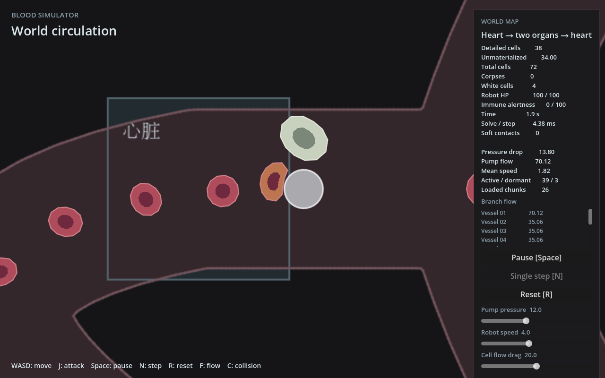

# 固定区块加载与实体卸载实现记录

2026-10-30。实现来源为`feat/world-streaming`，已由`5d644d7`合并到`main`；用户随后安排推送及回收旧工作树，当前统一在主目录工作。用户确认16单位固定世界网格、LBM 3×3、地图与实体5×5，并授权实装及缩小摄像机视野。未启动云实例或64×64 LBM实验。

## 实际行为

- 显式`--stream-world`启用；默认Full、原`--local-cells`、loop lab和原测量负载保留。
- 共享基础16定义在blood-fluid，simulation与GPU窗口引用；现场以玩家所在块固定5×5＝80×80，LBM仍3×3＝48×48。跨块才改变基础现场/库存分区。
- 不生成整图三角形/碰撞墙/背景纹理；按附近块生成core/paint几何，移除墙句柄和Godot块节点。基础25块，跨边缘真实身体需要的额外墙块暂时保留。
- 红细胞离场汇总库存；白细胞保存同一份id、生命、AI和形态/速度后删除真实身体，返回现场且位于镜头外、空间合法时恢复。拥堵时原记录继续休眠，可能本次经过暂不出现。
- 休眠AI冻结，尸体计龄继续，白细胞上限包括休眠及尚未到期尸体。全局暂停/单步/reset保持统一模拟时钟。
- 新流式入口zoom2，默认1280×800下视野约26.7×16.7；原入口视野不变。每块384×384核心及8像素留边，地标按实际显示范围裁切。

## 运行

```bash
# 正常解析流世界，固定区块装卸和白细胞休眠
bash scripts/run.sh -- --stream-world

# 已支持的LBM分叉验证场，需相应GPU环境
bash scripts/build.sh --features lbm-gpu
godot --path godot -- --local-lbm --lbm-validation --stream-world
```

`--stream-world`已隐含Local红细胞，不必重复传`--local-cells`；与local Stokes/loop lab组合拒绝。默认small_world的既有LBM边界限制保持，不据此声称其LBM可用。

## 实际检查

- `cargo test --locked -p simulation`及项目`bash scripts/check.sh`：通过，30单元＋5集成；包含旧world/lab headless加载、扩展构建、fmt和workspace check。
- `cargo test --locked -p simulation --features lbm-gpu`：37单元＋5集成通过，9个已有显式GPU诊断仍ignored。
- `cargo check --locked --workspace --all-targets --features godot_bridge/lbm-gpu`：通过。
- 初次沙箱内Godot导入虽退出0，但出现编辑器设置写入和套接字权限错误；按权限要求在沙箱外重跑导入及项目检查后通过。没有把初次退出0当作无错误证据。
- 正常流式场景使用本机Xorg＋llvmpipe静态截图检查，约第120步；未注入键鼠或执行UI交互。截图显示活跃39、休眠3（其中活跃红细胞38、活跃白细胞1）、墙块26、实际非空背景纹理14。多出的墙块用于边界身体。
- 一次独立只读代码审阅：无Critical/Important。少量地标字典每帧构造列Minor，当前仅3个地标，暂不增加缓存机制。旧阶段说明已更新。

新增4个直接行为用例：固定网格/几何接缝；真实形变的身份与身体保存恢复；现场往返及资源释放；休眠AI冻结/尸体寿命与暂停。其余复用现有数量、免疫和尸体用例，不复制各层测试。



## 稀疏地图资源检查

命令：`cargo run --locked -p simulation --example streaming_probe`。

纯Rust生产路径，300/1000/3000单位跨度、相同局部管宽和40模拟秒往返路线，**零红/白细胞**。只核对地图资源装卸，不作为完整物理负载或FPS对照；启动时间包含本机波动。

| 跨度 | 本轮启动ms | 峰值块 | 初始/返回墙数 |
| --- | ---: | ---: | ---: |
| 300 | 58.826 | 25 | 1038 / 1038 |
| 1000 | 38.313 | 25 | 1038 / 1038 |
| 3000 | 65.748 | 25 | 1038 / 1038 |

回到x=24，未生成3000×3000旧全图基线，避免无关高内存路径。[输出记录](scale.csv)。本轮没有宣称实时总显存、冷启动最坏值或高密度大图验收。

## 软件GPU联合短测

```bash
cargo run --locked -p simulation --features lbm-gpu --example lbm_gameplay_probe -- \
  --allow-software --functional --stream-world --case move --frames 420 --warmup 0 \
  --output /tmp/sunyunbo/blood-world-streaming/lbm
```

llvmpipe，72个红细胞的原验证场初始化，420步完成、一次LBM移窗及玩家所在区块变化；密度/面积/墙体/有限值运行守卫通过。红细胞详细数量仍72，数量账最大误差0；LBM实际耦合数量随位置变化。最终基础块25、墙1429，未加入白细胞。

[原始CSV](lbm-move.csv)、[状态记录](lbm-status.txt)。状态记录第一行config是调用构造器前的输入配置（旧Local 36/40/32）；流式构造器实际将范围统一为固定5×5，半边长40、保护由镜头决定。不能把输入行误读为仍使用旧72单位激活范围。

## 未验收与后续边界

实卡/FPS、新战斗负载、长程自由移动、拥堵回场手感和真实GPU资源占用未验收；软件GPU守卫不证明物理精度。全局图求解、距离/速度查询和初始细胞候选生成仍随地图内容增长，没有借本轮引入空间索引或线程队列。

[64×64 LBM实验草案](../2026-10-30-lbm-64-window-draft.md)只保存计算规模、定位问题与未来对照方法，不修改正式48×48窗口，也不授权新云实验。
