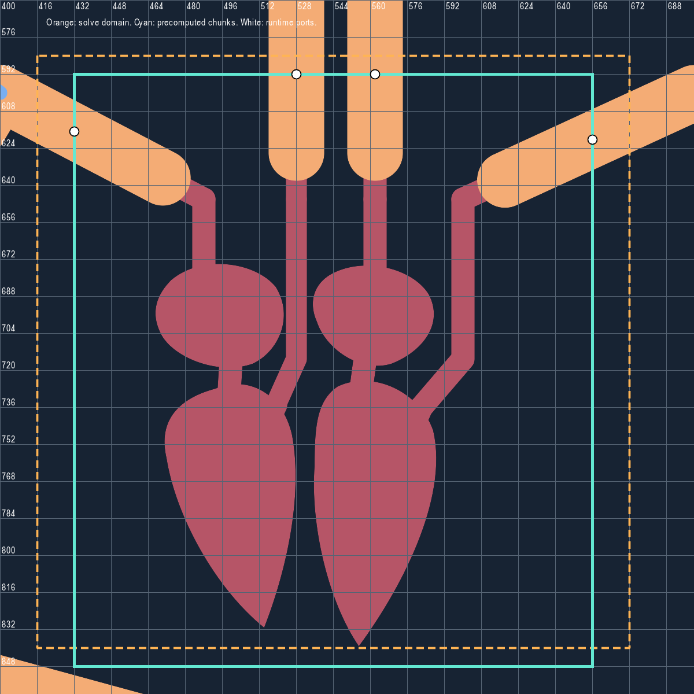
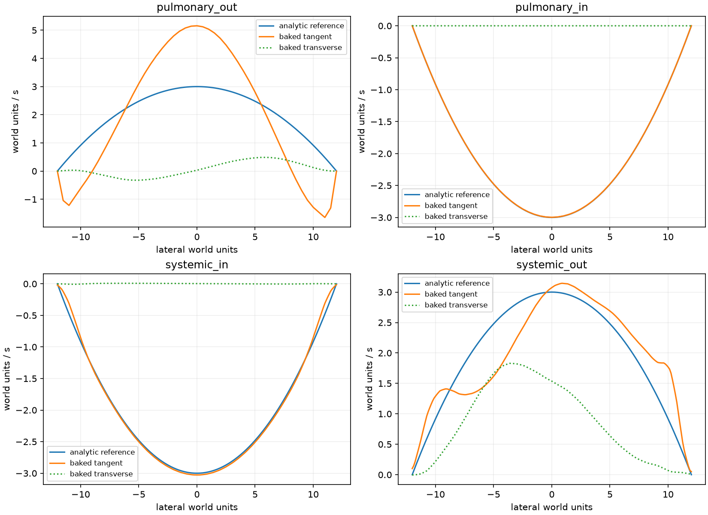
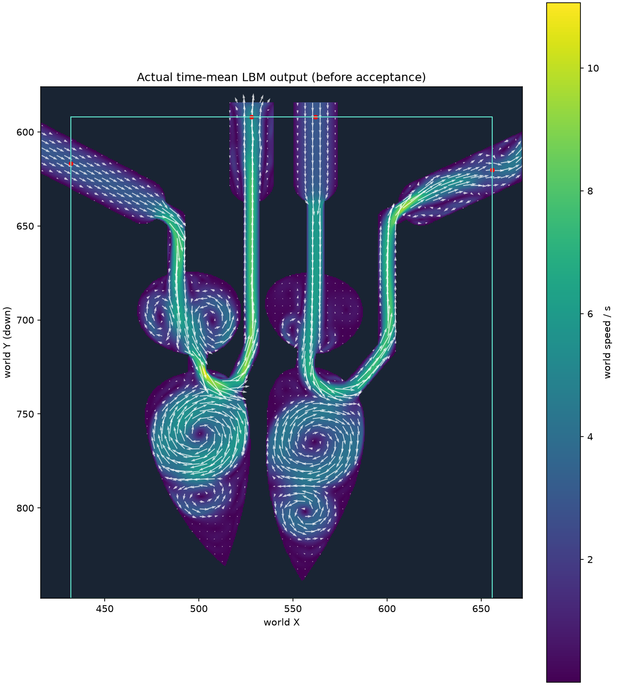

# 心脏附近背景场：预检与两次作业

2026-11-03，工作分支`feat/organ-heart-flow`，宿主管理工作树`7c02`。用户已确认[设计](../../superpowers/specs/2026-11-03-organ-traffic-design.md)，[执行计划](../../superpowers/plans/2026-11-03-organ-heart-flow.md)先做心脏烘焙，区域外解析，再接细胞。

## 当前状态

已完成新例子`organ_heart_bake`、实际地图CPU预检和两次有界软件作业。首次进程退出143（SIGTERM），原因未确定；用户随后回复“ok 跑一次吧。”，批准按原预算重跑一次。第二次完整完成48000步和60样本，导出/读回成功，但原生产端口剖面校验失败，命令退出1。**已取得实际求解资产，尚未取得可接入的背景资产**；不接运行入口或细胞，不把求解完成、预检或编译通过当作验收。

首轮之后补充了来源边界CPU扫描及离线作业阶段/进度日志，没有改变数值算法、地图、源标签、端口容差或预算。本机无硬件GPU，第二次仍用本地llvmpipe，无云实验。第二次之后仅进行资产只读采样和绘图，没有第三次烘焙或自动追加预算。

## 实际生产几何预检

- 标签矩形`[432,592]..[656,848]`，x=27..40、y=37..52，共224个16单位块，引用同一背景资产；不是224个常驻现场或求解器。
- 四个来源交接截面为(528,592)、(562,592)、(432,616.727273)、(656,620.24)。四腔包围框完整位于标签区，外围按<=0.25单位扫描仅找到四个声明端口。
- 首个方域`[416,576]..[736,896]`被生产规则拒绝。定位为右边界穿过外围edge55的(740,670)附近折弯；只补充拒绝位置，不放宽规则。
- 修订方域`[416,584]..[672,840]`、h=.5、512²通过。仅两套心脏连通流体区域，分别41146/41683个流体格，四个开口；各区域输入输出Q均约48.000004，收支为0。
- 生产参考压差14.145665169，循环Q48；最大初场世界速度7.9999495，格子速度.039999746，低于.05预算。

覆盖图橙线为离线方域，青线为预计算标签范围，白点为运行交接截面。它只表达真实几何和来源边界，不是已求得的血流。



## 首次实际作业

`dt=.0025`、每逻辑帧16步，1500帧预热＋1500帧采样、stride25；计划60＋60模拟秒、60样本、48000格子步。外层墙钟上限1200秒，TERM后10秒强制结束。此为显式本地软件功能/资产作业，无实卡/FPS结论。

```sh
VK_ICD_FILENAMES=/usr/share/vulkan/icd.d/lvp_icd.x86_64.json \
timeout --signal=TERM --kill-after=10s 1200s \
  /data/sunyunbo/www/bloodSimulator/target/release/examples/organ_heart_bake \
  --bake --allow-software --output /tmp/sunyunbo/organ-heart-flow-bake
```

报告文件修改时间为2026-11-03 06:49:09 UTC；06:57:56 UTC轮询确认退出143，没有最终报告。没有时间戳或信号来源证据能确定实际退出时刻/原因，不能宣称是20分钟timeout、数值发散或OOM。

首次二进制SHA256为`fa8cabdf6a5aa0f30ce6c45ad8de9773af1058b4341d18a765f8336ede58680d`。实际作业使用的[例子源码](attempt-01/job-source.rs)和[几何实现](attempt-01/lbm-geometry-source.rs)已单独保存；最终例子后来补充了来源边界CPU扫描，不混称为首次二进制的源码。新增离线进度日志也未包含在首次二进制内。

## 第二次完整作业

源码基线`ea3e812`，重新release构建；[source.json](attempt-02/source.json)保存二进制和实际源码哈希。[run.sh](attempt-02/run.sh)保存实际命令，新增`timeout --verbose`、开始/结束/退出码记录。仍为512²、dt=.0025、48000格子步、60秒预热＋60秒采样、60样本、外层最长1200秒，未调参数。

[生命周期记录](attempt-02/lifecycle.log)为2026-11-03 07:26:23～07:31:14 UTC，命令退出1；不是timeout或再次SIGTERM。[运行日志](attempt-02/run.log)包含solver ready、完整预热和采样进度。求解报告的wall_seconds为284.648616，生命周期总跨度291秒还包含CPU预检、导出和校验。

[实际报告](attempt-02/report.txt)：

| 项目 | 实测 |
| --- | --- |
| 样本数 | 60 |
| 采样密度范围 | 0.9888845～1.0076922 |
| 方域四个开口平均通量 | -47.9999907、47.9999995、48.0000083、-48.0000084 |
| 前后半均值速度差 RMS / 最大值 | 1.286838 / 5.793249 |
| 最终最大世界速度 | 15.670567 |
| 正常策略世界导入 | 失败：static port velocity profile does not match planar analytic flow |

原始格心场和地图对齐场分别保存为[raw-cell-centered.bfld](attempt-02/raw-cell-centered.bfld)、[organ-heart.bfld](attempt-02/organ-heart.bfld)。后者的文件名不表示已验收，未复制到正式assets或运行地图。文件写入/读回的速度和掩码精确一致；随后仍按原`try_new_policy_world`检查，失败没有改为成功或回退。

### 四口只读诊断

用[inspect_field.py](attempt-02/inspect_field.py)读取实际对齐场，按原生产双线性/掩码采样口径，在每口D24截面193点上独立比较参考抛物线。表中通量带沿图边方向的符号；这不是把生产导入重复运行四次。JSON保留完整精度，表格作舍入。

| 截面 | 期望通量 | 积分通量 | 最大向量速度差 | 原允许值 |
| --- | ---: | ---: | ---: | ---: |
| 肺流出 | 48 | 48.42293 | 2.20439 | 0.005509 |
| 肺流入 | -48 | -47.94437 | 0.00365 | 0.005509 |
| 体流入 | -48 | -47.97537 | 0.16990 | 0.005509 |
| 体流出 | 48 | 47.99286 | 1.95754 | 0.005509 |



肺流出口在该平均场中保留中心射流和近壁反向流，体流出口有明显横向速度（最大约1.83）；因此问题包括真实求解剖面与预设抛物线不一致，不能仅归结为斜壁或舍入。体流入口斜壁也有非零壁面插值误差。两半平均场仍有明显差异，现预算不足以支持已经获得稳定时间平均背景的结论；这也不单独证明数值发散或解释全部剖面差异。



额外在同一份已有资产的y=672四条窄直管上作只读候选切口采样：[narrow-port-probe.json](attempt-02/narrow-port-probe.json)。四口最大误差约2.268/0.233/1.093/0.655，各自允许约0.073/0.100/0.073/0.073，均超出；只挪本份资产的来源标签不能直接补救，未修改元数据或另行烘焙。

复现只读诊断：

```sh
MPLCONFIGDIR=/tmp/sunyunbo/organ-heart-mpl python3 \
  docs/research/2026-11-03-organ-heart-flow/attempt-02/inspect_field.py \
  docs/research/2026-11-03-organ-heart-flow/attempt-02/organ-heart.bfld
```

### 后续决策点

当前数据不支持只放宽容差或只加时长便宣称成功。可讨论两条路线，尚未选择或实施：

- 保留心腔烘焙主体，在接近直管内明确设置向解析剖面的过渡段。需要新增资产速度处理/连接约定，是保持游戏连续流动的一项近似；必须另行确认如何处理壁面、通量和过渡宽度，不能悄悄替换原始速度。
- 继续要求纯求解场在交接处自然满足原剖面约定。需要重新选择参考流速、接近段或采样预算并验证，成本和能否通过仍不确定；不据本轮失败自动改路网、降流速或追加长作业。

## 已有检查

- 基线`cargo test --locked -p simulation --quiet`：50单元＋5集成通过。
- `cargo test --locked -p simulation --features lbm-gpu --quiet`：63单元＋5集成通过，10项GPU诊断忽略。
- `cargo check --locked --workspace --all-targets --features godot_bridge/lbm-gpu`：通过；增加日志后的全目标编译也通过。
- `cargo fmt --all --check`：通过。
- `cargo test --locked -p blood-fluid-gpu lbm:: --lib --quiet`：7项通过、6项忽略。

本次重新执行release构建通过；完整烘焙/导入命令实际退出1，原因见上。产品数值代码未修改，沿用上述已有检查，没有重跑整套测试。未进行新入口Godot加载、完整心腔近壁/物理精度检查、细胞通行、手感、实卡性能或云实验。日志和停止决策见[执行记录](controller-notes.md)。
