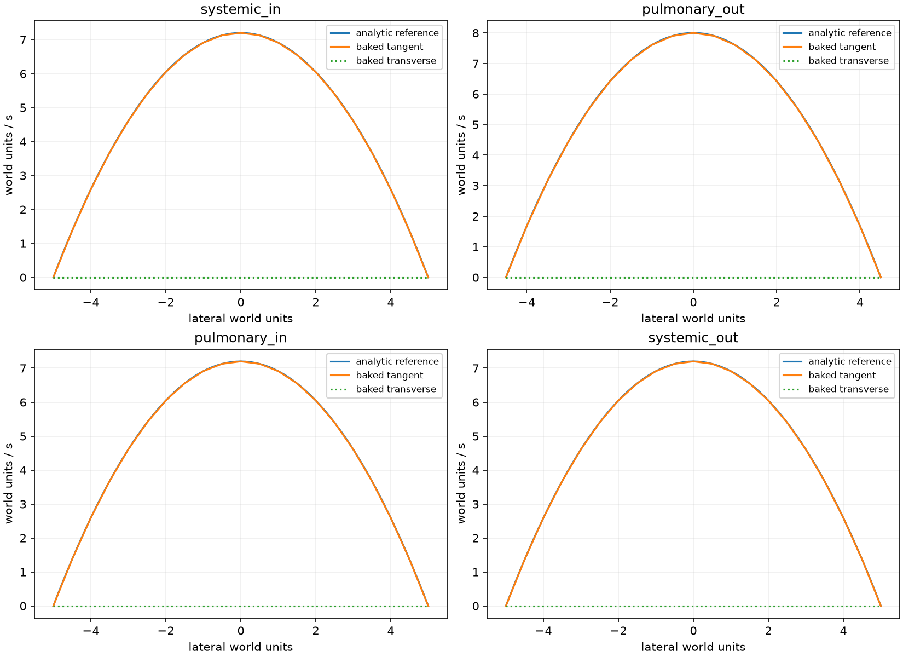
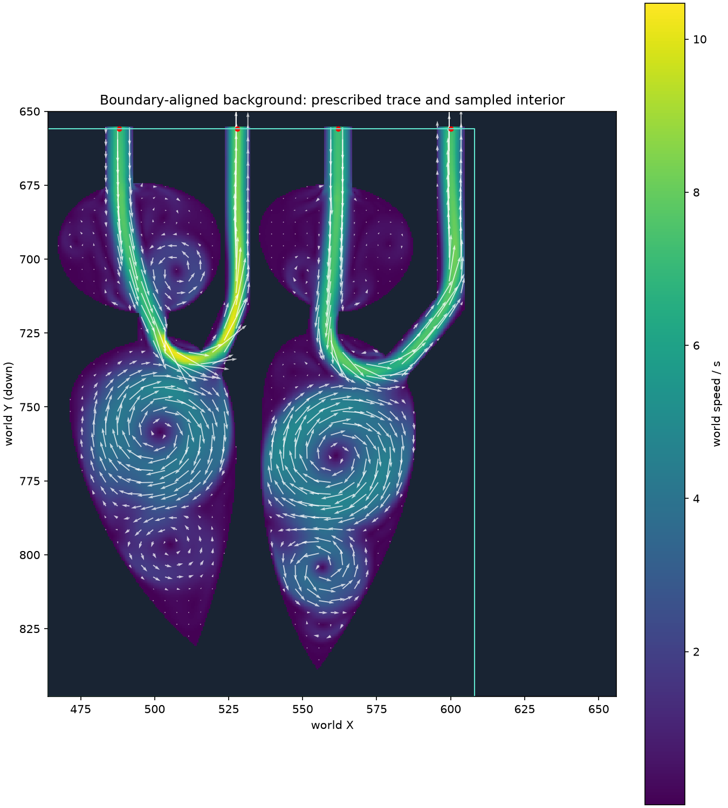
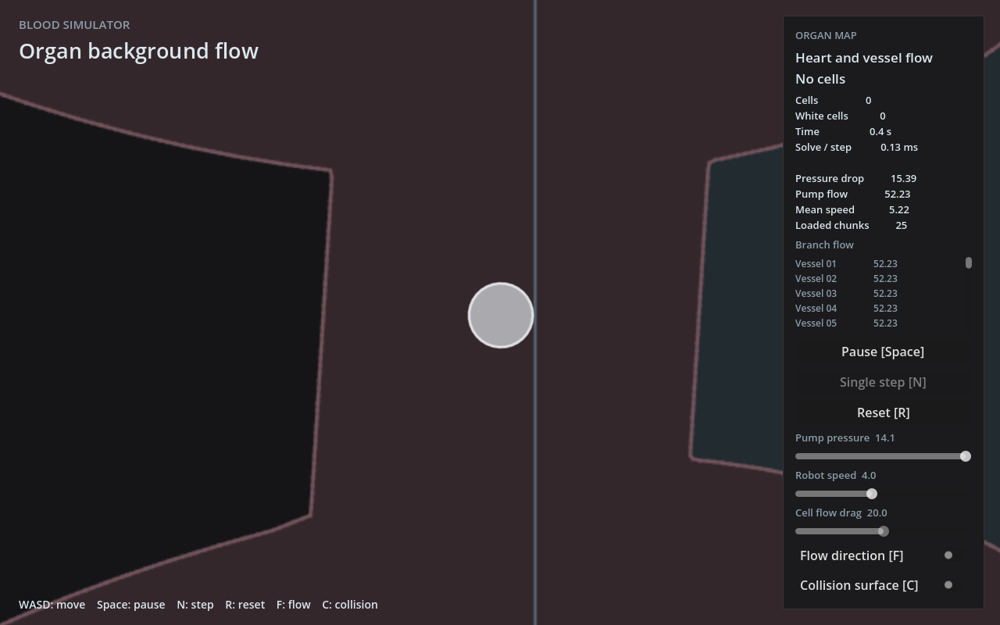

# 同面解析边界与心脏背景接入结果

2026-11-03，功能分支`feat/organ-heart-flow`。边界实现提交`08f3946`，无细胞运行入口提交`289901f`；未合并/推送。对应[已确认设计](../../superpowers/specs/2026-11-03-heart-boundary-alignment-design.md)、[实施计划](../../superpowers/plans/2026-11-03-heart-boundary-alignment.md)及[执行记录](boundary-alignment-notes.md)。

## 已交付

四个心口在y=656直接施加几何解析剖面，游戏交接也在该面；内部保持真实求解场的双线性采样。边界样本来自已施加条件，域外一排来自外侧解析背景，没有内侧混合段或容差调整。原`bake_mean`默认行为保留，显式剖面用原setter在首次推进前传入。

正方形域为`[464,656]..[656,848]`、h=.5、384²；来源标签`[464,656]..[608,848]`、108个16单位块。四腔完整，运行仍为5×5现场；外围二维解析流，实时LBM一律禁用。导出为387²、h=.5、原点(463.5,655.5)，保留BFLOW001协议及原生产校验。

正式资产`assets/flow/organ-heart.bfld`与[第三次输出](attempt-03/organ-heart.bfld)哈希一致：`b1760e82730802d5006843bd205a49267c32df5cdcd081355367347e41f697d9`。CPU默认构建即可使用，不需GPU feature或运行时磁盘资产目录。

## 单次实际作业

实际冻结源码为`08f3946`，参数/源码/二进制哈希见[source.json](attempt-03/source.json)，原始格心场完整保留。首行512²提示是遗留文案，真实DomainSpec、求解器和源码均为384²；文案随后单独修正，未混称为运行源码。

dt=.0025、每帧16步、1500预热＋1500采样帧、stride25，约60＋60模拟秒/48000步/60样本。外层限时1200秒。生命周期08:29:11～08:33:03 UTC、命令退出0；求解报告wall_seconds为225.516590。[日志](attempt-03/run.log)、[完整报告](attempt-03/report.txt)保留。

| 项目 | 实际值 |
| --- | --- |
| 方域四个开口平均通量 | -48.0000030 / 48.0000061 / -48.0000031 / 48.0000026 |
| 采样密度范围 | 0.8928303～1.1026058 |
| 前后半均值速度差RMS / 最大值 | 0.902615 / 4.270441 |
| 最终最大世界速度 | 16.570870 |
| 原正常策略导入 | `Ok(())` |

四口的[独立采样](attempt-03/port-inspection.json)如下。边界由已知条件构造，匹配是接口和导出一致性的证据，不能视为腔内速度自发恢复解析形状或物理精度证明。积分与连续Q的微小差别来自节点网格线性插值，仍通过原分辨率容差；没有逐口重归一。

| 截面 | 内径 | 参考外向通量 | 对齐场积分 | 最大向量误差 | 原允许值 |
| --- | ---: | ---: | ---: | ---: | ---: |
| 体流入 | 10 | -48 | -47.88000 | .01800 | .072721 |
| 肺流出 | 9 | 48 | 47.85186 | .02469 | .099566 |
| 肺流入 | 10 | -48 | -47.88000 | .01800 | .072721 |
| 体流出 | 10 | 48 | 47.88000 | .01800 | .072721 |

JSON同时记录向内.5/1/2/4单位的中心速度，确认检查没有只停在人为约束的边界面。内部平均场仍明显变化，密度约±10%的偏移也需要保留为物理限制；本版只作有限预算的游戏背景，不宣称稳定均值或物理精度已验收。





## 运行与实际检查

在本功能工作树中：

```sh
bash scripts/run.sh -- --organ-world
```

WASD、暂停/单步/重置、F流向与C碰撞显示可用；本阶段红白细胞均为0。压力上限来自资产参考压差，重置保留地图、当前压力与暂停状态。旧`--organ-preview`和`--heart-preview`仍固定无流/无细胞。policy地图HUD均速按既定H=1换算，旧地图保留旧口径。

[默认构造/reset测试](../../../crates/simulation/src/runtime/policy.rs)通过，未编译GPU feature。显式profile的16²软件功能用例和边界导出CPU用例均经历先失败后通过；内部测试独立给定非解析输入，确认其未被解析场覆盖。

[局部往返记录](alignment-checks/local-crossings.log)：四个明确起点(488/528/562/600,660)，各往返y652、660，真实MoveInput共972步、8次来源切换，最小中心净空4.5；保持零细胞、无实时LBM。它不代表普通出生点到四口的完整路线或细胞通行验收。



截图通过已有本地Xvfb＋llvmpipe获取，只等待渲染帧，无键鼠注入、自动按钮点击或UI交互流程。首次截图说明过长，缩短文字后只补截图；没有重复全套检查。

## 集中检查与审阅

- `bash scripts/check.sh`：fmt、workspace默认编译、51单元＋5集成、默认扩展构建通过；首次Godot冷导入仍以134退出，脚本在该处停止，**不记为整脚本通过**。
- 只补缓存导入及脚本尚未执行的加载：cached import、world、lab、两预览、organ-world均退出0；新入口与预览/局部LBM两项互斥均按预期退出1。[Godot结果](alignment-checks/godot-results.json)
- `cargo test --locked -p simulation --features lbm-gpu`：65单元＋5集成通过，10项GPU诊断忽略。
- `cargo check --locked --workspace --all-targets --features godot_bridge/lbm-gpu`通过。
- `cargo test --locked -p blood-fluid-gpu lbm:: --lib`：7通过、7忽略；本次新增显式profile诊断已单独运行通过。

[集中命令和退出码](alignment-checks/results.json)及完整日志保留。既有冷导入异常根因未在本轮处理，没有恢复性能或云研究。

独立只读整分支审阅无Critical/Important/Minor，核对正式资产哈希及972步记录；未代替实际模拟重复测试。审阅明确未判断：细胞交通、人工手感、内部物理精度/均值稳定性、FPS及冷导入根因。上述范围继续未验收，不据背景成功自动启动新作业或下一套模型。
