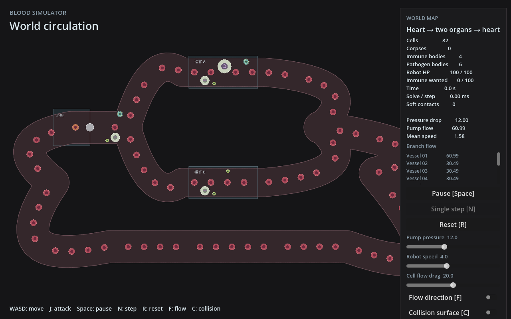
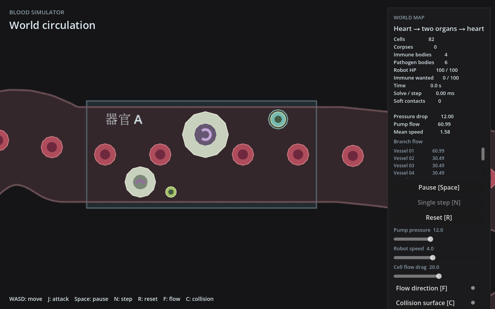

# 首批免疫与病原体战斗阶段记录

2026-11-04。中性粒细胞、巨噬细胞、游动细菌和荚膜细菌已接入共用实体、局部目标和伤害结算。用户要求阶段性提交、合并 main 并推送。

入口：`godot --path godot -- --combat-preview`。使用已有 small_world、解析流和 Full 模式；普通入口保留原四只中性粒。没有新流场烘焙、化学场、全图寻路、繁殖或感染模型。

- [设计](../../superpowers/specs/2026-11-04-immune-pathogen-combat-design.md)
- [实施计划及验证](../../superpowers/plans/2026-11-04-immune-pathogen-combat.md)
- [实现报告](implementation.md)
- [独立 Sol 审阅与定点复查](review.md)

实现报告记录的是当时的交付状态。随后已找到 X 显示服务 :2，通过临时截图脚本加载真实 world 场景、冻结初始状态并调整相机，使用软件 OpenGL 导出以下两张截图，无自动键鼠交互。人工战斗手感、动态表现与新负载 FPS 仍未验收。

独立审阅发现的旧攻击者标记问题已修复并复查通过：目标切换或放弃后清理旧来源，无新增计时系统。全套模拟57单元＋5集成通过后，最后修正相关12项通过，新增永久场景共7项；feature全目标检查、桥构建与三个场景180帧加载通过。
