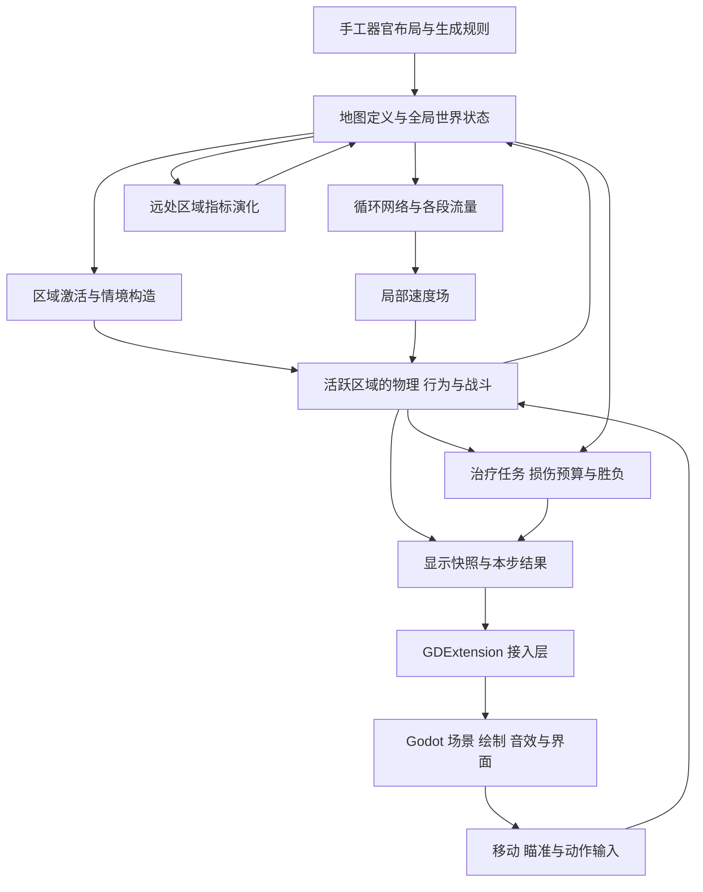

# 血管世界架构与子系统开发目标

日期：2026-10-21；2026-10-22 更新。状态：用户已确认整体方向并授权继续开发。本轮按下文的小型体循环范围落地，后续重要技术决策仍分别确认。

本项目以连续的大型血管地图、可变形细胞交通和多方生物互动作为特色。开发按三周 Game Jam、单人结合 Codex 的条件安排。前期使用小地图验证整体结构，最终地图规模与器官内容沿同一结构扩展。

现有技术基础见 [原设计草案](2026-10-19-blood-simulator-design.md) 与 [首轮实施记录](../plans/2026-10-20-implementation-log.md)。本文将规划范围从物理实验场扩展到完整游戏；不改变现有 Rust 模拟内核、Godot 表现层及 GDExtension 接入路线。

## 已确认的方向

- 类似 GTA2 的俯视驾驶体验，机器人自由移动，血流带来轻微流体感，操作应顺畅。
- 半写实、半艺术化的生物学视觉风格。
- 大地图是技术目标和卖点，各个器官作为可辨识的景点；前期允许在小地图上开发。
- 远处区域使用抽象指标模拟，进入详细模拟范围时按照指标现场构造情境。
- Boss 和特殊敌人可以作为普通群体抽象规则的例外。
- 地图采用混合制作：手工设计器官景点、重要通路和任务位置，程序生成补充血管网络及局部细节。
- 沿用此前确认的治疗、战斗、局部免疫反应、正常组织损伤代价和完成任务后撤离的游戏方向。
- 循环网络向局部速度场、再向物体单向驱动的路线保持不变；流体双向耦合和堵塞改变全局阻力仍是独立研究项。

## 2026-10-22 世界小地图的后续落地

用户本轮选择先完成世界小地图、分岔流量和镜头，战斗放到下一批；确认 Rust 内置样板、共享几何、Cholesky 小图求解和路口速度近似，并要求保留各子系统后续优化空间。具体方案见 [世界小地图设计](2026-10-22-world-small-map-design.md)。

当前默认入口为世界场景：11 节点、12 段的闭合分岔地图，心脏与两个器官位置样板，72 个软体红细胞，跟随机器人镜头及固定 HUD。`map.rs` 与 `map/geometry.rs` 生成共享碰撞/显示几何，`circulation/graph.rs` 提供各段流量和局部速度，runtime 以同一套物理推进逻辑运行世界或原实验场。细胞驱动通过速度采样闭包读取流场，为后续更换局部求解器保留接口。

本批所有区域详细运行；普通群体抽象演化、区域装卸、战斗与任务尚未实施。原单回路实验及历史测量继续保留。世界小图的测量、检查和限制见 [本轮实施记录](../plans/2026-10-22-world-small-map.md)。

## 2026-10-22 小型体循环的实际落地

本轮用户要求只做一圈体循环、极简画面、灰色圆形机器人，以及可随流循环并相互挤压的红细胞。长期的器官景点与大地图方向保留；这轮使用全景俯视的一条跑道形封闭血管，所有物体详细运行，器官内容、区域装卸和远处生态演化按后续任务推进。

代码已按当前需要分离：`vessel.rs` 定义中心线、管宽、内外墙轮廓与位置投影；`circulation.rs` 负责总阻力、总流量和局部速度采样；`runtime.rs` 从原 `world.rs` 接替固定步协调；`view.rs` 定义动态显示数据。原 `cell.rs` 与 `robot.rs` 继续处理软体驱动和机器人运动。未来模块布局见后文，当前不创建空的生态、任务或生成框架。

一个等效泵提供压差，整圈等效圆管阻力为 `R = 8 μ L / (π r⁴)`，总流量 `Q = ΔP / R`。在二维画面中采样圆管中心截面的泊肃叶分布：`u(d) = 2 Q / (π r²) × max(0, 1 - d²/r²)`，方向取血管中心线的局部切向。弯道延拓同一分布，采用准稳态近似；这与前期分岔实验场的二维平板、等效深度为一的截面约定不同，阻力、截面积和速度峰值现已统一为圆管约定。所有数值仍为游戏单位，不能据此声称定量复现真实血液动力学。

碰撞墙、绘制轮廓及流场使用同一份血管几何。稳定轮廓通过 `Simulation::geometry()` 和 bridge 的 `geometry()` 单独取得，Godot 创建场景时读取；动态 `snapshot()` 只传机器人、细胞轮廓、流向和统计，避免每步重复传送墙体。

机器人每个子步的目标速度为 `WASD意图 × 移动速度 + 局部流速 × 0.08`，不额外平滑或保留操控惯性；Rapier 仍处理接触。红细胞继续采用现有 20 粒子、保持面积的闭合软体，默认 72 个，以强拖曳趋向局部流速，膜边与面积约束分别为 12 Hz 和 30 Hz。默认场景实测 60 模拟秒内全部细胞完成至少一圈，最大面积偏差约 14%，未发现粒子越壁。此处表达低惯性的操控与流动感，不额外计算雷诺数或流体反作用。

软体能力通过实际生产模拟测量。`examples/circulation_probe.rs` 记录各细胞实际中心的绕行进度、面积变化、接触、越界及耗时，未用传送、删除或重新生成来完成循环。实测结果与验证见 [本轮计划及实施记录](../plans/2026-10-22-small-circulation-prototype.md)。

## 总体结构

地图总面积与详细物理的运行范围分别管理。世界系统保存整局的地图及状态；运行协调器决定哪些区域详细运行；Godot 展示附近场景及玩家反馈。



图中箭头表示运行时数据流。代码依赖始终是 Godot 调用 bridge，bridge 调用独立 simulation；simulation 不引用 Godot 类型。simulation 内部由协调器组合各模块，避免各模块相互直接修改状态。

## 世界的空间与状态

### 器官与运行区域

器官是内容分组和景点，可以包含多个运行区域。运行区域是详细模拟与抽象更新切换的单位，每个区域拥有自己的指标。器官层面的显示指标可以汇总所属区域，不再独立推进一套生态状态。

活跃范围覆盖玩家附近的可见空间及必要缓冲区域，避免以屏幕边缘直接作为物体生成与移除边界。具体区域尺寸、缓冲范围和更新频率在小地图与规模实验中确定。

相邻活跃区域共用一个 Rapier 物理世界，保证细胞、机器人、攻击物跨越区域边界时正常接触。区域划分不产生玩家可见的血管隔墙，也不让每个器官独立运行一套无法交互的物理。

运行中的对象始终有明确的空间归属；跨区运动后的状态计入当前所在区域。区域关闭时，不能同时被两个区域汇总。具体归属查询属于实现细节，先用满足实际地图规模的简单方法。

### 三类数据

| 数据 | 内容与归属 | 生命周期 |
| --- | --- | --- |
| 地图定义 | 世界布局、区域边界、血管连接与几何、器官景观定义、固定任务位置 | 一局内保持稳定 |
| 世界状态 | 各区域指标、治疗进度、重要对象记录、全局循环状态、任务累计结果 | 跨区域保留至本局结束 |
| 活跃现场 | 普通细胞和敌人的具体位置、软体粒子、刚体、攻击物及当前动作 | 详细模拟期间存在，退出时汇总必要结果 |

这里的跨区域保留指单局内存状态；磁盘存档不在本次架构工作的实施范围内。

血管连接、碰撞边界、速度场与渲染几何来自同一份地图定义。循环网络使用血管图，物理与显示使用该图对应的空间几何，避免分别维护互不一致的硬编码地图。

### 区域指标

建议从能直接改变现场的少量指标开始：普通细胞交通密度、感染程度、免疫活跃程度、局部组织损伤。实际字段随第一种病原体和免疫玩法确定，不预先增加完整生理指标体系。

感染与免疫活动分别表达，以区分尚未充分响应的感染区和正在激烈交战的区域。流量由循环网络提供，不用另一个生态指标重复保存同一含义的流量。

治疗目标是否完成、固定病灶是否清除等事实单独记录，不能仅由一个浮点强度重新推断。具有任务意义的具体目标按重要对象处理，避免重新进入区域时被当作普通群体生成。

局部组织损伤与任务的累计损伤预算分别保存。任务规则决定哪些来源的损伤计入失败预算；区域汇总不能把此前已经结算的损伤再次累计。具体归因规则在战斗与任务设计中确定。

### Boss 与特殊对象

重要对象有稳定身份和独立记录，普通群体的构造与汇总不包含这些对象。保留内容至少覆盖位置、存活与血量；战斗阶段、已触发事件等是否保留，由该对象的实际玩法决定。

建议首版让远处普通群体按指标演化，特殊对象默认保持其重要状态。Boss 是否在远处移动、恢复或继续参战，是后续该 Boss 的行为设计，不能仅凭区域感染指标改变其生死。

特殊对象可以在区域重新激活时恢复物理与表现。跨区域移动需要更新同一份世界记录，不另行生成一个同身份的对象。

## 两种模拟方式的衔接

1. **远处更新：** 以较低频率更新区域指标和明确的世界事实，不推进每个普通细胞或敌人的详细运动。全局循环网络的更新节奏独立安排。
2. **区域激活：** 读取稳定地图定义、当前指标和重要对象记录，构造普通群体的数量、类型及分布，恢复重要对象。
3. **详细运行：** 物理、行为和战斗推进现场。该区域停止抽象演化，任务与损伤结果按实际发生情况结算。
4. **区域退出：** 将普通群体汇总为新的区域指标，更新重要对象记录，移除详细运行对象，随后恢复抽象更新。

同一区域在同一段模拟时间只由一种方式推进。暂停与重置同时作用于详细模拟、抽象更新和任务时钟。

进入和退出需要使用相容的指标含义。没有发生行动且没有经过抽象演化时间时，反复进出区域不应凭空治愈感染、补满特殊敌人血量或重置治疗结果。此处只要求保留玩法后果，不要求复原每个普通红细胞的位置。

区域之间的普通群体迁移先采用与实际玩法相称的密度、数量或强度收支表达。具体指标、更新公式以及是否需要跨区域感染传播，在生态玩法设计时单独确定；首轮不引入全图化学场。

## 子系统职责与开发目标

| 子系统 | 拥有的职责与状态 | 对外提供什么 | 第一个可验收目标 |
| --- | --- | --- | --- |
| 世界与区域运行 | 地图定义、区域状态、重要对象记录、区域激活与退出的协调 | 区域查询、活跃范围、情境构造输入、世界结果 | 两个相邻区域连续通行，离开再返回后保留重要变化 |
| 地图制作与生成 | 手工布局约束、器官模板、生成规则 | 一份稳定的血管图及空间几何、景观与任务布置 | 手工连接心脏和两个器官样板，程序补充支路 |
| 循环与局部流场 | 心脏压力驱动、血管阻力网络、流量与速度采样 | 血管段流量和按位置采样的局部速度 | 从当前分岔实验扩展到小型闭合循环 |
| 物理与细胞交通 | Rapier 状态、软体构造、碰撞、力与运动响应 | 位姿、轮廓、接触与空间查询 | 机器人可穿行、逆行和推挤细胞，区域接缝不阻断运动 |
| 实体行为与战斗 | 机器人动作、普通敌人与免疫目标选择、武器、命中和伤害 | 物理动作请求、伤害及死亡等明确结果 | 一种病原体、一种免疫细胞、刺击与射击形成局部治疗战斗 |
| 远处生态演化 | 区域指标的抽象更新及详细现场的构造、汇总规则 | 新指标、普通群体构造参数、必要的世界变化 | 离开感染区一段时间后，返回现场反映指标变化 |
| 治疗与关卡流程 | 目标状态、正常组织损伤预算、胜负、撤离和关间规则 | 可显示的任务进度、结算与阶段切换 | 完成进入、治疗、撤离或失败的一关 |
| 接入与表现 | bridge 数据转换；Godot 输入、镜头、绘制、景观、音效和界面 | 玩家输入与可读的游戏反馈 | 镜头连续跟随，器官可辨识，玩家能看懂命中与任务反馈 |

区域运行负责切换时机与状态归属，生态模块决定构造数量、分布和汇总规则，物理与实体模块据此创建或移除现场对象。三者通过协调器组合，避免各自实现一套区域重建流程。

实验场和调参能力作为这些子系统的共用开发入口保留，复用正式逻辑。已有物理实验场继续用于软体与手感；后续按实际需要增加区域切换、战斗和生态情境，不建立另一套模拟实现。

## 关键模块之间的边界

### 循环与物理

循环网络输出各段流量，局部场结合地图几何提供速度。细胞交通读取速度并参与接触；机器人以自主推进为主，流动扰动单独调节。

堵塞对全局流量的反馈和完整二维流体求解不包含在本轮主干中。大地图的价值先由空间、交通、局部互动和器官内容体现。

原单回路实验继续使用 `circulation.rs` 的解析总阻力。世界小图已在 `circulation/graph.rs` 使用节点收支方程与稠密 Cholesky，预求固定阻力下的单位泵压解，再随泵压缩放；无新增依赖。该实现面向当前小图，扩展到大规模稀疏网络仍需依据测量选择算法和规模预算。

后续血流改进讨论中，用户明确优先考虑血管形状对局部流动的影响，以及机器人、细胞与周围流体的局部相互作用。大量红细胞完全堵死与全局阻塞反馈暂不作为目标；本阶段不加入凝血、血小板聚集或血栓生成机制。该选择不要求将局部流场与物体完全解耦，局部绕流和受力仍是研究目标。网格、粒子或其他局部求解器及其耦合方式尚未选定，当前运行代码仍采用单向管段泊肃叶驱动，世界路口增加相邻边速度混合。

### 行为、物理与伤害

行为负责选择目标和动作，物理负责运动、接触与查询，战斗负责判定命中与伤害。血量和生死由 Rust 实体状态管理，Godot 展示结果。

早期采用直接函数调用及少量明确的数据结构：输入意图、物理动作、伤害与治疗结果。任务和局部免疫反应读取所需结果；声音和特效使用本步结果。只有实际出现复用需求时才抽取共用逻辑。

结果需要区分来源、目标、位置和后果，以支持误伤结算与局部免疫反应；不由 Godot 根据动画推断实际命中。

### 细胞与其他实体的共同结构建议

当前红细胞仍以 `Vec<SoftBodyHandle>` 保存，具体粒子和约束由 Rapier 持有；机器人单独保存刚体句柄，尚未实现细菌、生命值或统一实体管理。

后续加入细菌和免疫细胞时，建议使用共同实体记录：独立的 `EntityId`、关联软体或刚体的 `BodyHandle`，以及按类型区分的 `EntityState`。专有状态分别保存红细胞、细菌、免疫细胞和机器人的实际数据；生命、目标和武器不强制成为每个实体都具备的字段。优先采用结构体组合与枚举，重复操作出现后再考虑 trait。

活跃时位置与速度以 Rapier 为准。实体身份独立于物理句柄，使重要对象在移除详细物理后仍能保留身份与必要状态；普通群体退出时继续按区域指标汇总。该节记录对象层的设计方向，尚未实施新的实体存储，也未决定所有生物都使用同一种物理身体。

### 世界状态与运行协调

`Simulation` 作为单局运行入口组合世界、循环、活跃物理、行为、战斗与任务，不继续承担所有场景构造和规则细节。各模块维护自己的明确状态，协调器传入所需数据并收集结果。

详细模拟继续使用固定时间步和一个实时调用入口。远处指标按模拟时间低频更新；区域调度也使用该时钟。首版保持现有单线程调用方式，再按测量结果决定是否需要并行。

### 模拟与表现

显示数据区分地图定义、动态快照和本步结果。稳定地图几何在区域创建或变化时传递；动态快照只包含表现需要的活跃对象，避免每帧复制整个世界。

桥接层只负责类型与调用转换。Godot 管理相机、景观、视觉细节、声音、菜单和 HUD；不建立第二套影响胜负的物理或实体状态。

## 地图制作与生物视觉

手工部分决定器官布局、主要通路、关键地标、任务区及需要精确安排的战斗空间。程序部分根据这些约束补充分支、局部血管形态、细胞分布和背景细节。

生成结果在一局内保持稳定。反复激活同一区域复用同一份地图几何，生态状态变化主要改变单位和局部情境。前期可直接在内存保存生成结果，生成算法与随机种子方案由地图任务决定。

器官样板至少区分景观、血管布局和可用的局部遭遇配置。器官独有机制按实际需要增加，不预先要求每个器官拥有专用生理模拟。

Godot 用材质、纹理、光影和动画建立半写实生物质感。碰撞轮廓、可通行空间、单位辨识和攻击反馈应清楚；视觉细节可随镜头距离调整。具体美术流程、素材来源与许可在内容制作时确定。

地图编辑与存储格式尚未选定。里程碑一需比较现有 Godot 场景或资源制作与外部数据定义的取舍，再确认制作入口；地图生成器向模拟提供同一套逻辑定义，避免编辑格式侵入各子系统。确认前可以在 Rust 中以小型样板构造这些逻辑定义。

## 建议的代码组织

继续保留 `simulation` 与 `godot_bridge` 两个 crate。以下为随目标逐步形成的模块方向，不要求一次创建全部目录或框架。

```text
crates/simulation/src/
  lib.rs                 对外运行接口
  runtime.rs             Simulation 协调与时间推进
  world/                 地图定义、区域与重要对象状态
  generation/            手工约束与程序生成
  circulation/           网络与局部流场
  physics/               Rapier、细胞与机器人运动
  gameplay/              实体、行为、武器与战斗结果
  ecology/               指标演化、现场构造与汇总规则
  mission/               治疗目标、损伤与关卡流程
  view.rs                Godot 无关的显示数据

crates/godot_bridge/src/  输入与输出转换
godot/                   场景、绘制、景观、镜头、声音和界面
scripts/                 保留现有构建、运行与检查入口
```

本轮已将原 `world.rs` 拆分为 `runtime.rs` 运行协调、`vessel.rs` 血管定义与 `view.rs` 显示数据。`cell.rs` 与 `robot.rs` 保留现有运动职责；后续随实际需要归入 physics，机器人武器和生命状态进入 gameplay。`circulation.rs` 在支持多分岔地图时再拆成网络与局部场。`lab.gd` 继续作为原型与实验入口，正式游戏的镜头、绘制和界面随后按职责组织。

## 开发里程碑

按依赖与可玩的成果推进，不把所有底层系统做完后才接游戏。三周内的具体日程需根据地图样板、规模测量和内容清单再确定，Codex 的实现效率计入开发能力。

| 阶段 | 目标与交付物 | 完成依据 |
| --- | --- | --- |
| 1 世界结构与小地图 | 明确地图制作入口；分离地图定义、世界状态和活跃现场；对接小型血管图求解与几何驱动的速度采样；建立心脏与两个器官样板的连通路线；接入跟随镜头 | 能连续驶过区域接缝；碰撞、绘制与流场使用一致的地图；物理实验入口仍可使用 |
| 2 局部治疗战斗 | 在小地图补齐瞄准、刺击、射击、病原体、免疫反应、正常组织损伤反馈，形成可汇总的真实现场状态 | 细胞交通影响战斗；攻击与误伤结果可辨识；能体验一段有目标的治疗过程 |
| 3 详细与抽象的衔接 | 根据实际战斗引入少量区域指标、激活与退出、普通群体构造及汇总、重要对象记录 | 离开再返回保留治疗变化及重要对象状态；同一区域不重复推进；人工观察切换体验 |
| 4 大地图规模验证 | 扩大血管图、区域数量和交通；扩展网络求解规模；测量模拟、桥接与绘制成本 | 报告地图规模、活跃细胞数、各段耗时与目标设备；详细物理成本主要由活跃规模决定 |
| 5 完整一关与器官内容 | 治疗目标、循环路线、撤离、失败和结算；扩大器官景点与遭遇；加入必要特殊敌人 | 一关从进入到撤离或失败可完整体验，目标时长沿用 10–20 分钟 |
| 6 音画与交付 | 完善生物视觉、反馈、必要过场和关间内容；按确认的平台打包 | 玩家能辨识器官、路线、危险和目标；目标平台可启动并体验完整关卡 |

第一阶段可以让小地图所有区域详细运行，先验证地图与连续驾驶；第二阶段提供实际玩法状态，第三阶段再验证这些状态如何在两种模拟方式之间转换。

阶段四应在阶段一得到样板后安排早期规模实验，并在区域调度完成后验证大地图运行成本。它与战斗内容可以交错推进，避免最后才发现地图结构和性能预算不匹配。每次实验只解决明确问题，不扩展为独立性能框架。

## 验证与验收方式

文档工作不运行游戏测试。实施时按改动运行已有检查；新增永久测试只覆盖具体关键行为或不变量，优先复用现有真实模拟入口。

区域机制值得覆盖的关键行为是：重要状态跨区域保留、一次时间段内只由一种模式推进、任务结果不因区域重建重复结算。它们围绕实际区域流程验证，不复制生成和更新算法来证明自身。

血管网络继续检查必要的流量关系；软体使用已有检查并结合目标场景观察。地图连通、景点可读性、操作手感及战斗趣味性需要人工体验。画面验证最多截图查看，不自动操作输入或运行交互流程。

性能报告同时列出地图总规模与活跃模拟规模，区分物理、抽象更新、快照转换和绘制成本。帧率目标、设备、活跃细胞数量尚未确定，在规模验证任务开始前确认。未取得测量依据前，不承诺特定地图或软体数量。

## 后续决策点

以下决策按对应任务推进时确认，不妨碍当前子系统讨论：

- 地图的手工制作入口及资源格式；程序生成的第一种规则。
- 器官清单、路线规模、单关目标分布与具体内容优先级。
- 一般血管图求解算法及是否需要新增依赖。
- 瞄准方式、武器参数、第一种病原体与免疫细胞、损伤归因规则。
- Boss 和特殊敌人的保留字段及远处行为。
- 目标桌面平台、设备、帧率与活跃细胞规模；最终打包方式。

这些事项需要在相关任务实施前解决。本文整体确认只确认子系统结构和推进方向，不替代后续技术栈、重要依赖、地图资源格式或新增复杂机制的单独决策。
