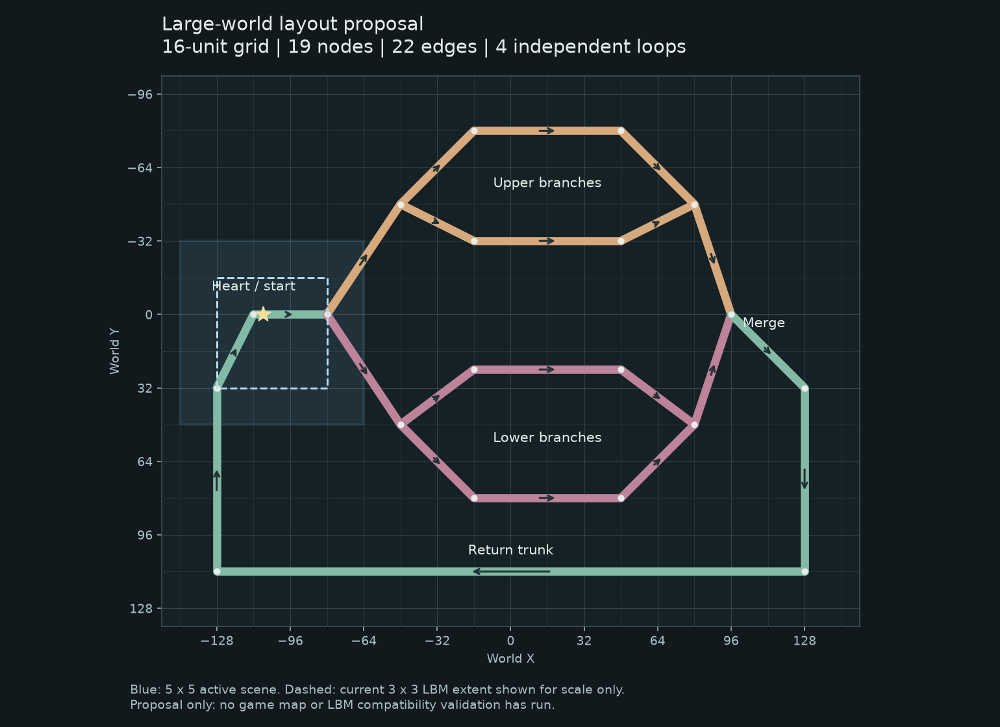

# 首张代表性大地图准备草案

**已撤回实施候选：** 用户随后认为本草案过于简单，要求继续扩大、将心脏做成实际器官，并区分血管粗细。以下256×192布局、313细胞和33.261压差仅保留为旧通路样板的准备记录，不作为新版本实施参数。新方向见[器官与分级血管讨论稿](2026-10-30-organ-world-direction.md)。尚未授权按旧草案实施。

2026-10-30。用户已同意准备一张几百单位、包含多处分叉和回路的代表性地图，先使用解析流。本文件提出具体布局、接入入口和配置，**尚未实施，具体方案待用户审阅**。本阶段不重新开启性能研究或云实验。

## 目的

把已经完成的16单位固定区块、5×5现场、红细胞数量输运及白细胞休眠放到真实有交通和分叉的地图里。需要保留足够的局部交通密度，观察不同通路、连续跨块、返回区域时的实际行为。

这是一张可玩的代表性样板，不是正式器官关卡。治疗、任务、病原体、组织生态、地图编辑器和存档仍在后续范围。

## 路线与取舍

| 路线 | 收益 | 成本与建议 |
| --- | --- | --- |
| 继续使用Rust内置MapDefinition | 沿用已有数据模型、单泵阻力图和运行入口；容易复现 | 地图编辑需要改代码；推荐本轮采用 |
| 新增JSON等外部地图格式 | 后续数据制作更方便 | 需要格式、校验和载入接口，本轮暂缓 |
| 程序生成网络 | 可以很快增加网络数量 | 需要布局、交叉与连通规则，增加不确定性，本轮暂缓 |

推荐增加一个独立的内置地图定义文件，不建立地图资源管理框架，不修改区块/物理/流体算法。旧small_world、loop lab与LBM验证场继续保留。

## 布局建议

中心线范围x=-128～128、y=-80～112，跨度256×192世界单位（16×12个基础区块）。管宽计入后几何范围会略大；运行时仍只加载附近5×5及边界身体所需墙块。

建议19个节点、22条边、4个独立回路：心脏起点→主分叉→上下两条通路，各自再分成两条并行支路→各自汇合→主汇合→外侧回流干道→心脏。两区只使用地标名称/底色，不新增器官模拟。

蓝框为起点附近5×5现场，虚线为当前3×3流体范围的尺度示意。图中的流体框不代表这张地图已通过LBM开口验收；本轮地图仅接解析流。图中的线宽用于辨识通路，不是精确管宽绘制。

| 节点 | 世界坐标 | 用途 |
| --- | --- | --- |
| 0 | (-112, 0) | 心脏 |
| 1 | (-80, 0) | 主分叉 |
| 2 | (-48, -48) | 上区分叉 |
| 3、4 | (-16, -80)、(48, -80) | 上区外侧路线 |
| 5 | (80, -48) | 上区汇合 |
| 6、7 | (-16, -32)、(48, -32) | 上区内侧路线 |
| 8 | (-48, 48) | 下区分叉 |
| 9、10 | (-16, 24)、(48, 24) | 下区内侧路线 |
| 11 | (80, 48) | 下区汇合 |
| 12、13 | (-16, 80)、(48, 80) | 下区外侧路线 |
| 14 | (96, 0) | 主汇合 |
| 15～18 | (128,32)、(128,112)、(-128,112)、(-128,32) | 回流干道 |

连接路径为：`0→1→2`；`2→3→4→5`、`2→6→7→5`；`5→14`；`1→8`；`8→9→10→11`、`8→12→13→11`；`11→14→15→16→17→18→0`。

泵位于18→0。主干半管宽3.5，区内并行支路半管宽3.1，沿用现有体型和通路宽度尺度。使用显式折线，不调用当前已有末项待核对的bezier辅助函数，也不顺带修复旧地图曲线。所有几何相交必须对应图节点，不能画出没有拓扑连接的平面交叉。

起点建议(-108,0)，靠近心脏而避开墙与初始交通；最终合法放置仍用已有生产逻辑核对。

## 红细胞数量

建议按当前small_world的单位中心线长度密度确定全图数量：

`新数量 = round(输入cell_count × 新图总中心线长度 / small_world总中心线长度)`。

按默认72细胞的规划估算，小图长度约306.515、新图约1334.176，得到约313个红细胞。只有附近份额构造软体，其余进入已有远场库存；不要求全图313个完整身体，也不强制附近永远72个。

这是线密度近似，未按管宽、分叉混合和拥堵做生理容量建模。它足以避免扩大地图后仍只有72个细胞导致过稀；本轮不新增密度场、配额管理或远场输运算法。

白细胞先保留全局初始4只、最多8条记录（含休眠和尸体）。不在本轮自动改为每块/每器官8只；若大图体验中显得过稀，另行确定免疫分布。

## 血流选择：待用户回答

两种可行方案：

- **推荐：保持接近小图的泵段平均流速。** 用同一GraphNetwork求新旧地图的单位压差泵段平均速度，首次创建大地图时按比值标定输入压差。规划估算从12升至约33.261；分叉实际速度仍由本图阻力决定，不承诺所有管段与旧图相同。
- 保持输入压差12：不改控件范围，但规划估算泵段平均流速约为旧图36%，交通循环明显变慢。

规划数值来自本机独立双精度计算，使用当前阻力公式及小图现有折线，**不是Rust生产构造器验证，也没有运行游戏/物理回放**。生产接入后重新核对数量、单位流速及实际压力。

若采用推荐方案，保留真实压差含义，不改成不透明的速度倍率：仅大地图入口设置初始实际压差，bridge保存该场景的压力控件上限`max(30, 2×初始压差)`，HUD读取上限；旧入口仍为0～30。约需新入口显示0～66.522。重置保留当前实际压力，不能再次乘标定比值。

## 接入与状态契约

- 建议新增`--large-world`，隐含`--stream-world`，保持16单位区块、LBM相关生产参数、5×5现场和zoom2。
- 第一阶段仅解析流，和local Stokes、local LBM、LBM validation/benchmark组合时给出明确提示；不能默默运行另一张地图或后端。
- 大图仍使用现有MapDefinition、GraphNetwork及单Rapier世界，不新增导入格式/存储层。
- 地图定义建议放在`simulation/src/map/large_world.rs`，由`MapDefinition::large_world()`返回；配置与构造协调留在现有runtime/streaming.rs。
- reset保留当前大地图、313左右的已确定总量及实际压力，不切回小图、不重新扩大数量或标定压力。
- 新增的选择入口沿用bridge和world.gd；HUD只修正场景名称和压力范围，不新增地图制作面板。

## 本轮实施后的检查范围

1. 在真实地图定义上核对连通回路、泵方向、节点流量收支及没有未建节点的交叉；不为普通几何配置穷举输入组合。
2. 使用真实模拟做代表性路线：至少经过上下支路各一段、连续跨块，再返回心脏附近。检查红细胞账目、白细胞记录、实际软体/墙/区块数量及新旧区域交接。
3. 记录启动、普通步、跨块尖峰和活跃数量；不把本地图的313总量或测试通过直接作为FPS承诺。若全图查询/初始化确实成为瓶颈，提出具体优化决策，不自行更换算法或扩大规模研究。
4. 使用已有检查与一次正常场景截图；UI不注入键鼠、不自动交互。人工驾驶、战斗及拥堵恢复手感另列未验收。

不会运行64×64 LBM实验、启动云实例或重启暂停中的profiling。本轮准备阶段只新增设计/布局资料，不修改生产代码、不提交推送。

## 待确认建议

Rust内置地图、上述256×192中心线布局、按旧图线密度估算种群、保留白细胞全局上限，以及首次创建时的血流标定方案。用户接受后再将方案整理成正式实施计划并接入。
