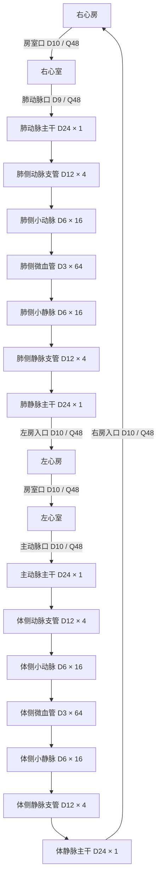

# 心脏与分级血管：连接图和参考流量草案

日期：2026-11-01。用户已确认[血管尺寸与流速基准](../../physics/vessel-scale-baseline.md)，并安排开始准备连接图和流量表。用户随后回复“开干”，确认完整分级方案及Q48、四端口和方域作为几何设计起点；本阶段实施实际血管布局与图流量检查，**不包含心脏烘焙或启用游戏血流**。当前四腔预览的零流、零细胞行为保持。

## 推荐方案与取舍

推荐采用完整的对称分级模块：每套循环从1条主干分成4条器官支管，再分成16条小血管，最后通过64条微血管后对称汇流。肺循环和体循环串联，均承担参考循环流量48；不把它们做成分走总流量的两个并联支路。

| 方案 | 得到什么 | 代价 |
| --- | --- | --- |
| 推荐：完整1→4→16→64分级 | 四档管径及全部平均速度都落入已确认基准，供血和回流有共同数量依据 | 每套循环64条微血管，两套共128条；需要为它们安排空间和合法分叉 |
| 小规模连通样板 | 先用少量支路接通四类心脏接口，几何工作较少 | 在同一主干流量下，少量微血管会更快，无法宣称满足全部分级流速；后续需重做外部布局 |

完整模块先按对称等效阻力设计，降低流量分配的不确定性。具体形状仍需画到地图中检查，本文的数量与通量计算不等于已完成空间嵌入。分支数量不表示同时常驻相同数量的软体或全图网格。

## 连接图

下图只表示连接关系和各层并联数量，不按空间比例绘制。箭头表示计划的参考流向；当前游戏仍为零流。

每条D12支管承担4条D6支路，每条D6支路承担4条D3微血管。回流侧镜像汇合，不新增心腔之间的捷径，也不保留绕过末梢的占位回路。

## 参考流量表

沿用共同等效深度 `H=1`，表中 `Q=H×D×u_mean`，二维通量 `q=Q/H`；此处二者数值相同。取参考循环流量 `Q_ref=48`，下表对肺循环、体循环分别适用。

| 稳态直段层级 | 同层并联数量 N | 内径 D | 单条流量 Q | 平均速度 | 二维抛物线中心峰值 | 同层总流量 |
| --- | ---: | ---: | ---: | ---: | ---: | ---: |
| 动脉主干 | 1 | 24 | 48 | 2 | 3 | 48 |
| 动脉支管 | 4 | 12 | 12 | 1 | 1.5 | 48 |
| 小动脉 | 16 | 6 | 3 | 0.5 | 0.75 | 48 |
| 微血管 | 64 | 3 | 0.75 | 0.25 | 0.375 | 48 |
| 小静脉 | 16 | 6 | 3 | 0.5 | 0.75 | 48 |
| 静脉支管 | 4 | 12 | 12 | 1 | 1.5 | 48 |
| 静脉主干 | 1 | 24 | 48 | 2 | 3 | 48 |

动静脉的对称直段在本候选中速度相同，分别落在基准允许范围内：主干2、小血管0.5和微血管0.25等。首版不额外制造动静脉速度差，也不承诺真实生理压力差。若以后希望静脉普遍更慢，应从总通行宽度和汇流布局重新设计，不能乘上局部速度系数。

上述均分要求同组下游等效阻力相同；仅有相同管径和支路数量不足以保证均分。具体中心线长度、转接与回流路径定稿后，必须用真实GraphNetwork求解检查。沿用现有阻力模型和单一全局等效驱动，不在本阶段引入独立左右心泵或真实心腔阻力模型。

全局参考压差尚不填写固定数值。应在几何确定后求单位压差的主干流量 `Q_unit`，再取 `pressure_ref=48/Q_unit`，重算全部支路。若支路分配偏离目标，调整布局/长度，不用逐边速度覆盖掩盖差异。该压差只是现有等效图模型的驱动值。

## 心脏端口和窄口

暂保留四腔轮廓、左右组织隔墙及现有房室口宽度。沿目前四条上方接口轴线向外延伸，建议在 `y=-32` 的直段设置统一交接截面；下列坐标为候选值，不是已有端口配置。

| 端口 | 候选位置 | 内径 | 相对心脏域的流向 | 有符号向外通量 | 平均速度大小 | 直管峰值估算 |
| --- | --- | ---: | --- | ---: | ---: | ---: |
| 体静脉→右房 | (38, -32) | 10 | 进入，朝+y | -48 | 4.8 | 7.2 |
| 右室→肺动脉 | (78, -32) | 9 | 离开，朝-y | +48 | 16/3 ≈ 5.333 | 8 |
| 肺静脉→左房 | (112, -32) | 10 | 进入，朝+y | -48 | 4.8 | 7.2 |
| 左室→主动脉 | (150, -32) | 10 | 离开，朝-y | +48 | 4.8 | 7.2 |

四个端口均位于心脏域上边，向外法向为 `(0,-1)`；最终 `FieldPort.outward_sign` 仍须按对应边的切向填写，不直接照抄世界坐标符号。两侧分别满足一进一出通量相抵。全部四端口的入流大小之和、出流大小之和均为96，是同一循环流量48先后经过两侧的重复计数，不代表系统循环流量变为96。

两处房室口D10同样承担Q48，截面均速估算4.8。腔室、转弯和开口局部速度必须以后续实际场为准；表中1.5倍仅适用于充分发展直管剖面，不能当作局部全场速度上限。肺动脉D9窄口的直管峰值估算已达8，明显高于D24主干的3；若该候选不满足现有数值条件，应再讨论减小全局流量或加宽窄口，不擅自削峰、改端口通量或放宽LBM守卫。

## 空间安排与烘焙区域候选

- 心脏保留现有约160×192量级和两心室至少80单位可穿行跨度，不为接大管缩小腔室。
- 肺循环模块布置在心脏上方；体循环模块布置在下方，通过主体左右两侧的外部走廊连接主动脉出口和右房入口。最终世界范围随合法嵌入确定，不强塞回旧512×384建议框。
- 24单位主干在心脏外侧连接，候选连接点位于 `y≤-64`。在交接截面附近保留D9/10直段，不能把穿过心房旁边的现有细管整体加粗：那会有穿通组织壁并绕过房室口的风险。
- 固定离线方域的候选为 `x∈[-32,224]、y∈[-32,224]`，边长256世界单位；这与实时48×48窗口无关。现有短肺连接和包围心脏的矩形体回路必须移出/替换，不能被意外烘焙进心脏域。
- 对该方域，体循环两侧外走廊可分别安排在 `x≤-64` 和 `x≥256`，下方模块在 `y≥272`，给D24通道留出域外间距；肺模块向上展开。上述仅为避让方向和候选界限，尚未生成全图中心线、检查交叉、分叉或实体净空。
- 方域格距、格子数、时间步、预热/采样预算及资产拆分方式留待烘焙设计，不在本次选择；不启动GPU/云实验。首版继续静态恒定参考驱动，不引入收缩、动态瓣膜或额外细胞模型。

每个分级模块的逻辑数量为106段（1+4+16+64+16+4+1），两套合计212段；实际节点、连接段和过渡段数量会随布局变化。四分支是逻辑分配，不要求所有位置做成同一种几何四岔口，更不据此宣称任意分叉能启用实时LBM；继续按完整窗口许可与几何限制决定。

## 准备计算与实施范围

本轮只核对层级计数、`Q=H×D×u_mean`、分流/汇流守恒、直管峰值及端口符号；没有运行新地图模拟、生成烘焙资产或改变游戏。结果见[计算表](../../research/2026-11-01-heart-vessel-layout/flow-table.csv)。未得到参考压差或实际不对称支路流量，也未验收空间交叉、隔墙、玩家路径、心腔流场或LBM稳定性。

sol high已做[实施准备检查](../../research/2026-11-01-heart-vessel-layout/builder-check.md)，未发现额外的重要遗漏或与已确认架构的冲突；待选项仍是本文件已列出的完整/样板范围，以及Q48、端口和方域候选。该静态检查不代替实际地图求解与几何验收。

用户已选择完整分级方案，并确认Q48与草案端口作为起点。本阶段沿用MapDefinition、VesselEdge、固定区块及heart-preview入口，替换两条占位外回路；实现几何、真实GraphNetwork参考流量核对与零状态穿行。四腔轮廓和房室口保持，具体中心线与等长绕行属于实施细节。若必须改变管径、数量、参考流量或心脏端口才能实现，应报告新的决策点；不自动新增求解器、管径数据模型、场景注册或资产烘焙。
